<p align="center">
  
</p>

<h1 align="center">🎛️ OFAD GOLEM — Groovebox</h1>

> Une groovebox complète dans l'ordinateur ou la tablette : 16 pistes, synthés, boîtes à rythmes,
> sampler, effets, séquenceur, scènes, morceau et montage audio — sans latence ajoutée.

<p align="center">
  
  
  
  
  
  
  
  
</p>

<p align="center">
  <a href="../../releases/latest"></a>
  <a href="docs/NOTICE.pdf"></a>
  <a href="docs/NOTICE-EN.pdf"></a>
  <a href="docs/CATALOGUE.pdf"></a>
</p>

<p align="center">
  <b><a href="../../releases/latest">Télécharger</a></b> ·
  <b><a href="docs/NOTICE.pdf">Notice de prise en main et raccourcis (PDF)</a></b> ·
  <b><a href="docs/NOTICE-EN.pdf">Manual in English (PDF)</a></b> ·
  <b><a href="docs/CATALOGUE.pdf">Catalogue des 38 instruments et 54 effets (PDF)</a></b>
</p>

<p align="center"><b>🇬🇧 English speakers: <a href="#-english-summary">English summary below ↓</a></b></p>

---

## 🆕 Nouveautés de la 1.1.0 — piste MIDI, télécommande, écran AUDIO

<p align="center"><b><a href="../../releases/tag/v1.1.0">Tout le détail et les téléchargements sur la page de la version 1.1.0</a></b></p>

- **Piste MIDI** : GOLEM **joue vos synthés et boîtes à rythmes externes** avec son séquenceur, ses verrous, ses scènes et ses effets MIDI (arpège, accord, gamme, écho de notes). Bandeau Appareil · Émission · Réception · Banque · Son, **32 boutons CC** en 4 sections renommables (avec **Apprendre**), **16 pads** (CC maintenu, marche / arrêt, par pas, note). USB partout, Bluetooth MIDI sur téléphone, tablette et Mac.
- **Son du pas** : chaque pas peut jouer **un autre préréglage** de l'instrument (ou un autre son de l'appareil MIDI, banque comprise), puis la piste revient à son son.
- **Télécommande** : le téléphone pilote GOLEM sur le PC (**câble USB ou Wi-Fi**, sans pilote) ou un appareil MIDI : mixage, 16 boutons, pavé Chaos, onglet FM-1, **Apprendre** et **profils**.
- **Écran AUDIO** : enregistrer le master, des pistes, des retours ou l'entrée — **calé**, **boucle parfaite**, N mesures ou libre — avec une **chaîne de 4 effets** appliquée après ou pendant la prise, vers un pad, « Son traité » ou à la place de l'original.
- **Éditeur d'échantillon** partout (appui long sur une piste) : sélection, fondus, rogner, et **Traiter…** hors temps réel.
- **Restauration** (7 outils) : débruiteur, anti-ronflement, anti-clics, dé-esseur spectral, anti-plosives, anti-écrêtage, dé-réverb.
- **Golem Titan FX** (9 effets haut de gamme) : réverbérations d'époque et de mixage, limiteur de mastering, écho créatif, saturations analogique et multibande, phaseur, flanger-doubleur, filtres.
- **Courbes de l'écran SON** qui suivent le son et **se tirent au doigt** ; **compensation de latence** automatique avec son voyant.
- **MIDI** : banque + changement de programme et CC 102 à 105 (effets des inserts) **par piste et par canal** ; voir l'[implémentation MIDI](docs/IMPLEMENTATION-MIDI.md).
- **Nouvelle démo Tribe** au démarrage (180 BPM, scènes, vecteur en cercle, petit morceau prêt à jouer), à côté de la démo Techno.
- **Fiabilité du son** : coups identiques d'une frappe à l'autre, oscillateurs et LFO qui repartent pareil (6 modes de déclenchement), boutons qui suivent les scènes.

<table>
<tr><td align="center" colspan="2"><a href="docs/img/v110/pc-midi-piste.jpg">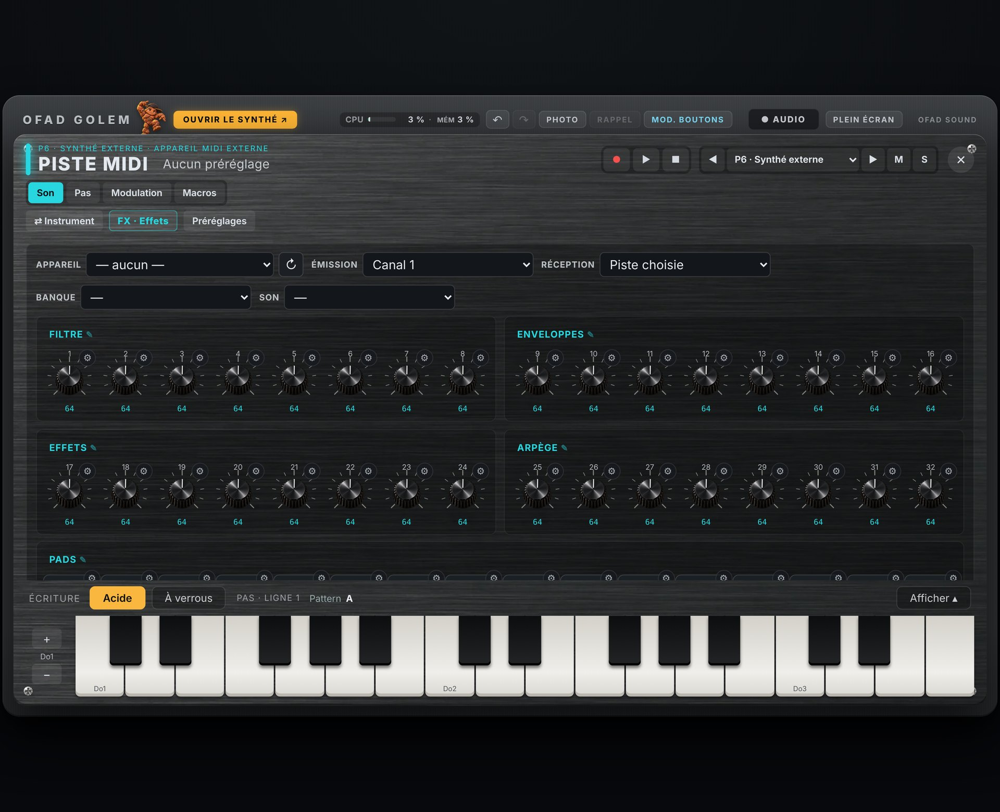</a><br><b>Piste MIDI</b> · bandeau de l'appareil, 32 boutons CC en 4 sections, 16 pads</td></tr>
<tr><td align="center"><a href="docs/img/v110/pc-audio.jpg">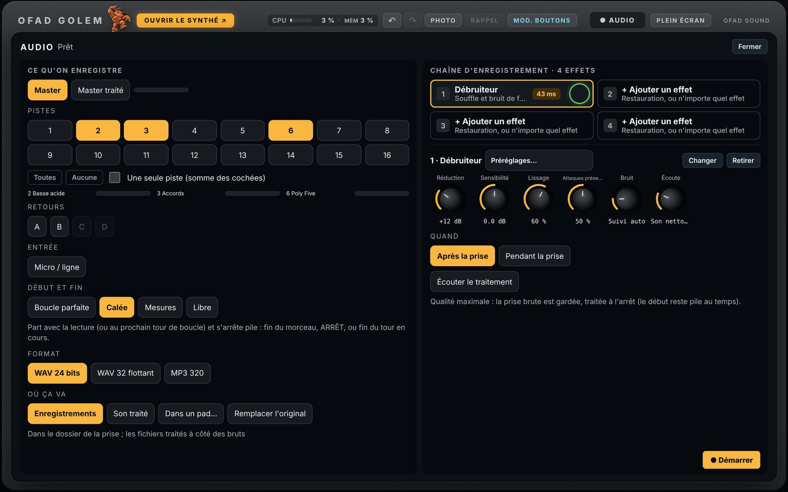</a><br><b>Écran AUDIO</b> · sources, prise calée, chaîne d'effets</td><td align="center"><a href="docs/img/v110/pc-son-du-pas.jpg">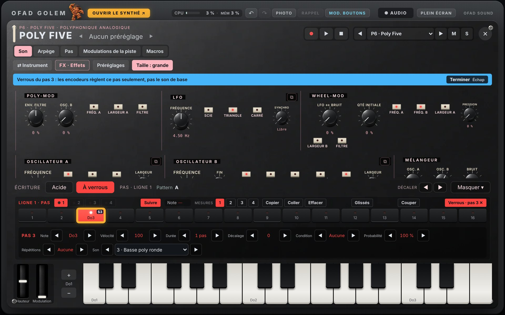</a><br><b>Son du pas</b> · repère « S3 » sur le pas</td></tr>
<tr><td align="center"><a href="docs/img/v110/pc-titan-pedalier.jpg">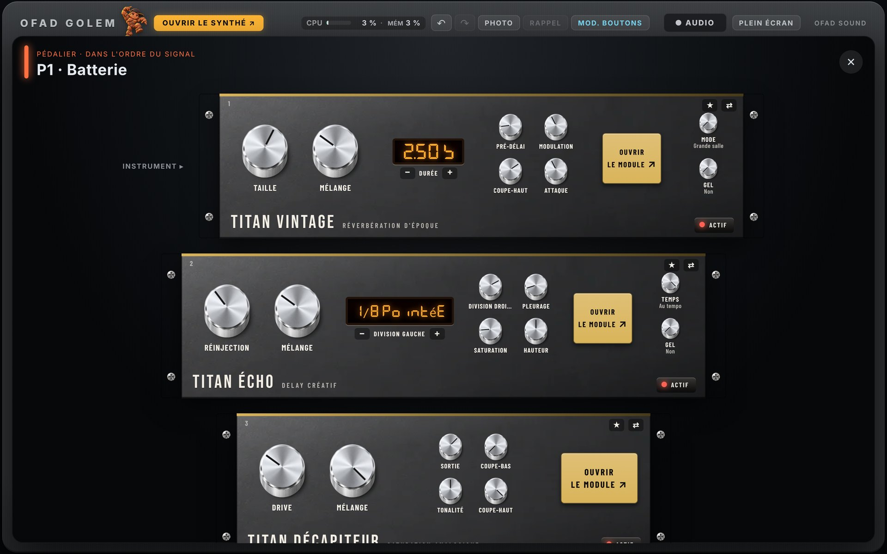</a><br><b>Golem Titan FX</b> · dans le pédalier</td><td align="center"><a href="docs/img/v110/pc-courbes.jpg">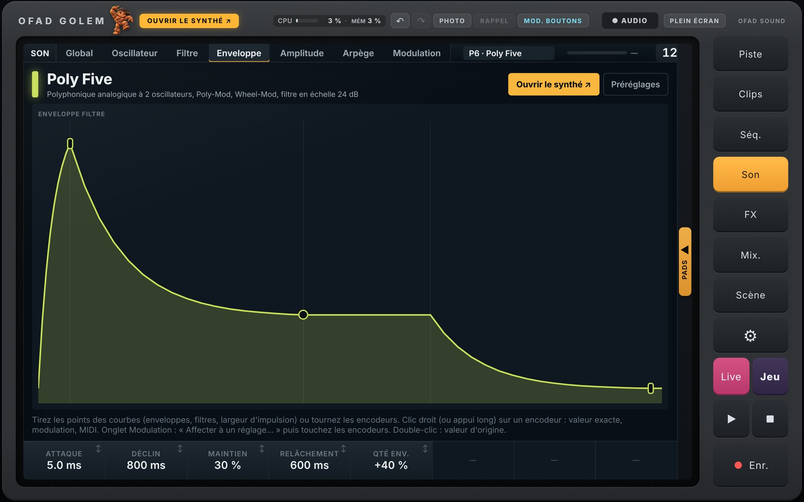</a><br><b>Courbes</b> · points à tirer</td></tr>
<tr><td align="center"><a href="docs/img/v110/tel-telecommande-mixage.jpg">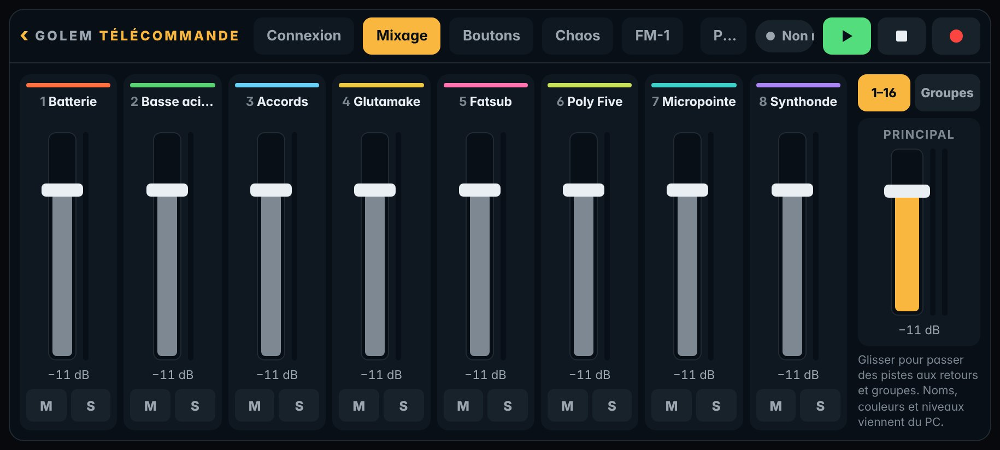</a><br><b>Télécommande · Mixage</b></td><td align="center"><a href="docs/img/v110/tel-telecommande-chaos.jpg">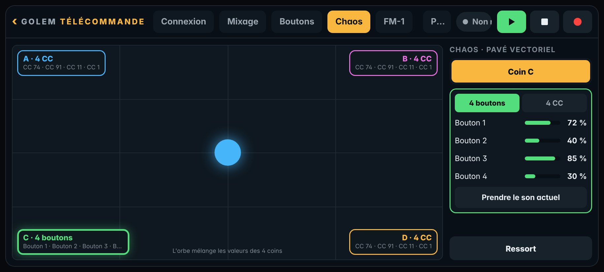</a><br><b>Télécommande · Chaos</b></td></tr>
</table>

**Version précédente** : [nouveautés de la 1.0.0](../../releases/tag/v1.0.0) (FM Player et firmwares libres pour le FM-1, nouveau workflow à une seule vue, écran Jeu, mode Grand…).

<sub>M-VAVE et FM-1 sont des marques de leurs propriétaires respectifs. OFAD GOLEM n'est ni affilié, ni approuvé, ni sponsorisé par M-VAVE ; ces noms indiquent seulement la compatibilité avec les firmwares écrits pour le FM-1. Aucun logiciel d'origine de M-VAVE n'est fourni.</sub>

---

## ✨ Présentation

**OFAD GOLEM** est une groovebox logicielle pensée pour **toutes les musiques électroniques** : techno,
house, acid, hardtek et tribe, hardcore, drum & bass, électro, ambient, beatmaking…

Le flux de travail reprend celui des **stations de production autonomes à pads** que les beatmakers
connaissent : on choisit un instrument par piste, on joue sur les
16 pads, on écrit des patterns, on les lance comme des clips, on enchaîne les scènes au crossfader, on
construit le morceau, puis on le retravaille en audio et on l'exporte.

L'idée : réunir dans un seul outil **tout ce qui a fait ses preuves** sur les machines qu'on aime. Les
**séquenceurs qu'on connaît tous** — pas à pas, verrous de réglages sur chaque pas, séquenceur acide (note,
octave, accent, glissé), conditions (A:B, Fill…), répétitions, Fill et Break en direct — et les
instruments et les effets, qui reprennent l'**architecture** des machines qui ont fait ces musiques :
boîtes à rythmes analogiques des années 80 et 90, basse acide à séquenceur, synthés analogiques
monophoniques et polyphoniques à filtres en échelle ou qui crient, synthés FM, tables d'ondes, drones,
vocodeurs, sampler de performance, échos à bande, réverbérations, compresseurs de studio… Chacun est
**recréé de zéro** : son propre nom, sa propre façade, ses propres sons d'usine.

- **Application Windows et Mac** (autonome), **plugins VST3 et AU** pour les logiciels de musique, **application Android** pour téléphone et tablette et version **iPhone / iPad** (essai), avec **contrôleur MIDI** USB ou Bluetooth prêt à jouer.
- **Interface en français ou en anglais** (*English interface*) : la langue se choisit à l'installation sur Windows, au premier lancement sur Android, et se change dans Réglages.
- **38 instruments**, **2432 sons d'usine**, **54 effets**, 16 pistes, 16 patterns par piste (A à P), 32 scènes.
- **Vue live** pour le jeu en direct : crossfader ou **pavé vectoriel** à quatre scènes (formes en mouvement, taille, hauteur, rotation), console des 16 pistes avec faders, FX et M / S, et les **16 boutons assignables** avec leurs propres modulations.
- Logiciel **libre** (AGPL-3.0) : les sources de chaque version sont fournies avec elle.

### 🤝 Un projet qui évolue avec vous

OFAD GOLEM n'est pas figé : c'est la groovebox idéale que l'on construit ensemble. Une machine qui vous
manque, un effet, une fonction de séquenceur, un geste de jeu ? Dites-le dans l'onglet
**[Issues](../../issues)** : les idées des utilisateurs font les prochaines versions.

---

## 🖼️ Captures

<table>
<tr><td align="center"><a href="docs/img/appareil.jpg"></a><br><b>L'appareil</b></td><td align="center"><a href="docs/img/accueil.jpg"></a><br><b>Accueil</b></td></tr>
<tr><td align="center"><a href="docs/img/facade.jpg"></a><br><b>Façade d'un instrument</b></td><td align="center"><a href="docs/img/sequence.jpg"></a><br><b>Séquence</b></td></tr>
<tr><td align="center"><a href="docs/img/pedalier.jpg"></a><br><b>Effets en pédales</b></td><td align="center"><a href="docs/img/mixeur.jpg"></a><br><b>Mixeur</b></td></tr>
<tr><td align="center"><a href="docs/img/morceau.jpg"></a><br><b>Morceau</b></td><td align="center"><a href="docs/img/montage.jpg"></a><br><b>Montage audio</b></td></tr>
<tr><td align="center"><a href="docs/img/facade-acide.jpg"></a><br><b>Séquenceur acide sur la façade</b></td><td align="center"><a href="docs/img/facade-verrous.jpg"></a><br><b>Séquenceur à verrous</b></td></tr>
<tr><td align="center"><a href="docs/img/scenes-reperes.jpg"></a><br><b>Scènes A / B et crossfader</b></td><td align="center"><a href="docs/img/sequence-reperes.jpg"></a><br><b>Rouleau de notes, accent, glissé, pages</b></td></tr>
<tr><td align="center"><a href="docs/img/scenes-crossfader-pc.jpg"></a><br><b>Scènes : crossfader</b></td><td align="center"><a href="docs/img/scenes-vecteur-pc.jpg"></a><br><b>Scènes : pavé vectoriel</b></td></tr>
<tr><td align="center"><a href="docs/img/vue-live-crossfader.jpg"></a><br><b>Vue live : crossfader et console</b></td><td align="center"><a href="docs/img/vue-live-vecteur.jpg"></a><br><b>Vue live : pavé vectoriel et console</b></td></tr>
<tr><td align="center" colspan="2"><a href="docs/img/modulations-boutons.jpg"></a><br><b>Modulations propres aux 16 boutons assignables</b></td></tr>
</table>

<p align="center"><i>Les repères numérotés sont expliqués dans la <a href="docs/NOTICE.md">notice</a>.</i></p>

### 🎹 Les 38 instruments

<p align="center">
  
  
  
  
  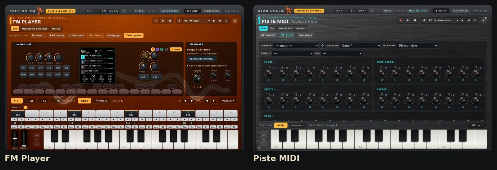
</p>

### 🎚️ Les 54 effets

<p align="center">
  
  
  
  
  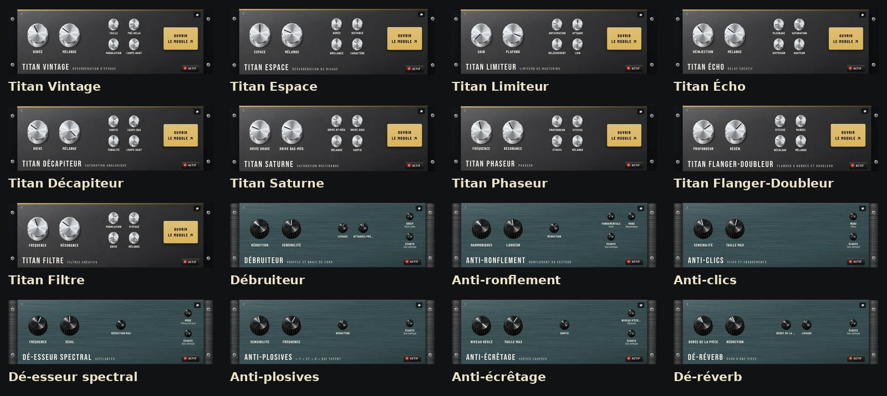
</p>

---

## 📱 Sur téléphone et tablette, avec un contrôleur MIDI

Toute la groovebox tient dans un **téléphone ou une tablette Android** : les mêmes écrans que sur PC
(lancement, séquence, son, effets, mixeur, scènes, morceau), une disposition pensée pour le doigt
(la même vue unique, pads dépliables, écran Jeu, rangées plus grandes, façades qui défilent), la **Vue live** et
les **16 boutons assignables**. De quoi faire un live complet avec seulement le téléphone et un
contrôleur.

- **Contrôleur MIDI prêt à jouer** : un clavier ou un contrôleur **USB** est reconnu tout seul, sans
  réglage (câble ou hub USB-C « OTG » ; on peut le brancher en cours de jeu). En **Bluetooth** :
  Réglages › « Appairer un contrôleur Bluetooth… ».
- **Télécommande (1.1)** : le téléphone pilote GOLEM sur le PC, par câble USB ou en Wi-Fi, ou un appareil
  MIDI branché : mixage, boutons, pavé Chaos, onglet FM-1.
- **Tout s'apprend** : appui long sur un réglage, un bouton de synthé, une valeur, un M / S, le
  crossfader, une rangée › **Apprendre MIDI**, puis on touche la commande du contrôleur. Les 16 boutons
  assignables s'apprennent aussi : une rangée de boutons du contrôleur pilote tout ce qu'on leur confie.
- Les notes jouent la piste choisie (les pads sur une batterie), avec molette, pitch bend et pédale.
- Téléphone avec un seul port USB-C : un hub USB-C avec charge permet de brancher le clavier, la sortie
  son vers la table de mixage et le chargeur en même temps.

<table>
<tr><td align="center"><a href="docs/img/v100/captures/tel-07-scenes.jpg">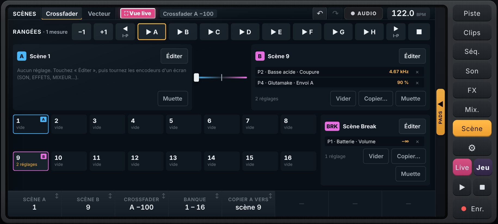</a><br><b>Téléphone : Scènes</b></td><td align="center"><a href="docs/img/v100/captures/tel-pads-sequence.jpg">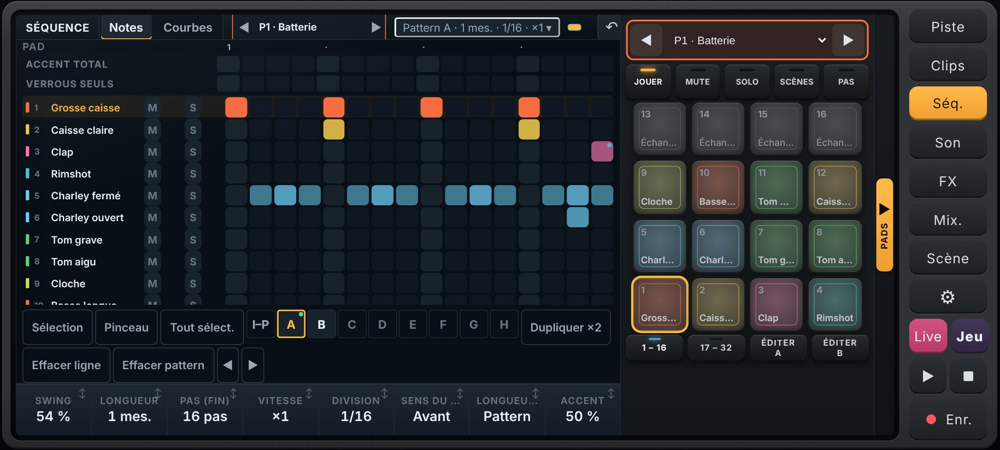</a><br><b>Téléphone : Séquence + pads</b></td></tr>
<tr><td align="center"><a href="docs/img/v100/captures/tel-live-crossfader.jpg">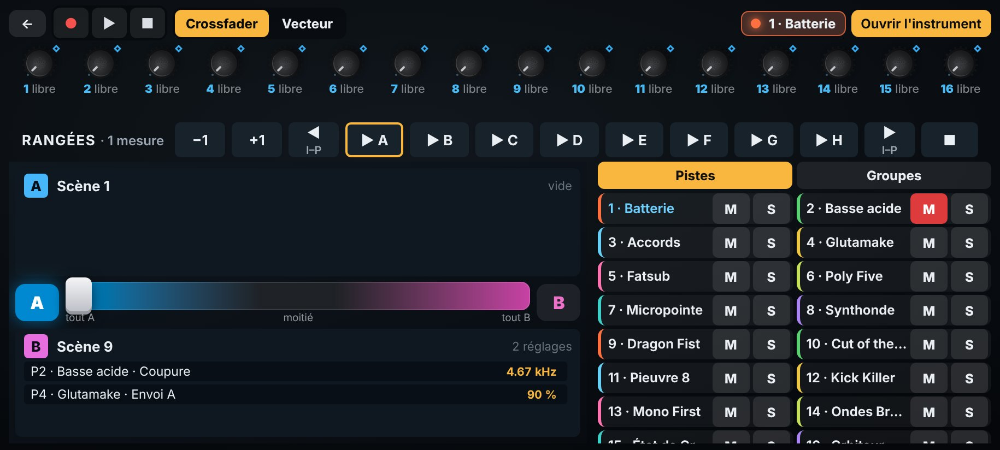</a><br><b>Téléphone : Vue live · crossfader</b></td><td align="center"><a href="docs/img/v100/captures/tel-live-vecteur.jpg">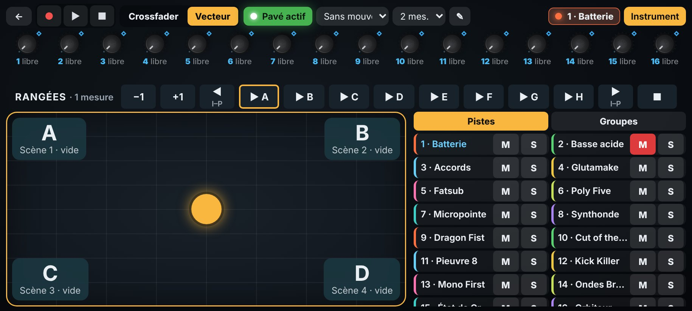</a><br><b>Téléphone : Vue live · pavé vectoriel</b></td></tr>
</table>

---

## 🎛️ Fonctionnalités

### 🥁 Pistes et instruments
- **16 pistes**, un instrument par piste : batteries (analogiques, à machines, à échantillons), basses, polys,
  nappes, sampler de performance, synthés FM, drones, vocodeurs, entrée audio.
- **Façade en grand** de chaque instrument (« Ouvrir le synthé »), avec son clavier ou ses pads.
- Choix de l'instrument **par les images** des façades ; préréglages rangés par catégories.

### 🎹 Jeu
- **16 pads** (jouer, couper, scènes, pas à pas, effacer), clavier de l'ordinateur, contrôleur MIDI.
- Gammes et toniques pour les pads des instruments mélodiques ; Fill, Break, Break temporisé.

### 🧮 Séquenceur — trois façons d'écrire, une seule séquence
- **16 patterns** (A à P) par piste, jusqu'à 32 mesures ; division (binaire, ternaire) et vitesse par pattern ;
  pages de 16 pas que l'on **tourne** (◀ ▶, pastilles, ou « Suivre » pour que la page avance avec la lecture).
- **Séquenceur acide** sur la façade des basses et des synthés : pour chaque pas, la **note** (tirer ou
  molette : demi-ton, ▲ ▼ : octave), la vélocité, la durée, l'**accent** et le **glissé** (la note tient et
  glisse vers la suivante ; même note : liée).
- **Séquenceur à verrous** : pages 1 à 4, longueur de 1 à 4 mesures ; on choisit un pas (appui long ou
  mode Verrous) et chaque bouton tourné — façade, pédales, écran Son — est **verrouillé sur ce pas** :
  chaque pas peut avoir sa note, sa coupure, sa résonance, ses effets.
- **Écran Séquence** : une ligne par pad (batterie) ou un **rouleau de notes** (chaque pas reçoit la note
  qu'on veut, jusqu'à 4 notes par pas pour les accords), lignes Accent, Glissé et « Verrous seuls ».
- **Enregistrement avec ENR.** : jouez aux pads, au clavier ou au contrôleur, les notes s'écrivent dans le
  pattern qui tourne (quantification de 0 à 100 %) ; les mouvements des boutons deviennent des courbes.
- **Tout est lié** : un pas posé sur la façade apparaît dans l'écran Séquence, et inversement — c'est
  toujours la même séquence, quelle que soit la vue.
- **Par pas** : note, **vélocité** (le volume du coup), durée, décalage fin, **condition**, probabilité,
  répétitions (roulements ↗ ↘), flam, verrous ; avec plusieurs pas choisis, les encodeurs règlent tout à la fois.
- **Menu du pas** sur la façade, en écriture Acide comme À verrous : **clic droit** (PC) ou **appui long**
  (doigt) sur un pas ouvre tous ses réglages en grand, Accent et Glissé compris.
- **Conditions** (pas qui ne jouent pas à chaque fois) : A:B (un tour sur deux, au 4e tour…), FILL / NON FILL,
  PRÉ, VOISIN, 1ER et leurs contraires, plus la probabilité — des variations sans écrire d'autres patterns.
- **Fill et Break en direct** : tenir **Fill** fait jouer les pas FILL (relances, roulements) et taire les
  pas NON FILL — des mini-breaks préparés dans le pattern. **Break** applique la **scène de Break** (une
  scène comme les autres : grosse caisse coupée, filtre fermé…) et déclenche Fill en même temps ;
  Break temporisé de 1 à 16 temps.
- Sélection comme dans un logiciel de musique : Ctrl+A, Ctrl+clic, rectangle, copier, couper, coller,
  dupliquer, déplacer, pinceau ; effacer une ligne ou **tout le pattern** d'un bouton ; Ctrl+Z.
- Réglages de la piste : swing, longueur (mesures ou au pas près), vitesse, division (binaire, triolets),
  sens de lecture, longueur par pad (polyrythmes), accent.

### 🚀 Lancement, scènes, morceau
- **Grille de lancement** façon clips, 16 rangées A à P en deux pages, −1 / +1 qui passent d'une page à l'autre (chaque rangée peut lancer sa scène liée), arrêt par piste.
- **32 scènes** de réglages : une scène retient les réglages qu'on tourne (de n'importe quelle piste,
  effet ou mixeur). Une scène à gauche (A), une à droite (B), et le **crossfader** fait glisser tous ces
  réglages de l'une à l'autre en douceur.
- **Scènes en chaîne** : une scène lancée se place du côté qu'on entend ; avec Maj, de l'autre côté. On
  amène ainsi scène après scène au crossfader, sans coupure. Scène de **Break** tant que Break est tenu.
- **Morceau** : rangées jouées l'une après l'autre ; enregistrement du jeu et des **mouvements**
  (boutons, faders, égaliseurs, mutes, solos, groupes, crossfader).

### 🎛️ Un instrument, trois vues liées
- La **façade du synthé** (tous ses boutons, comme sur la machine), l'**écran Son** (les mêmes réglages
  aux 8 encodeurs, par onglets) et le **pédalier** (« FX · Effets » : les effets de la piste en pédales)
  règlent **les mêmes paramètres** : tourner la coupure sur la façade la tourne aussi dans l'écran Son.
- Verrous de pas, scènes, modulations, macros et apprentissage MIDI marchent depuis les trois vues.

### 🎚️ Mixage et effets
- **4 effets d'insert** par canal, ouverts aussi en **pédales** depuis la façade d'un instrument.
- Mixeur : volume, panoramique, largeur, égaliseur, envois vers **4 retours**, **7 groupes**, bus principal.
- Modulations (LFO, fonctions, suiveurs, séquenceurs), **macros** réelles ou relatives.

### 🎞️ Montage audio et export
- **Prise** de chaque piste et de chaque retour pendant le jeu ; découpage automatique en **clips**.
- **Prise de boucle** : Boucle allumée, la prise dure exactement la boucle, s'arrête seule à sa fin (à
  l'échantillon près) et donne des clips pile de la longueur de la boucle.
- Couper, déplacer, copier, dupliquer, rogner, volume et fondus par clip, aimant à la mesure, annuler / rétablir.
- **Export** du morceau en WAV 24 bits ou MP3 320 kbit/s ; enregistrement audio du master ou des pistes séparées.

### 💾 Projets
- Projet en un fichier `.gbx` (sons, échantillons, séquences, scènes) ; **modèles** sans les écritures.
- Annuler / rétablir (50 étapes), **Photo** et **Rappel** de tous les réglages.
- Apprentissage **MIDI** de chaque réglage et de chaque bouton, canaux par piste.

---

## 🎹 Instruments

<details>
<summary><b>Les 38 instruments</b> (cliquer pour déplier)</summary>

<!-- CATALOGUE:INSTRUMENTS -->
38 instruments, 2432 sons d'usine rangés par catégories. Le détail (vignettes, principe, sons par catégorie) est dans [docs/CATALOGUE.md](docs/CATALOGUE.md).

### Batteries

| Instrument | Principe | Sons d'usine |
|---|---|---|
| **Machine électronique** | Batterie analogique à machines : 30 modèles de voix au choix par pad, chacun avec ses réglages, échantillon superposé, LFO, filtre analogique et VCA par pad | — |
| **Boum 80** | Boîte analogique du début des années 80 : circuits en T ponté, 6 oscillateurs pour les métaux | — |
| **Club 90** | Boîte hybride de la fin des années 80 : grosse caisse balayée, cymbales en basse résolution | — |
| **Dragon Fist** | Boîte analogique compacte et agressive : dix voix, une couleur par voix, distorsion de sortie | — |
| **Cut of the Beat** | Batterie à échantillons : pads à déposer, précalcul par pad (synthèse ajoutée, sous-harmonique, résolution, écrêtage), GATE, compresseur interne | — |
| **Kick Killer** | Percussion analogique semi-modulaire : 2 VCO, bruit, filtre en échelle, 3 enveloppes à déclin, séquenceur 8 pas hauteur et vélocité | 91 (Basses 11, Effets 11, Percussions 45, Séquences 24) |

### Basses

| Instrument | Principe | Sons d'usine |
|---|---|---|
| **Acid Lover** | Basse monophonique à filtre à diodes, accent et glissé | 90 (Basses 19, Leads 8, Effets 10, Acide 53) |
| **Fatsub** | Monophonique / duo analogique : 2 oscillateurs, réinjection, filtre en échelle 6 à 24 dB, 2 bus de modulation, DAHDSR bouclables | 90 (Basses 41, Leads 25, Plucks 10, Arpèges 6, Effets 8) |
| **Hurleur 200** | Deux oscillateurs, filtres passe-haut et passe-bas 12 dB à réinjection saturée qui crient, générateur de modulation à forme réglable, échantillonneur-bloqueur | 94 (Basses 20, Leads 16, Nappes 6, Plucks 12, Claviers 4, Cordes 3, Cuivres 4, Effets 10, Acide 4) |
| **Mono First** | Un oscillateur, mélangeur impulsion / scie / sous-oscillateur / bruit, filtre 24 dB résonant, enveloppe déclenchée par la porte ou le LFO, arpège | 90 (Basses 22, Leads 18, Nappes 5, Plucks 10, Claviers 3, Cordes 2, Cuivres 3, Arpèges 4, Effets 8, Acide 4) |

### Polys

| Instrument | Principe | Sons d'usine |
|---|---|---|
| **Poly Five** | Polyphonique analogique à 2 oscillateurs, Poly-Mod, Wheel-Mod, filtre en échelle 24 dB | 90 (Basses 13, Leads 13, Nappes 15, Plucks 9, Claviers 11, Cordes 8, Cuivres 10, Arpèges 6, Effets 5) |
| **Chorus 80** | Polyphonique à oscillateur numériquement contrôlé, filtre 24 dB, arpège, chorus stéréo à lignes à retard | 89 (Basses 12, Leads 8, Nappes 15, Plucks 10, Claviers 13, Cordes 10, Cuivres 7, Arpèges 9, Effets 5) |
| **Micropointe** | Polyphonique hybride : 3 oscillateurs numériques, filtre multimode, saturation avant et distorsion après filtre | 89 (Basses 15, Leads 13, Nappes 15, Plucks 11, Claviers 10, Cordes 5, Cuivres 5, Arpèges 7, Effets 8) |
| **Synthonde** | Balayage de tables d'ondes à 2 oscillateurs mutants, 2 filtres en série ou parallèle | 89 (Basses 14, Leads 12, Nappes 17, Plucks 10, Claviers 10, Cordes 5, Cuivres 5, Arpèges 7, Effets 9) |
| **World Tour** | Polyphonique analogique 8 voix : 2 oscillateurs à forme continue, oscillateur de modulation, 2 filtres en échelle (série, parallèle, stéréo), retard diffusant | 103 (Basses 12, Leads 12, Nappes 12, Plucks 11, Claviers 11, Cordes 11, Cuivres 11, Arpèges 11, Effets 12) |
| **Glutamake** | Tables d'ondes à morphs, bille sur une surface (physique de mouvement) et séquence à couloirs | 89 (Basses 20, Leads 16, Nappes 17, Plucks 10, Claviers 6, Cordes 4, Cuivres 3, Arpèges 4, Effets 4, Synthés 4, Séquences 1) |
| **Good Doctor** | Trois oscillateurs à tables d'ondes à double déformation, deux filtres en série ou parallèle, distorsion, matrice | 90 (Basses 26, Leads 12, Nappes 12, Plucks 8, Claviers 7, Cordes 5, Cuivres 5, Arpèges 6, Effets 5, Acide 4) |
| **FM Player** | Lecteur de firmwares du boîtier de synthèse FM-1 (processeur émulé) : chaque firmware .fwsc devient un instrument | — |

### Nappes

| Instrument | Principe | Sons d'usine |
|---|---|---|
| **Bignappe One** | Virtuel-analogique à deux parties, unisson épais jusqu'à 8 voix, filtres par partie, chorus intégré | 89 (Basses 11, Leads 12, Nappes 24, Plucks 12, Claviers 7, Cordes 6, Cuivres 4, Arpèges 8, Effets 5) |
| **Ondes Bretzel** | Hybride numérique : 3 oscillateurs (formes analogiques ou tables), 2 filtres série / parallèle, 4 enveloppes, 3 LFO, matrice | 90 (Basses 18, Leads 14, Nappes 18, Plucks 12, Claviers 8, Cordes 3, Cuivres 3, Arpèges 6, Effets 8) |
| **État de Grâce** | Polyphonique analogique à 2 oscillateurs à forme continue, filtre d'état 2 pôles passe-bas → réjection → passe-haut, X-Mod | 89 (Basses 20, Leads 16, Nappes 13, Plucks 11, Claviers 9, Cordes 5, Cuivres 5, Arpèges 4, Effets 6) |
| **Orbiteur** | Synthèse vectorielle : 4 coins (générateurs d'harmoniques, mélange, filtre) mélangés par un orbe en orbite | 90 (Basses 18, Leads 14, Nappes 22, Plucks 9, Claviers 10, Cordes 3, Cuivres 3, Arpèges 5, Effets 6) |

### Sampler

| Instrument | Principe | Sons d'usine |
|---|---|---|
| **Cutsample** | 16 zones sur les pads, découpage automatique, calage au tempo (moteur StemSampler Pro) | — |
| **Chromasample** | Un échantillon joué sur tout le clavier, boucles, enveloppes d'ampli et de filtre (moteur StemSampler Pro) | 3 |
| **Poussière de Vinyle** | 16 pads à échantillons, deux bus d'effets à trois commandes : vinyle, lo-fi, cassette, filtre + saturation, isolateur, boucle DJ, écho, réverbération | 9 |
| **Pieuvre 8** | 8 pistes internes (machines Flex et Pickup), réserve de 128 emplacements, découpes, étirement, enregistreurs, LFO à pas, 2 effets par piste | 10 |

### Synthés FM

| Instrument | Principe | Sons d'usine |
|---|---|---|
| **Old Metal** | FM à 6 opérateurs, 32 algorithmes, enveloppes à 4 vitesses et 4 niveaux, échelle au clavier | 115 (Basses 17, Leads 12, Nappes 16, Plucks 12, Claviers 15, Cordes 11, Cuivres 11, Arpèges 10, Effets 11) |
| **New Metal** | FM à 4 opérateurs (C, A, B1-B2), 8 algorithmes à deux sorties mélangées, harmoniques, puis filtres et enveloppes soustractifs | 104 (Basses 12, Leads 11, Nappes 12, Plucks 12, Claviers 12, Cordes 11, Cuivres 11, Arpèges 11, Effets 12) |
| **Komodo Fuel** | FM à 6 opérateurs à algorithme libre (matrice 6 × 6), 12 formes d'onde balayées, enveloppes à 6 étapes en boucle, filtre multimode | 101 (Basses 11, Leads 11, Nappes 12, Plucks 11, Claviers 12, Cordes 11, Cuivres 11, Arpèges 11, Effets 11) |

### Drones

| Instrument | Principe | Sons d'usine |
|---|---|---|
| **Hot Sauce** | Hybride à deux moteurs (analogique, table d'ondes, harmonique, modal), FM de A vers B, sous-oscillateur et bruit, deux filtres série → parallèle, 3 LFO et 2 enveloppes | 92 (Basses 10, Leads 10, Nappes 11, Plucks 10, Claviers 10, Cordes 10, Cuivres 10, Arpèges 10, Effets 11) |
| **Octo Lyma** | 8 voix en paires et en groupes, FM croisée entre paires, tenue en bourdon, LFO hyper (ET / OU), retard modulé à deux lignes et distorsion | 92 (Basses 10, Leads 10, Nappes 11, Plucks 10, Claviers 10, Cordes 10, Cuivres 10, Arpèges 10, Effets 11) |
| **Komodo Dragon** | Synthèse par masques de bits : sinus découpé en segments, masques de 8 bits (256 par oscillateur), passage d'un masque à l'autre par une enveloppe delta, filtre d'état 12 dB | 92 (Basses 11, Leads 10, Nappes 11, Plucks 10, Claviers 10, Cordes 10, Cuivres 10, Arpèges 10, Effets 10) |

### Vocodeurs

| Instrument | Principe | Sons d'usine |
|---|---|---|
| **Robot 78** | Vocodeur analogique 16 canaux : bandes fixes de 50 Hz à 5 080 Hz, souffle et bourdon, aigus directs, maintien, décalage des bandes | 90 (Basses 9, Leads 18, Nappes 20, Cordes 3, Effets 11, Voix 29) |
| **Robot Choral** | Clavier cordes et vocodeur : porteuse à cordes (8' + 4', registre, ensemble), 16 à 40 bandes, formants, gel, sibilantes | 90 (Basses 9, Leads 18, Nappes 21, Cordes 3, Effets 9, Voix 30) |
| **Spectral Vocal** | Vocodeur logiciel à algorithmes : 8 bancs (analogique, numérique, voyelles, inversé, cristal…), formants, expansion, traînes, stéréo, consonnes de synthèse | 92 (Basses 9, Leads 18, Nappes 21, Cordes 3, Effets 10, Voix 31) |
| **Speak Synth** | Processeur vocal à modules parallèles : vocodeur, voix d'ordinateur, boîte parlante, voix modélisée, épaississement | 90 (Basses 9, Leads 18, Nappes 18, Cordes 3, Effets 11, Voix 31) |

### Entrée

| Instrument | Principe | Sons d'usine |
|---|---|---|
| **Entrée audio** | Entrée de la carte son ou de la piste du logiciel hôte, traitée par les effets de la piste | — |

### MIDI externe

| Instrument | Principe | Sons d'usine |
|---|---|---|
| **Piste MIDI** | Joue un appareil MIDI externe : notes, CC, programme, avec le séquenceur, les verrous et les effets MIDI | — |

<!-- /CATALOGUE:INSTRUMENTS -->

</details>

## 🎚️ Effets

<details>
<summary><b>Les 54 effets</b> (cliquer pour déplier)</summary>

<!-- CATALOGUE:EFFETS -->
54 effets. Le détail (vignettes, principe) est dans [docs/CATALOGUE.md](docs/CATALOGUE.md).

### Égaliseurs

| Effet | Principe | Préréglages |
|---|---|---|
| **Prism** | Paramétrique 8 bandes statiques, dynamiques ou à dynamique spectrale (attaque, relâchement), sans latence | 28 |
| **Ember** | Égaliseur passif de studio : grave accentué et atténué sur la même fréquence, aigu en cloche, étage de lampe | 20 |
| **Strip** | Tranche de console : filtres 18 / 12 dB, 4 bandes, Q proportionnel ou constant, saturation d'entrée | 20 |

### Compresseurs et dynamique

| Effet | Principe | Préréglages |
|---|---|---|
| **Lumen** | Cellule photo-résistive : attaque douce, relâchement en deux temps dépendant du programme | 20 |
| **Thunder** | Étage à transistor à effet de champ : attaque très rapide, coloration, mode tous rapports | 20 |
| **Cement** | Compresseur de bus à crans : rapports 2, 4, 10, relâchement automatique, filtre de détection | 20 |
| **Scalpel** | Compresseur polyvalent à 10 styles (propre, classique, opto, voix, mastering, bus, percussif, pompage, vari-mu, montant), caractère (lampe, diode, brillant), seuil automatique ; sans anticipation (aucune latence) | 20 |
| **Ceiling** | Limiteur sans anticipation (latence nulle), plafond garanti, écrêtage doux final, mode crête vraie | 20 |
| **Sentinel** | Porte de bruit à hystérésis et maintien, filtre de détection ; dé-esseur sur la bande des sifflantes, sans latence | 21 |
| **Quartet** | 4 bandes (compression ou expansion) + 2 bandes flottantes dynamiques, séparation sans latence | 20 |
| **Velvet** | Vari-mu : le rapport grandit avec le niveau, 6 constantes de temps (2 selon le programme), étage de lampe | 20 |
| **Bruiser** | Seuil fixe poussé par l'entrée, rapports 1:1 à 20:1 et Nuke, distorsion 2 ou 3, filtres de détection, mode britannique | 20 |
| **Snap** | Attaque et maintien relevés ou creusés sans seuil (deux paires de suiveurs comparés) | 20 |

### Mastering

| Effet | Principe | Préréglages |
|---|---|---|
| **Varnish** | Chaîne de mastering tout-en-un : égaliseur, dynamique 3 bandes, image stéréo par bande, excitation, maximiseur à deux relâchements (sans pompage), crête vraie, latence nulle | 21 |

### Saturation

| Effet | Principe | Préréglages |
|---|---|---|
| **Furnace** | Deux moteurs de saturation, 14 algorithmes, asymétrie, 5 routages, filtres, dynamique et réinjection | 22 |
| **Grinder** | Distorsion multibande : 2 à 4 bandes, chacune avec porte, dynamique, réinjection accordée, 16 algorithmes, asymétrie ; 3 modulateurs | 20 |
| **Ferrite** | Bande poussée : saturation à mémoire, polarisation, bosse du grave et perte d'aigus selon la vitesse, pleurage, souffle | 21 |
| **Glow** | Étage de triode : courbe asymétrique (harmoniques paires), polarisation, affaissement de l'alimentation, tonalité | 20 |

### Échos

| Effet | Principe | Préréglages |
|---|---|---|
| **Ricochet** | Écho à caractères : simple, double, ping-pong, bande, analogique | 21 |
| **Reel** | Bande en boucle, 3 têtes de lecture, intensité jusqu'à l'auto-oscillation, usure, ressort intégré | 20 |
| **Comet** | Délai multimode : numérique, bande, seau BBD, lo-fi, inverse, filtre balayé, double, ping-pong | 21 |

### Réverbérations

| Effet | Principe | Préréglages |
|---|---|---|
| **Nave** | Réseau de 8 lignes à retard modulées, déclin RT60, brillance, rapport des graves, premières réflexions | 20 |
| **Heirloom** | Réverbérations numériques des années 70-80 : réservoir en huit, 6 modes, couleurs 1970 / 1980 / actuelle | 20 |
| **Gold Leaf** | Plaque à tôle tendue : très dense, amortisseur, pré-délai, brillance | 20 |
| **Spiral** | Réverbération à ressorts : 1 à 3 ressorts dispersifs (le « boing »), ton, éclaboussure | 20 |
| **Sovereign** | Réseau de 8 lignes (matrice de Hadamard), premières réflexions, déclin séparé grave / aigu, 6 modes, gel ; sans latence | 20 |
| **Atmosphere** | Réverbération d'ambiance à 12 algorithmes : salle, plaque, chatoiement, nuage, floraison, pièce, ressort, gonflement, chorale, magnéto, non linéaire, réflexions ; gel, traîne | 22 |

### Modulation

| Effet | Principe | Préréglages |
|---|---|---|
| **Moire** | Ensemble de 2 à 4 voix de lignes à retard modulées (principe BBD) | 20 |
| **Whirl** | 4 à 12 étages de passe-tout modulés, réinjection, décalage stéréo | 20 |
| **Contrail** | Flanger à seau (BBD) : ligne courte balayée, réinjection ±, mode matrice (balayage figé), mode inversé | 20 |
| **Twinspin** | Deux phasers de 4 à 12 étages, deux balayages (libres ou au tempo), série, parallèle ou stéréo | 20 |
| **Expanse** | Chorus spatial à 4 réglages : deux lignes à seau en opposition, croisées et inversées ; large et compatible mono | 20 |
| **Trinity** | Trois lignes à seau déphasées de 120° : chorus, vibrato ou ensemble (deux vitesses), largeur, ton | 20 |

### Filtres et performance

| Effet | Principe | Préréglages |
|---|---|---|
| **Staccato** | Capture d'une tranche calée sur le tempo et répétition (stutter), probabilité, chute de hauteur | 20 |
| **Iris** | Filtre multimode résonant modulé par LFO et par l'enveloppe du signal | 20 |
| **Hopscotch** | Grille de 16 à 64 pas calée sur le tempo : un effet et son réglage par pas (préréglages par effet et 4 réglages perso) | 20 |
| **Sculptor** | 9 effets pilotés chacun par sa courbe (14 formes, 1/16 à 4 mesures, au tempo ou à chaque attaque), sur tout le son ou une bande | 20 |
| **Infinity** | Pédale de boucle : enregistrer, fermer, surcouches, arrêt, effacement ; longueur calée sur les mesures, vitesse, envers | 20 |

### Restauration

| Effet | Principe | Préréglages |
|---|---|---|
| **Débruiteur** | Spectral : bruit estimé (statistiques minimales), appris ou figé, gain sans bruit musical ; latence 43 ms en direct, compensée au traitement | 4 |
| **Anti-ronflement** | Coupe-bandes très étroits sur le 50 ou 60 Hz du secteur et ses harmoniques, fondamentale détectée ; sans latence | 4 |
| **Anti-clics** | Modèle autorégressif : clics détectés sur le résidu de prédiction, trous comblés par interpolation ; latence 21 ms en direct, compensée au traitement | 4 |
| **Dé-esseur spectral** | Sifflantes atténuées dans leur bande seulement, quand elles dépassent : mode filtres sans latence, ou spectral (21 ms en direct) | 5 |
| **Anti-plosives** | Bouffées graves détectées (consonnes explosives, souffle sur le micro), coupe-bas dynamique ; sans latence | 3 |
| **Anti-écrêtage** | Redessine les crêtes coupées d'un son saturé ; qualité maximale au traitement (reconstruction cohérente), version légère en direct (11 ms) | 3 |
| **Dé-réverb** | Réduit l'écho d'une pièce : prédiction linéaire pondérée au traitement, suppression de la queue en direct (43 ms) | 4 |

### Golem Titan FX

| Effet | Principe | Préréglages |
|---|---|---|
| **Titan Vintage** | 12 réverbérations numériques des années 70–80 et 3 couleurs d'époque (1970 à mi-fréquence, 1980 bruitée, Maintenant propre) ; sans latence | 10 |
| **Titan Espace** | Un bouton Espace (pièce → grande salle), durée réglée par bande dans la boucle (grave, médium, aigu), égaliseur de sortie, ducking ; sans latence | 8 |
| **Titan Limiteur** | 8 styles de limitation (transparent à agressif, bus, sûr), anticipation 0–5 ms compensée, crête vraie, lien des voies, suréchantillonnage, écoute à gain unité | 7 |
| **Titan Écho** | Deux lignes à bande (libres ou au tempo), réinjection croisée, ping-pong, temps « bande » ou « étirement » ; dans la boucle : 2 filtres, saturation, basse-fidélité, diffusion, hauteur ; ducking, gel | 9 |
| **Titan Décapiteur** | 5 circuits (magnétophone à lampes, console, germanium, triode, pentode) ; coupe-bas, bosse et tonalité avant, coupe-haut doux ou raide après ; punition, gain auto ; sans latence | 9 |
| **Titan Saturne** | 1 à 4 bandes (Linkwitz-Riley recalées en phase), 16 styles par bande (lampes, bandes, transformateur, amplis, repli, bits, fuzz…), réinjection, dynamique, tonalité ; sans latence | 9 |
| **Titan Phaseur** | 2 à 24 étages passe-tout, 8 styles de circuits, résonance, couleur, saturation ; LFO, rythme, pas, aléatoire, enveloppe, déclenchée ; sans latence | 9 |
| **Titan Flanger-Doubleur** | Flanger à deux bandes (auto, manuel, VSO à servo, enveloppe), polarité, passage par zéro (5 ms de latence), régénération ; doubleur de voix et doublage auto à 3 ms sans peigne | 8 |
| **Titan Filtre** | 2 filtres (série, parallèle, stéréo), 8 types, 6 à 48 dB/oct, auto-oscillation, 9 styles non linéaires ; LFO, rythme, suiveur, aléatoire, déclenchée ; saturation à 7 styles ; sans latence | 9 |

<!-- /CATALOGUE:EFFETS -->

</details>

Le détail, avec les vignettes de chaque façade : [docs/CATALOGUE.md](docs/CATALOGUE.md) · [PDF](docs/CATALOGUE.pdf).

---

## ⌨️ Raccourcis essentiels

| Touche | Effet |
|---|---|
| **Barre d'espace** | Lecture / arrêt |
| **Ctrl + Z** / **Ctrl + Y** | Annuler / rétablir |
| **F11** | Plein écran |
| **Échap** | Refermer la fenêtre ouverte (façade, pédalier, choix…) |
| **W X C V · Q S D F · A Z E R · 1 2 3 4** | Pads 1 à 16 (AZERTY) ; **Maj** = accent |
| **B** / **N** maintenu | Break / Fill |
| Glisser · **Maj** · double-clic · clic droit | Régler · réglage fin · valeur d'origine · menu (valeur exacte, modulation, MIDI) |

Tous les raccourcis, écran par écran, et les bases de l'édition en images :
**[Notice de prise en main (PDF)](docs/NOTICE.pdf)** · [version texte](docs/NOTICE.md).
In English: **[Manual (PDF)](docs/NOTICE-EN.pdf)** · [text version](docs/NOTICE.en.md).

---

## 🇬🇧 English summary

**OFAD GOLEM** is a complete groovebox for your computer, phone or tablet, made for all electronic music
(techno, house, acid, hardtek, drum & bass, electro, ambient, beatmaking…). It follows the workflow of
standalone pad-based production stations: 16 tracks, 16 pads, patterns launched like clips, scenes on a
crossfader, song mode and audio editing. Its **38 instruments** and **54 effects** follow the architecture of
the machines that made this music, rebuilt from scratch with their own names, panels and sounds. The whole
interface is available **in English** (choose it when installing on Windows, at first launch on Android, or in
Settings). Free software (AGPL-3.0).

**What's new in 1.1.0 — MIDI track, remote, AUDIO screen**:
- **MIDI track**: GOLEM **plays your external synths and drum machines** with its sequencer, locks, scenes and MIDI effects (arpeggiator, chord, scale, note echo). Device · Send · Receive · Bank · Sound bar, **32 CC knobs** in 4 renamable sections (with **Learn**), **16 pads** (CC held, on / off, steps, note). USB everywhere, Bluetooth MIDI on phones, tablets and Mac.
- **Step sound**: each step can play **another preset** of the instrument (or another sound of the MIDI device, bank included), then the track goes back to its sound.
- **Remote**: the phone controls GOLEM on the PC (**USB cable or Wi-Fi**, no driver) or a MIDI device: mix, 16 knobs, Chaos pad, FM-1 tab, **Learn** and **profiles**.
- **AUDIO screen**: record the master, tracks, returns or the input — **synced**, **perfect loop**, N bars or free — with a **4-effect chain** applied after or during the take, into a pad, "Processed sound" or in place of the original.
- **Sample editor** everywhere (long press on a track): selection, fades, trim, and offline **Process…**.
- **Restoration** (7 tools): denoiser, de-hum, de-click, spectral de-esser, de-plosive, de-clip, de-reverb.
- **Golem Titan FX** (9 high-end effects): vintage and mixing reverbs, mastering limiter, creative echo, analogue and multiband saturation, phaser, flanger-doubler, filters.
- **SOUND screen curves** that follow the sound and **can be dragged**; automatic **latency compensation** with its indicator.
- **MIDI**: bank + program change and CC 102 to 105 (insert effects) **per track and channel**; see the [MIDI implementation](docs/MIDI-IMPLEMENTATION.en.md).

Previous release: [what's new in 1.0.0](../../releases/tag/v1.0.0) (FM Player and free FM-1 firmwares, single-view workflow, Play view, Big mode…).

<p align="center">
  <b><a href="../../releases/tag/v1.1.0">Download 1.1.0 (Windows · Mac · Android · iPhone)</a></b> ·
  <b><a href="docs/NOTICE-EN.pdf">Manual in English (PDF)</a></b> ·
  <b><a href="docs/CATALOGUE.pdf">Catalogue (PDF)</a></b>
</p>

---

## 📥 Téléchargement

Les versions prêtes à installer sont publiées dans les **[Releases](../../releases)** du dépôt :
- **Windows** : `OFAD-GOLEM-<version>-Windows-installateur.exe` — application, plugin VST3 (au choix), notice et catalogue, sources.
- **Android** : `OFAD-GOLEM-<version>-Android.apk` (tablette, téléphone).
- **iPhone / iPad** (essai) : `OFAD-GOLEM-<version>-iOS-non-signe.ipa` — non signée, à installer avec AltStore ou Sideloadly.
- **Mac** : `OFAD-GOLEM-<version>-Mac-app.zip` (application), `-Mac-VST3.zip` et `-Mac-AU.zip` (plugins) — voir « Sur Mac » plus bas.
- **Sources** : `OFAD-GOLEM-<version>-sources.tar.gz` (licence AGPL-3.0).

Ou compiler depuis les sources (voir plus bas).

### 🔒 Vérifier votre téléchargement · Verify your download

Téléchargez GOLEM **uniquement depuis cette page GitHub** : une copie reçue par un autre chemin (forum,
groupe, messagerie, miroir) peut avoir été modifiée. Chaque release contient un fichier **`SHA256SUMS.txt`**
avec l'empreinte de chaque fichier ; comparez-la avec celle de votre fichier :
- Windows (PowerShell) : `Get-FileHash .\OFAD-GOLEM-<version>-Windows-installateur.exe -Algorithm SHA256`
- Mac : `shasum -a 256 OFAD-GOLEM-<version>-Mac-app.zip` · Linux : `sha256sum <fichier>`

Si les deux empreintes diffèrent, n'installez pas le fichier.

*Download GOLEM **only from this GitHub page**. Each release includes a `SHA256SUMS.txt` file: compare it
with the hash of your file (commands above). If they differ, do not install it.*

## 📦 Installation — Windows

1. Lancer `OFAD-GOLEM-<version>-Windows-installateur.exe`. Windows peut afficher « Windows a protégé votre ordinateur » :
   le programme n'est pas encore signé — « Informations complémentaires » puis « Exécuter quand même ».
2. Cocher « plugin VST3 » pour l'utiliser dans un logiciel de musique (Ableton, FL Studio, Reaper…).
3. Au premier lancement : **Options** (en haut à gauche) › Audio/MIDI Settings. Pour la latence la plus faible :
   pilote ASIO de la carte son ou « Windows Audio (Low Latency Mode) », tampon de 128 à 256 échantillons.

| | Minimum | Recommandé |
|---|---|---|
| Système | Windows 10 64 bits | Windows 11 64 bits |
| Affichage de l'interface | Microsoft Edge WebView2 Runtime | (fourni avec Windows 11) |
| Audio | Carte son intégrée | Interface audio avec pilote ASIO |
| Écran | 1280 × 800 | 1920 × 1080 |

## 🍎 Sur Mac

L'application et les plugins ne sont pas encore signés par Apple. Au premier lancement, macOS refuse de les
ouvrir : **clic droit sur l'application › Ouvrir**, puis **Ouvrir** dans la fenêtre qui s'affiche (une seule
fois). Si macOS indique que l'application est « endommagée », dans le Terminal :
`xattr -dr com.apple.quarantine /Applications/Groovebox.app`. Plugins : copier `Groovebox.vst3` dans
`~/Library/Audio/Plug-Ins/VST3` et `Groovebox.component` dans `~/Library/Audio/Plug-Ins/Components`.

*On Mac, the app and plugins are not signed by Apple yet: right-click the app › Open, then Open (once). If
macOS says the app is damaged, run the `xattr` command above in Terminal.*

## 📱 Android

Copier l'APK sur la tablette et l'ouvrir (autoriser l'installation d'applications inconnues). Audio à faible
latence (AAudio) ; un appui long vaut un clic droit ; un contrôleur MIDI USB branché est ouvert automatiquement.

## 🔨 Compiler depuis les sources

- **Windows** : `COMPILER-ET-LANCER.bat` (application et plugin), `CREER-INSTALLATEUR.bat` (installateur, avec Inno Setup 7 ou 6).
- **Android** : `scripts\build-android.bat`.
- Prérequis, organisation du code, tests : **[docs/TECHNIQUE.md](docs/TECHNIQUE.md)**.

---

## 🧠 Choix techniques

- ✅ **Zéro latence ajoutée** : aucun effet n'annonce de latence, pas d'anticipation dans le limiteur.
- ✅ **Fil audio sûr** : ni allocation, ni verrou, ni disque ; changements publiés sans verrou.
- ✅ **Une seule base de code** C++20 / JUCE 8 pour Windows, VST3 et Android ; interface React dans la WebView.
- ✅ **Interface protégée** : chaque appel de l'interface est vérifié ; ni accès réseau, ni fichiers hors des dossiers choisis.
- ✅ **Sons mesurés** : chaque son d'usine est joué et mis au même niveau perçu (LUFS, crête vraie).

## 🏗️ Structure du projet

```
GROOVEBOX/
├── src/
│   ├── engine/        moteur : pistes, séquenceur, scènes, morceau, modulations
│   ├── instruments/   les 38 instruments
│   ├── effects/       les 54 effets
│   ├── dsp/, synth/   briques de traitement et de synthèse
│   ├── Montage.*      montage audio
│   └── Plugin*.*      processeur et fenêtre JUCE
├── ui/                interface React (Vite, TypeScript)
├── android/           projet Android (Projucer)
├── docs/              notice, catalogue, documentation technique, captures
├── tests/, tools/     tests et outils de contrôle
└── scripts/           compilation, installateur, documents
```

## 📚 Documentation

| Document | Contenu |
|---|---|
| [Notice (PDF)](docs/NOTICE.pdf) | Prise en main, bases de l'édition, **raccourcis par écran** |
| [Manual, English (PDF)](docs/NOTICE-EN.pdf) | La notice en anglais, avec la correspondance des libellés de l'interface |
| [Catalogue (PDF)](docs/CATALOGUE.pdf) | Tous les instruments et effets, avec leurs façades |
| [TECHNIQUE.md](docs/TECHNIQUE.md) | Compilation, organisation du code, latence, tests |

## 🤝 Contribuer

- 🐛 Signaler un problème : onglet **[Issues](../../issues)** du dépôt.
- 💡 Proposer une idée : onglet **[Discussions](../../discussions)** (s'il est ouvert).
- 🎛️ Partager vos préréglages et projets `.gbx`.

## 📜 Licence

**GNU AGPL-3.0-or-later** (fichier [LICENSE](LICENSE)). Les sources de chaque version sont fournies avec elle.

- JUCE 8 : AGPLv3 (ou licence commerciale de JUCE).
- Encodeur MP3 LAME 3.100 : GNU LGPL 2 (`src/third_party/lame/`).
- Police Inter : SIL Open Font License.

## 🙏 Crédits

- **JUCE** — cadre audio et plugin.
- **LAME** — encodage MP3.
- **React** et **Vite** — interface.
- **Inter** — police de l'interface.

> OFAD GOLEM est un projet indépendant : ses instruments reprennent des principes de synthèse connus, sans
> utiliser les noms, logos, façades, sons ou logiciels d'aucun fabricant.

---

<p align="center">
  <b>OFAD GOLEM — la groovebox qui a du coffre.</b><br>
  Made with ❤️ by <b>One For All Distribution (OFAD)</b>
</p>
