# Catalogue des instruments et des effets

Fichier écrit par `scripts/gen-docs.py` à partir du catalogue du moteur (`groovebox_catalog`) : ne pas le modifier à la main.
Les noms sont propres au Groovebox ; chaque module reprend le **principe** d'une famille de machines, jamais son nom,
sa façade ni ses sons.

**34 instruments** (1249 sons d'usine) et **38 effets**.

## Instruments

### Batteries

| | Instrument | Principe | Sons d'usine |
|---|---|---|---|
| 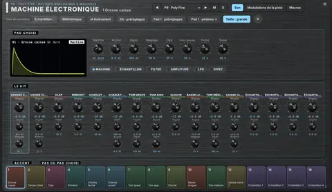 | **Machine électronique** | Batterie analogique à machines : 30 modèles de voix au choix par pad, chacun avec ses réglages, échantillon superposé, LFO, filtre analogique et VCA par pad | — |
| 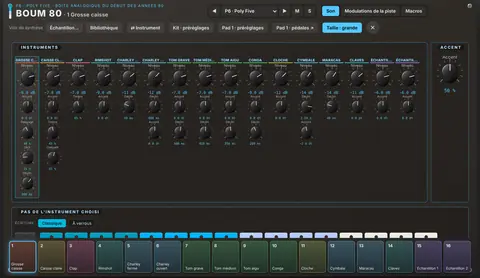 | **Boum 80** | Boîte analogique du début des années 80 : circuits en T ponté, 6 oscillateurs pour les métaux | — |
| 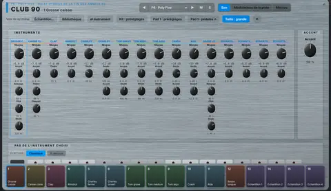 | **Club 90** | Boîte hybride de la fin des années 80 : grosse caisse balayée, cymbales en basse résolution | — |
| 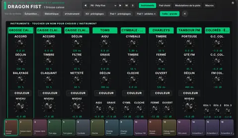 | **Dragon Fist** | Boîte analogique compacte et agressive : dix voix, une couleur par voix, distorsion de sortie | — |
| 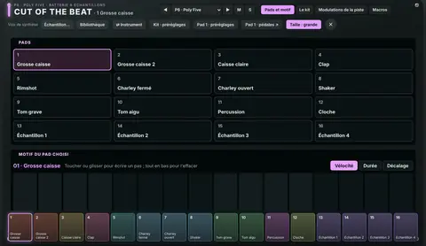 | **Cut of the Beat** | Batterie à échantillons : pads à déposer, précalcul par pad (synthèse ajoutée, sous-harmonique, résolution, écrêtage), GATE, compresseur interne | — |
| 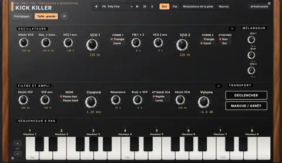 | **Kick Killer** | Percussion analogique semi-modulaire : 2 VCO, bruit, filtre en échelle, 3 enveloppes à déclin, séquenceur 8 pas hauteur et vélocité | 11 (Basses 1, Effets 1, Percussions 5, Séquences 4) |

### Basses

| | Instrument | Principe | Sons d'usine |
|---|---|---|---|
| 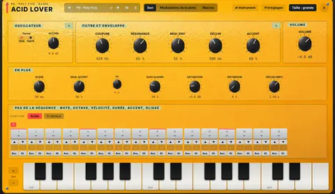 | **Acid Lover** | Basse monophonique à filtre à diodes, accent et glissé | 54 (Basses 11, Leads 4, Effets 6, Acide 33) |
| 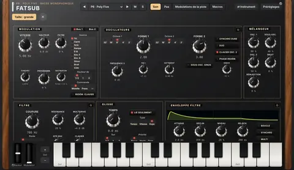 | **Fatsub** | Monophonique / duo analogique : 2 oscillateurs, réinjection, filtre en échelle 6 à 24 dB, 2 bus de modulation, DAHDSR bouclables | 58 (Basses 25, Leads 17, Plucks 6, Arpèges 4, Effets 6) |
| 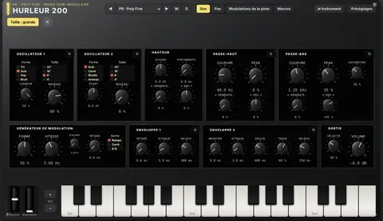 | **Hurleur 200** | Deux oscillateurs, filtres passe-haut et passe-bas 12 dB à réinjection saturée qui crient, générateur de modulation à forme réglable, échantillonneur-bloqueur | 15 |
| 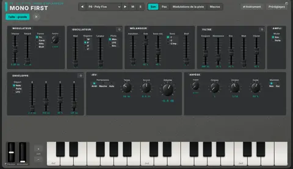 | **Mono First** | Un oscillateur, mélangeur impulsion / scie / sous-oscillateur / bruit, filtre 24 dB résonant, enveloppe déclenchée par la porte ou le LFO, arpège | 11 |

### Polys

| | Instrument | Principe | Sons d'usine |
|---|---|---|---|
| 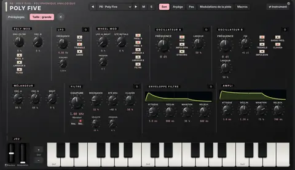 | **Poly Five** | Polyphonique analogique à 2 oscillateurs, Poly-Mod, Wheel-Mod, filtre en échelle 24 dB | 56 (Basses 7, Leads 8, Nappes 9, Plucks 5, Claviers 7, Cordes 5, Cuivres 7, Arpèges 4, Effets 4) |
| 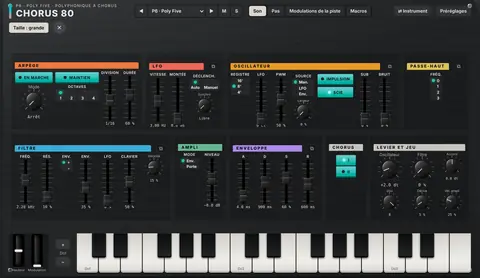 | **Chorus 80** | Polyphonique à oscillateur numériquement contrôlé, filtre 24 dB, arpège, chorus stéréo à lignes à retard | 56 (Basses 7, Leads 4, Nappes 9, Plucks 6, Claviers 9, Cordes 7, Cuivres 4, Arpèges 7, Effets 3) |
| 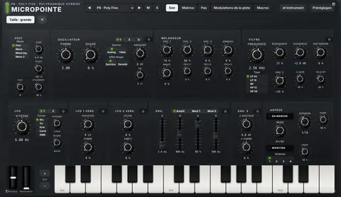 | **Micropointe** | Polyphonique hybride : 3 oscillateurs numériques, filtre multimode, saturation avant et distorsion après filtre | 59 (Basses 9, Leads 9, Nappes 10, Plucks 7, Claviers 7, Cordes 3, Cuivres 3, Arpèges 5, Effets 6) |
| 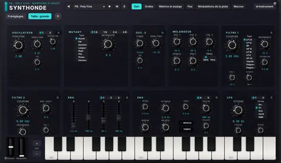 | **Synthonde** | Balayage de tables d'ondes à 2 oscillateurs mutants, 2 filtres en série ou parallèle | 60 (Basses 8, Leads 8, Nappes 12, Plucks 6, Claviers 7, Cordes 3, Cuivres 3, Arpèges 5, Effets 8) |
| 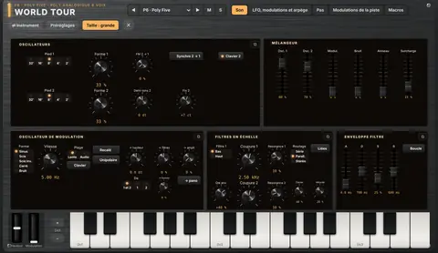 | **World Tour** | Polyphonique analogique 8 voix : 2 oscillateurs à forme continue, oscillateur de modulation, 2 filtres en échelle (série, parallèle, stéréo), retard diffusant | 103 (Basses 12, Leads 12, Nappes 12, Plucks 11, Claviers 11, Cordes 11, Cuivres 11, Arpèges 11, Effets 12) |

### Nappes

| | Instrument | Principe | Sons d'usine |
|---|---|---|---|
| 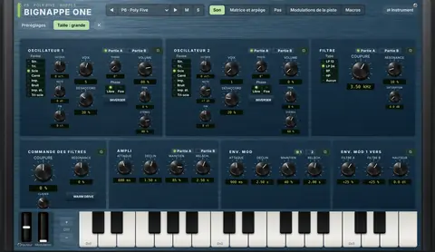 | **Bignappe One** | Virtuel-analogique à deux parties, unisson épais jusqu'à 8 voix, filtres par partie, chorus intégré | 58 (Basses 6, Leads 8, Nappes 14, Plucks 9, Claviers 4, Cordes 4, Cuivres 3, Arpèges 6, Effets 4) |
| 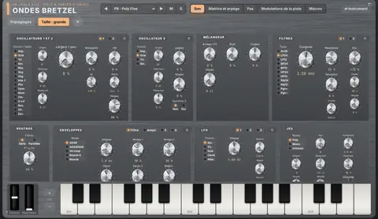 | **Ondes Bretzel** | Hybride numérique : 3 oscillateurs (formes analogiques ou tables), 2 filtres série / parallèle, 4 enveloppes, 3 LFO, matrice | 16 (Basses 2, Leads 2, Nappes 4, Plucks 2, Claviers 2, Arpèges 2, Effets 2) |
| 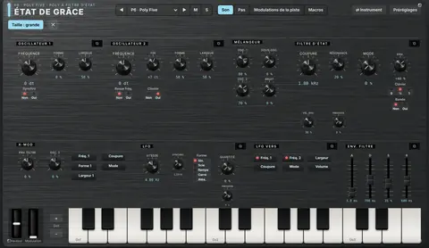 | **État de Grâce** | Polyphonique analogique à 2 oscillateurs à forme continue, filtre d'état 2 pôles passe-bas → réjection → passe-haut, X-Mod | 14 (Basses 2, Leads 2, Nappes 2, Plucks 1, Claviers 3, Cordes 1, Cuivres 1, Effets 2) |
| 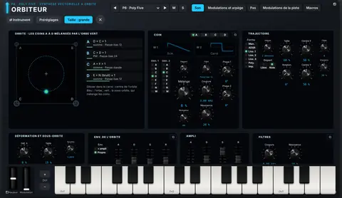 | **Orbiteur** | Synthèse vectorielle : 4 coins (générateurs d'harmoniques, mélange, filtre) mélangés par un orbe en orbite | 18 (Basses 2, Leads 1, Nappes 7, Plucks 1, Claviers 4, Arpèges 1, Effets 2) |

### Sampler

| | Instrument | Principe | Sons d'usine |
|---|---|---|---|
| 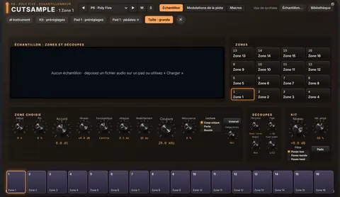 | **Cutsample** | 16 zones sur les pads, découpage automatique, calage au tempo (moteur StemSampler Pro) | — |
| 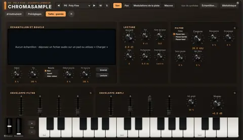 | **Chromasample** | Un échantillon joué sur tout le clavier, boucles, enveloppes d'ampli et de filtre (moteur StemSampler Pro) | 3 |
| 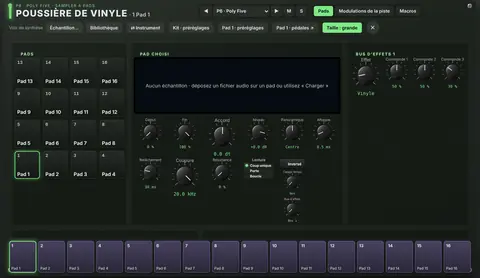 | **Poussière de Vinyle** | 16 pads à échantillons, deux bus d'effets à trois commandes : vinyle, lo-fi, cassette, filtre + saturation, isolateur, boucle DJ, écho, réverbération | 9 |
| 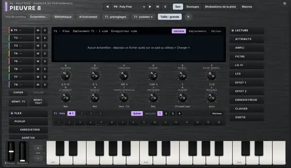 | **Pieuvre 8** | 8 pistes internes (machines Flex et Pickup), réserve de 128 emplacements, découpes, étirement, enregistreurs, LFO à pas, 2 effets par piste | 10 |

### Synthés FM

| | Instrument | Principe | Sons d'usine |
|---|---|---|---|
| 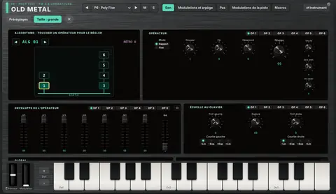 | **Old Metal** | FM à 6 opérateurs, 32 algorithmes, enveloppes à 4 vitesses et 4 niveaux, échelle au clavier | 115 (Basses 17, Leads 12, Nappes 16, Plucks 12, Claviers 15, Cordes 11, Cuivres 11, Arpèges 10, Effets 11) |
| 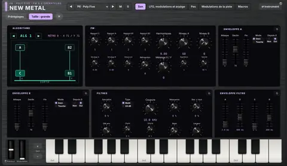 | **New Metal** | FM à 4 opérateurs (C, A, B1-B2), 8 algorithmes à deux sorties mélangées, harmoniques, puis filtres et enveloppes soustractifs | 104 (Basses 12, Leads 11, Nappes 12, Plucks 12, Claviers 12, Cordes 11, Cuivres 11, Arpèges 11, Effets 12) |
| 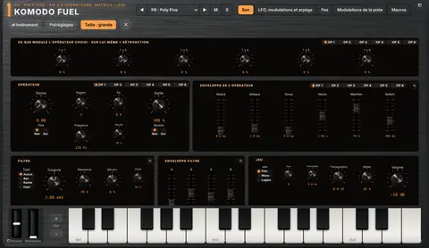 | **Komodo Fuel** | FM à 6 opérateurs à algorithme libre (matrice 6 × 6), 12 formes d'onde balayées, enveloppes à 6 étapes en boucle, filtre multimode | 101 (Basses 11, Leads 11, Nappes 12, Plucks 11, Claviers 12, Cordes 11, Cuivres 11, Arpèges 11, Effets 11) |

### Drones

| | Instrument | Principe | Sons d'usine |
|---|---|---|---|
| 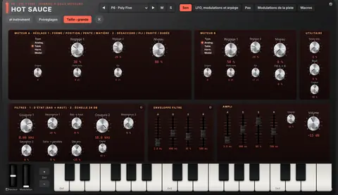 | **Hot Sauce** | Hybride à deux moteurs (analogique, table d'ondes, harmonique, modal), FM de A vers B, sous-oscillateur et bruit, deux filtres série → parallèle, 3 LFO et 2 enveloppes | 92 (Basses 10, Leads 10, Nappes 11, Plucks 10, Claviers 10, Cordes 10, Cuivres 10, Arpèges 10, Effets 11) |
| 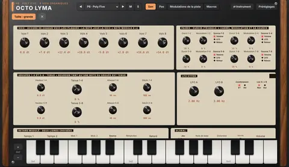 | **Octo Lyma** | 8 voix en paires et en groupes, FM croisée entre paires, tenue en bourdon, LFO hyper (ET / OU), retard modulé à deux lignes et distorsion | 92 (Basses 10, Leads 10, Nappes 11, Plucks 10, Claviers 10, Cordes 10, Cuivres 10, Arpèges 10, Effets 11) |
| 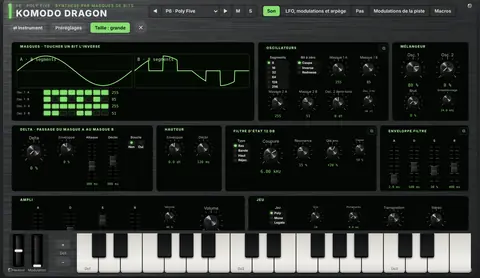 | **Komodo Dragon** | Synthèse par masques de bits : sinus découpé en segments, masques de 8 bits (256 par oscillateur), passage d'un masque à l'autre par une enveloppe delta, filtre d'état 12 dB | 92 (Basses 11, Leads 10, Nappes 11, Plucks 10, Claviers 10, Cordes 10, Cuivres 10, Arpèges 10, Effets 10) |

### Vocodeurs

| | Instrument | Principe | Sons d'usine |
|---|---|---|---|
| 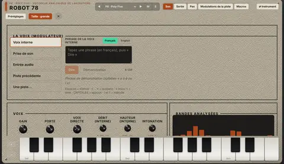 | **Robot 78** | Vocodeur analogique 16 canaux : bandes fixes de 50 Hz à 5 080 Hz, souffle et bourdon, aigus directs, maintien, décalage des bandes | 10 (Nappes 2, Effets 3, Voix 5) |
| 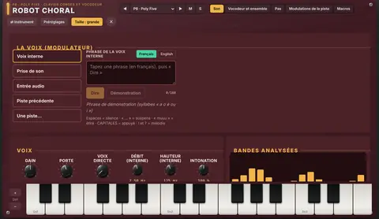 | **Robot Choral** | Clavier cordes et vocodeur : porteuse à cordes (8' + 4', registre, ensemble), 16 à 40 bandes, formants, gel, sibilantes | 10 (Nappes 3, Effets 1, Voix 6) |
| 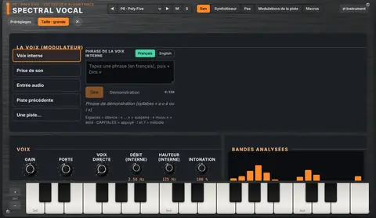 | **Spectral Vocal** | Vocodeur logiciel à algorithmes : 8 bancs (analogique, numérique, voyelles, inversé, cristal…), formants, expansion, traînes, stéréo, consonnes de synthèse | 12 (Nappes 3, Effets 2, Voix 7) |
| 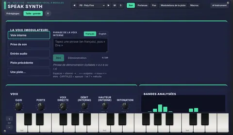 | **Speak Synth** | Processeur vocal à modules parallèles : vocodeur, voix d'ordinateur, boîte parlante, voix modélisée, épaississement | 10 (Effets 3, Voix 7) |

### Entrée

| | Instrument | Principe | Sons d'usine |
|---|---|---|---|
| 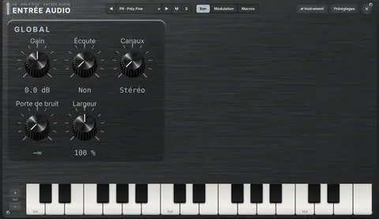 | **Entrée audio** | Entrée de la carte son ou de la piste du logiciel hôte, traitée par les effets de la piste | — |

## Effets

### Égaliseurs

| | Effet | Principe | Préréglages |
|---|---|---|---|
| 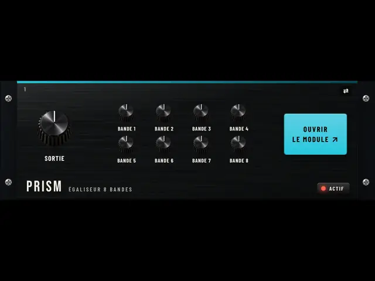 | **Prism** | Paramétrique 8 bandes statiques, dynamiques ou à dynamique spectrale (attaque, relâchement), sans latence | 14 |
| 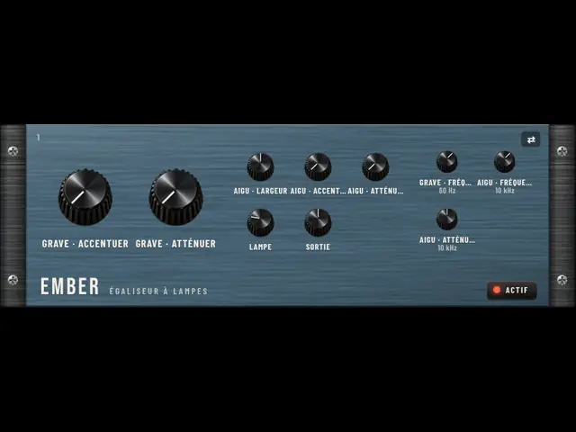 | **Ember** | Égaliseur passif de studio : grave accentué et atténué sur la même fréquence, aigu en cloche, étage de lampe | 6 |
| 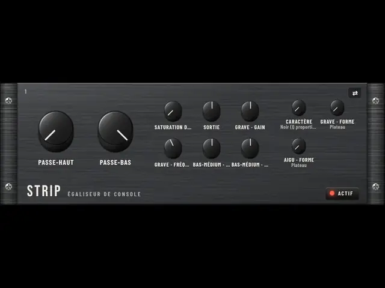 | **Strip** | Tranche de console : filtres 18 / 12 dB, 4 bandes, Q proportionnel ou constant, saturation d'entrée | 6 |

### Compresseurs et dynamique

| | Effet | Principe | Préréglages |
|---|---|---|---|
| 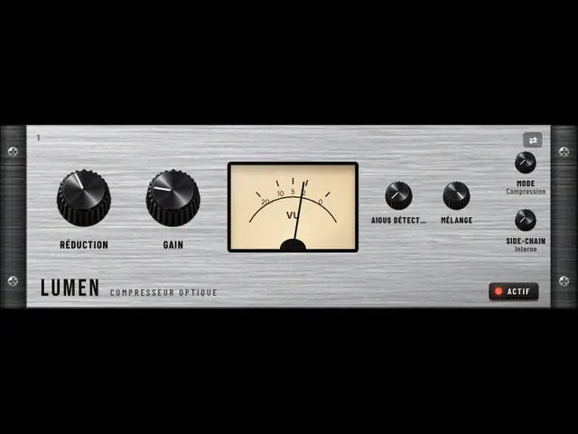 | **Lumen** | Cellule photo-résistive : attaque douce, relâchement en deux temps dépendant du programme | 6 |
| 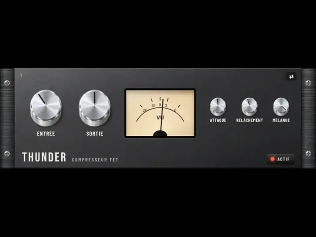 | **Thunder** | Étage à transistor à effet de champ : attaque très rapide, coloration, mode tous rapports | 5 |
| 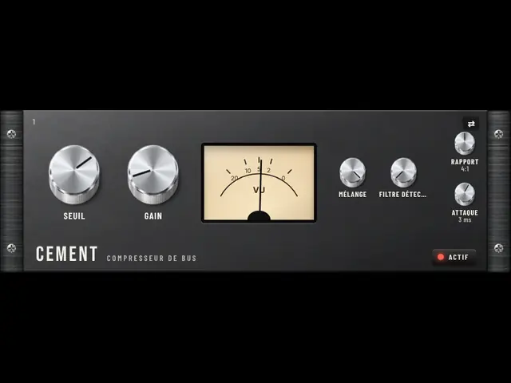 | **Cement** | Compresseur de bus à crans : rapports 2, 4, 10, relâchement automatique, filtre de détection | 5 |
| 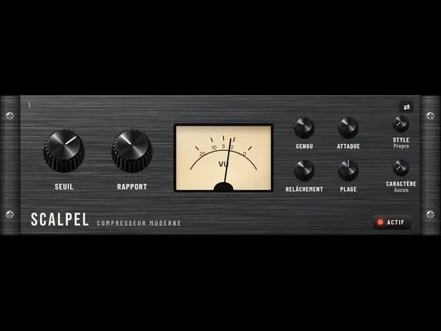 | **Scalpel** | Compresseur polyvalent à 10 styles (propre, classique, opto, voix, mastering, bus, percussif, pompage, vari-mu, montant), caractère (lampe, diode, brillant), seuil automatique ; sans anticipation (aucune latence) | 15 |
| 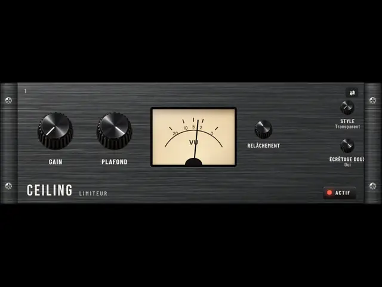 | **Ceiling** | Limiteur sans anticipation (latence nulle), plafond garanti, écrêtage doux final, mode crête vraie | 5 |
| 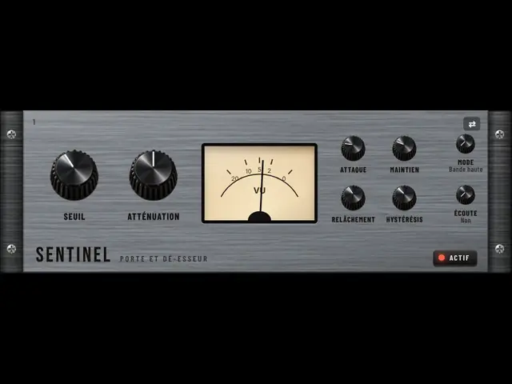 | **Sentinel** | Porte de bruit à hystérésis et maintien, filtre de détection ; dé-esseur sur la bande des sifflantes, sans latence | 9 |
| 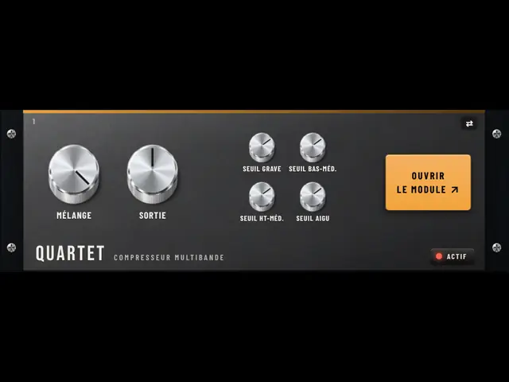 | **Quartet** | 4 bandes (compression ou expansion) + 2 bandes flottantes dynamiques, séparation sans latence | 7 |
| 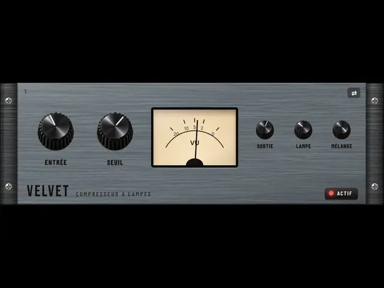 | **Velvet** | Vari-mu : le rapport grandit avec le niveau, 6 constantes de temps (2 selon le programme), étage de lampe | 6 |
| 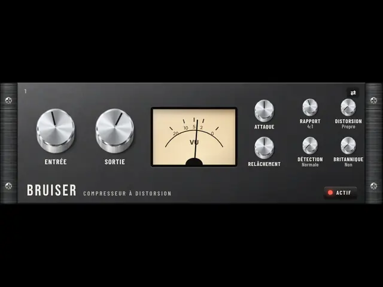 | **Bruiser** | Seuil fixe poussé par l'entrée, rapports 1:1 à 20:1 et Nuke, distorsion 2 ou 3, filtres de détection, mode britannique | 5 |
| 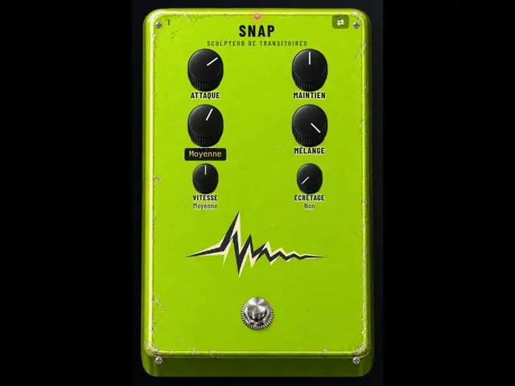 | **Snap** | Attaque et maintien relevés ou creusés sans seuil (deux paires de suiveurs comparés) | 4 |

### Mastering

| | Effet | Principe | Préréglages |
|---|---|---|---|
| 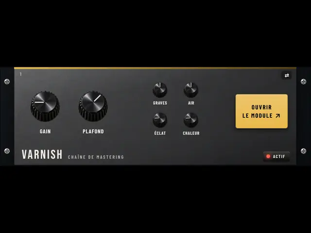 | **Varnish** | Chaîne de mastering tout-en-un : égaliseur, dynamique 3 bandes, image stéréo par bande, excitation, maximiseur à deux relâchements (sans pompage), crête vraie, latence nulle | 7 |

### Saturation

| | Effet | Principe | Préréglages |
|---|---|---|---|
| 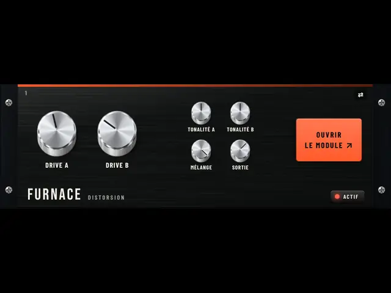 | **Furnace** | Deux moteurs de saturation, 14 algorithmes, asymétrie, 5 routages, filtres, dynamique et réinjection | 16 |
| 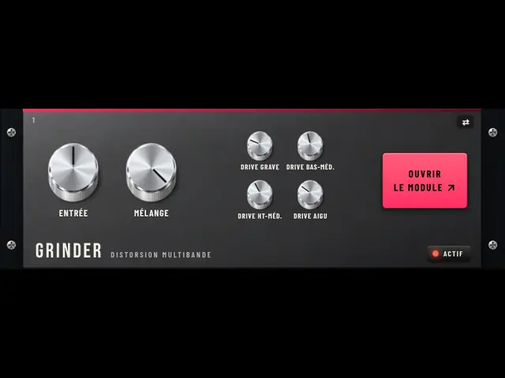 | **Grinder** | Distorsion multibande : 2 à 4 bandes, chacune avec porte, dynamique, réinjection accordée, 16 algorithmes, asymétrie ; 3 modulateurs | 9 |
|  | **Ferrite** | Bande poussée : saturation à mémoire, polarisation, bosse du grave et perte d'aigus selon la vitesse, pleurage, souffle | 5 |
|  | **Glow** | Étage de triode : courbe asymétrique (harmoniques paires), polarisation, affaissement de l'alimentation, tonalité | 4 |

### Échos

| | Effet | Principe | Préréglages |
|---|---|---|---|
|  | **Ricochet** | Écho à caractères : simple, double, ping-pong, bande, analogique | 11 |
|  | **Reel** | Bande en boucle, 3 têtes de lecture, intensité jusqu'à l'auto-oscillation, usure, ressort intégré | 6 |
|  | **Comet** | Délai multimode : numérique, bande, seau BBD, lo-fi, inverse, filtre balayé, double, ping-pong | 9 |

### Réverbérations

| | Effet | Principe | Préréglages |
|---|---|---|---|
|  | **Nave** | Réseau de 8 lignes à retard modulées, déclin RT60, brillance, rapport des graves, premières réflexions | 7 |
|  | **Heirloom** | Réverbérations numériques des années 70-80 : réservoir en huit, 6 modes, couleurs 1970 / 1980 / actuelle | 7 |
|  | **Gold Leaf** | Plaque à tôle tendue : très dense, amortisseur, pré-délai, brillance | 4 |
|  | **Spiral** | Réverbération à ressorts : 1 à 3 ressorts dispersifs (le « boing »), ton, éclaboussure | 4 |
|  | **Sovereign** | Réseau de 8 lignes (matrice de Hadamard), premières réflexions, déclin séparé grave / aigu, 6 modes, gel ; sans latence | 6 |
|  | **Atmosphere** | Réverbération d'ambiance à 12 algorithmes : salle, plaque, chatoiement, nuage, floraison, pièce, ressort, gonflement, chorale, magnéto, non linéaire, réflexions ; gel, traîne | 22 |

### Modulation

| | Effet | Principe | Préréglages |
|---|---|---|---|
|  | **Moire** | Ensemble de 2 à 4 voix de lignes à retard modulées (principe BBD) | 4 |
|  | **Whirl** | 4 à 12 étages de passe-tout modulés, réinjection, décalage stéréo | 3 |
|  | **Contrail** | Flanger à seau (BBD) : ligne courte balayée, réinjection ±, mode matrice (balayage figé), mode inversé | 6 |
|  | **Twinspin** | Deux phasers de 4 à 12 étages, deux balayages (libres ou au tempo), série, parallèle ou stéréo | 5 |
|  | **Expanse** | Chorus spatial à 4 réglages : deux lignes à seau en opposition, croisées et inversées ; large et compatible mono | 5 |
|  | **Trinity** | Trois lignes à seau déphasées de 120° : chorus, vibrato ou ensemble (deux vitesses), largeur, ton | 4 |

### Filtres et performance

| | Effet | Principe | Préréglages |
|---|---|---|---|
|  | **Staccato** | Capture d'une tranche calée sur le tempo et répétition (stutter), probabilité, chute de hauteur | 3 |
|  | **Iris** | Filtre multimode résonant modulé par LFO et par l'enveloppe du signal | 4 |
|  | **Hopscotch** | Grille de 16 à 64 pas calée sur le tempo : un effet et son réglage par pas (préréglages par effet et 4 réglages perso) | 10 |
|  | **Sculptor** | 9 effets pilotés chacun par sa courbe (14 formes, 1/16 à 4 mesures, au tempo ou à chaque attaque), sur tout le son ou une bande | 12 |
|  | **Infinity** | Pédale de boucle : enregistrer, fermer, surcouches, arrêt, effacement ; longueur calée sur les mesures, vitesse, envers | 5 |
