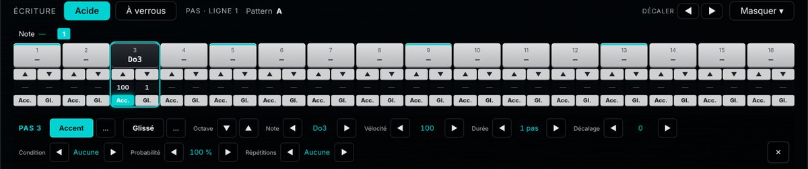
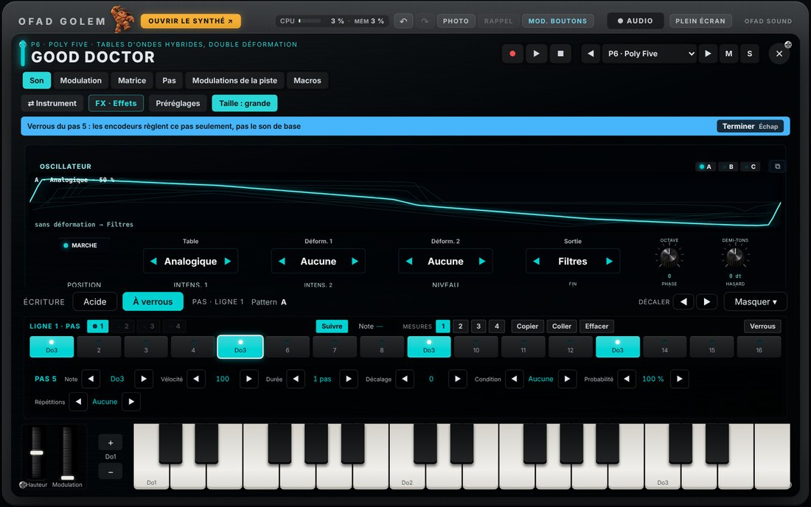
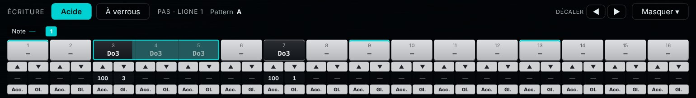
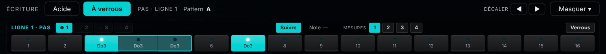
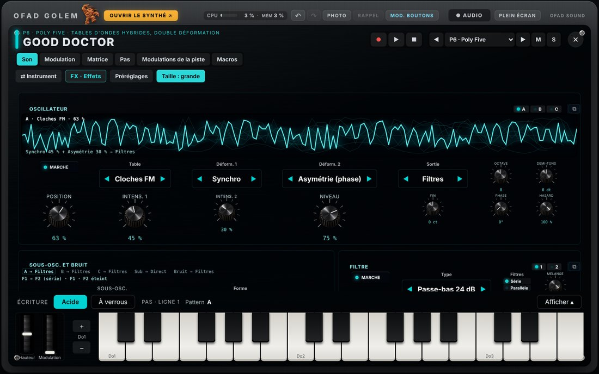
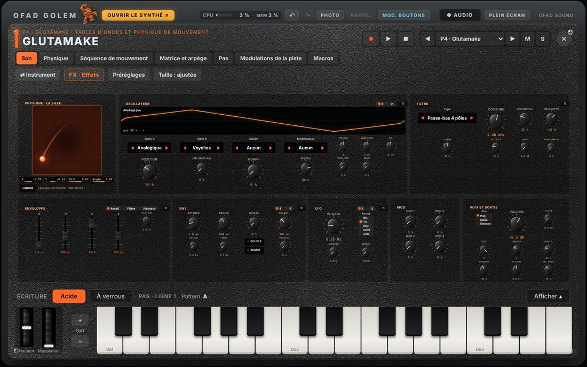

# OFAD GOLEM — Getting started

This manual covers the basics; the instruments and effects are described in detail in the **Catalogue**.

> **The interface is available in English.** Choose the language when you install on Windows, or at the
> first launch on Android; change it at any time in Settings › Project (**Français / English**). This
> manual uses the English names of the controls; if you use the French interface, the table below gives
> the French label you will see on screen.

| In this manual | On screen (French) |
|---|---|
| Screens TRACKS, LAUNCH, SEQUENCE, SOUND, EFFECTS, MIXER, SCENES, SETTINGS | PISTES, LANCEMENT, SÉQUENCE, SON, EFFETS, MIXEUR, SCÈNES, RÉGLAGES |
| LAUNCH tabs: Grid, Song, Audio | Grille, Morceau, Audio |
| Transport: Rec, Play, Stop, Fill, Break, Shift | Enr., Lecture, Arrêt, Fill, Break, Maj |
| Pad roles: Play, Mute, Scenes, Step, Erase | Jouer, Couper, Scènes, Pas, Effacer |
| Open the synth · Photo · Recall · Knob mods · Live view | Ouvrir le synthé · Photo · Rappel · Mod. boutons · Vue live |
| Assign to… · Free the knob · Learn MIDI | Assigner à… · Libérer le bouton · Apprendre MIDI |
| Accent · Slide · Locks · Locks only | Accent · Glissé · Verrous · Verrous seuls |
| Writing: Acid / Locks · Follow · Nudge · Hide / Show | Écriture : Acide / À verrous · Suivre · Décaler · Masquer / Afficher |
| Edit · Done · Pad active / stopped · Corners · Size · Height · Rotation | Éditer · Terminer · Pavé actif / arrêté · Coins · Taille · Hauteur · Rotation |
| Rec performance · Rec motion · Record a take · Arrange mode · Loop | Enr. le jeu · Enr. les mouvements · Enregistrer une prise · Mode montage · Boucle |

## Keyboard and mouse shortcuts

### Everywhere

| Key or gesture | Action |
|---|---|
| **Space bar** | Play / stop |
| **Ctrl + Z** | Undo |
| **Ctrl + Y** (or Ctrl + Shift + Z) | Redo |
| **F11** | Full screen / back to window |
| **Esc** | Close the open window: synth panel, pedalboard, instrument or effect picker, presets, menu, home screen |
| **B** held | Break: the Break scene while the key is held (and Fill at the same time) |
| **N** held | Fill: FILL steps play, NOT FILL steps go silent |
| Right-click (long press with a finger) on an LED button, Photo, Recall, M / S… | Assign to the MIDI controller |
| Touch the **tempo** (status bar, or the Tempo row on a phone) | Type the tempo (40 to 240 BPM, to a tenth) |

<figure class="wide"><figcaption>Where the main controls are</figcaption></figure>

1. **Open the synth**: the track's instrument panel, full size.
2. **Undo / Redo** (Ctrl + Z / Ctrl + Y), **Photo** and **Recall** of all settings.
3. **Audio**: record what comes out (master or separate tracks).
4. **Full screen** (F11).
5. The **16 assignable knobs** (blue diamond): each one drives the value you gave it (see below).
6. **M / S**: mute and solo of the tracks shown.
7. **Transport**: Rec, Play, Stop (space bar); Fill (N), Break (B), timed Break, Shift.
8. **Crossfader** for scenes A / B (double-click: back to the middle).
9. The **8 screens**.
10. The **pad role**: Play, Mute, Scenes, Step, Erase.

### Pads on the computer keyboard (AZERTY)

| Keys (top to bottom, like the pads) | Pads |
|---|---|
| **1 2 3 4** | 13 to 16 (top row) |
| **A Z E R** | 9 to 12 |
| **Q S D F** | 5 to 8 |
| **W X C V** | 1 to 4 (bottom row) |
| **Shift** + key | Accented hit (full velocity) |

The keys follow the pad role chosen on the right: Play, Mute, Scenes, Step, Erase.

<figure class="pads"><figcaption>The keyboard key on each pad (the same small letter is shown in the top right corner of each pad)</figcaption></figure>

### Knobs and values (synth panel knobs, values at the bottom of the screens, assignable knobs)

| Gesture | Action |
|---|---|
| Drag up / down | Adjust |
| **Shift** + drag | Fine adjustment |
| Mouse wheel | One step (**Shift** + wheel: fine step) |
| Double-click (double tap with a finger) | Default value |
| Arrows ↑ ↓ ← → (knob selected) | One step (**Shift**: fine step) |
| Right-click (long press with a finger) | Menu: exact value, modulation, Learn MIDI, assignable knob (and macros, on a synth panel) |
| Mixer: double-click on a fader | Default value; double-click on a group name: rename it |
| Crossfader: double-click | Back to the middle |

**The values at the bottom of the screens** (Swing, Length, Division, X, Y, Crossfader, Scene A…) are
adjusted by dragging on them. A **long press** (right-click on PC) opens their menu, the same
everywhere: exact value (list of choices or a number to type), **Learn MIDI**, **drive with knob 1 to
16**; modulation only appears for a sound, effect or mix setting. The synth **macros** are only offered
on a synth panel.

<figure class="wide"><figcaption>Adjusting a value and handing it to a knob</figcaption></figure>

1. A **value at the bottom of the screen**: drag, double-click.
2. Its **menu** (long press, right-click): exact value, modulation, Learn MIDI, knob 1 to 16.
3. The **16 assignable knobs**.

**The 16 assignable knobs** replace the old encoders: they no longer change with the screen, each one
keeps the value you gave it. On PC and tablet they sit in one row of 16; on a phone, in two rows of 8.
A **blue diamond** marks them: hollow when the knob is free, filled when it drives something (its name is
written under the number). The full travel, from 0 to maximum, takes **a single gesture**.

<figure class="wide"><figcaption>Long press on an assignable knob</figcaption></figure>

- **Long press** (right-click) on a knob › **Assign to…**: the knob **blinks blue** and everything that
  can be driven is **underlined in dotted blue**. Touch the value you want: a value at the bottom of a
  screen, a synth or effect knob, a macro, the crossfader, the tempo, Play, Fill, an M / S… You can
  change screen or open a synth before touching. **Esc** cancels.
- **Free the knob**: it no longer drives anything.
- **Modulate the knob**: the 16 knobs have **their own modulation sources** (4 sources: LFO, function,
  follower or sequencer), independent from the synths' ones: a setting can be modulated both by the
  synth's LFO and by the knob's. The knob menu offers these 4 sources, the **depth** (−100 to +100 %)
  and "Remove modulation"; a coloured dot shows the source and the knob moves with it. Removing the
  modulation or freeing the knob puts the setting back as it was. Everything the knob drives can be
  modulated (sound, effects, mix, crossfader, vector pad, macros), except the tempo and the commands.
- **Knob mods** (next to Photo / Recall, at the top on PC, under the 16 knobs on phone and tablet) opens
  the panel of these 4 sources, the same as a synth's modulations: shape, tempo sync, speed, phase…;
  **Assign to a knob…** then touch the knobs to modulate.
- **Learn MIDI**: a knob or fader on the controller turns this knob.

<figure class="wide"><figcaption>Knob mods: the 4 sources of the 16 knobs</figcaption></figure>

<figure class="wide"><figcaption>Knob 3 is waiting: touch the value it should drive</figcaption></figure>

Values that belong to one screen (Length, Division, Family…) follow their knob while the interface is
open; after opening a project, show the screen concerned once. Sound, effects, tempo, swing,
crossfader, scenes, vector pad and macros always respond.

### SEQUENCE screen (notes and steps)

| Key or gesture | Action |
|---|---|
| Click on a cell | Add / remove a step (or a note) |
| **P** | Brush: dragging writes one step per cell crossed |
| **Ctrl** + click | Add to / remove from the selection |
| Drag from an empty cell | Selection rectangle (**Shift**: adds) |
| Drag a selection | Move it; **Ctrl** (or Alt) + drag: copy it |
| **Ctrl + A** | Select all |
| **Ctrl + C / Ctrl + X / Ctrl + V** | Copy / cut / paste under the mouse |
| **Ctrl + D** | Duplicate right after |
| **Delete** (or Backspace) | Clear the selection |
| **Esc** | Empty the selection |
| Arrows ← → | Move by one step (**Shift**: by one bar) |
| Arrows ↑ ↓ | Note: one semitone (**Shift**: one octave); drums: next pad |
| Right-click on a step | Step settings (velocity, duration, condition, locks) |
| Touch an **Accent** / **Slide** cell | Turn the step's accent or slide on / off |
| Long press (right-click) on an **Accent** / **Slide** cell | The step's value: accent strength, slide time |
| ◀ ▶ next to the pattern (or the small dots) | Turn pages (one page = 16 steps) |
| **Shift** + Octave ◀ ▶ (transport) | Previous / next page |
| **Rec** then play | The notes you play are written into the pattern (quantise: Settings) |

<figure class="wide"><figcaption>The SEQUENCE screen of a melodic instrument (here the acid bass)</figcaption></figure>

1. The **track** shown (◀ ▶ or the list).
2. The **pattern**: number of bars (1 to 32), division (1/16, triplets…), speed.
3. **Turn pages**: ◀ ▶ and "page / total" (dots up to 4 pages).
4. The **Accent** and **Slide** lines (and "Locks only": the step sets its settings without playing).
   Long press on a cell: its value (see "A step's value").
5. The **piano roll**: each step gets whatever note you want, up to 4 notes per step (chords).
6. **Select**, **Brush**, select all, patterns **A to P** (8 at a time; the small "I–P" / "A–H" chip shows the other page), duplicate, clear.
7. **Notes / Curves**: the knob movements recorded with **REC** in this pattern.
8. The **track settings** when no step is selected (swing, length, speed…) — see "3. Writing a sequence".

### LAUNCH screen › Grid

| Key or gesture | Action |
|---|---|
| Touch a cell | Launch and edit the pattern |
| **Shift** (button) + touch | Edit without launching |
| **Ctrl + C** then a cell, **Ctrl + V** | Copy a pattern to another cell (same track or another track) |
| ▶ at the head of a row | Launch the same letter on all tracks (and the scene linked to the row) |

<figure class="wide"><figcaption>LAUNCH › Grid</figcaption></figure>

1. The **Grid**, **Song**, **Audio** tabs.
2. The **grid**: one column per track, one cell per pattern; ▶ launches a row, ■ stops a track. The 16 rows (A to P)
   are shown 8 at a time: **A–H** / **I–P** in the top left corner.
3. Copy, clear or edit the selected pattern or row.
4. The values at the bottom: track, edited pattern, **launch quantise**, row, **linked scene**.

### LAUNCH screen › Song and curves

| Key or gesture | Action |
|---|---|
| **Ctrl** + wheel | Zoom the timeline |
| Curve editor: **Shift** + drag | Draw a straight line |
| Curve editor: right-click + drag | Erase |

<figure class="wide"><figcaption>LAUNCH › Song</figcaption></figure>

1. **Song mode** (the rows play one after another) or **Loop** (the grid plays).
2. **● Rec performance** (your playing becomes rows) and **● Rec motion** (knobs, faders, mutes, solos, crossfader as curves).
3. The **rows** played one after the other; the **curves** below.
4. Add what is playing as a row, clear the rows or the curves.

### LAUNCH screen › Audio (arrangement)

| Key or gesture | Action |
|---|---|
| Drag a clip | Move it (also to another track) |
| Drag the edge of a clip | Trim it |
| **Ctrl** (or Shift) + click | Select several clips |
| Drag a rectangle in empty space | Select the clips it touches (**Ctrl**: adds) |
| **Ctrl + A** | Select all clips |
| Right-click on a clip | Menu: split here, copy, duplicate, volume to 0 dB, delete |
| Right-click in empty space | Menu: paste here, playhead here, select all |
| ✂ tool, or **S** key | Split (S: at the playhead) |
| **Ctrl + C / Ctrl + V** | Copy / paste at the playhead |
| **Ctrl + D** | Duplicate right after |
| **Delete** (or Backspace) | Delete |
| **Ctrl + Z / Ctrl + Y** | Undo / redo (arrangement) |
| Click on the ruler (drag: move it) | Place the playhead — the next take lands there |
| Right-click (or **Shift**) + drag on the ruler | New loop |
| Drag the orange loop bar | Move the loop; its edges: lengthen or shorten it |
| **Loop** on + "● Record a take" | The take lasts exactly the loop and **stops by itself** at its end |

<figure class="wide"><figcaption>LAUNCH › Audio (arrangement)</figcaption></figure>

1. **● Record a take** (it lands at the playhead, or at the start of the loop when Loop is on).
2. **Arrange mode**: playback plays the clips instead of the instruments.
3. A **clip**: drag, trim by the edges, right-click: menu.
4. **WAV / MP3 export** of the finished arrangement.
5. The **ruler**: click = playhead; right-click (or Shift) + drag = loop (orange bar).
6. **Select** / **Scissors** tools and snap (bar, beat, 1/16, free).
7. **Loop**: when it is on during a take, it sets the take's length to the step.

## Getting started

- At launch, the mascot shows while loading, then the **home screen**: resume the last session, new
  empty project, demo project, open a file, or a project from the folder. (Settings › "Home screen at
  startup" to show it or not.)
- **Language**: French or English, chosen when installing (Windows) or at the first launch (Android); change
  it at any time in Settings › Project (**Français / English**).
- Sound card: **Options** (top left of the window) › Audio/MIDI Settings. For the lowest latency: the
  sound card's ASIO driver or "Windows Audio (Low Latency Mode)", buffer of 128 to 256 samples.

<figure><figcaption>The home screen at launch: resume, new project, demo, open, projects in the folder</figcaption></figure>

## The device

- **8 screens** (buttons on the right): Tracks, Launch, Sequence, Sound, Effects, Mixer, Scenes, Settings.
- **16 assignable knobs** under the screen: each one drives the value you gave it (see "Knobs and
  values"). The screen's own values are adjusted directly at the bottom of the screen.
- **16 pads** on the right: their role (Play, Mute, Scenes, Step, Erase) is chosen above them.
- **Transport** at the bottom: Rec (record into the pattern), Play, Stop; Fill, Break, Shift; octave;
  crossfader for scenes A / B.
- **On a phone**: next to the screen, two tabs. **Controls**: the screens, the 16 knobs, the transport,
  Fill and Break, the crossfader, Photo / Recall and the **Tempo** row (− / value to touch to type it /
  + / **Tap**: tap in time, the tempo follows). **Pads**: the pad role, the 16 pads, the scene bank.
- **Top bar**: "Open the synth" (the instrument panel, full size), CPU load, undo / redo, Photo and
  Recall of the settings, Audio recording, full screen.

<figure><figcaption>The device: the screen (here LAUNCH › Grid), the 16 assignable knobs, M / S, transport, the 8 screens and the 16 pads</figcaption></figure>

## Editing basics

### 1. Choosing a sound

TRACKS screen: choose the instrument of each track (or "⇄ Instrument" on the panel, with pictures).
**Presets** are chosen by category.

<figure><figcaption>TRACKS screen: the instrument, name and colour of each track</figcaption></figure>

### 2. Playing

The pads, the computer keyboard, the panel's keyboard or a MIDI controller (notes go to the track
shown). "Open the synth" shows the instrument panel full size.

<figure><figcaption>An instrument panel (here the drum machine kit): all its settings, its pads or its keyboard</figcaption></figure>

**The header of every panel** always has three lines, on PC as on a phone: 1. the instrument name, the
transport (● ▶ ■), the track selector (◀ ▶, M, S) and ✕ to close; 2. the pages (Sound, Steps, Track
modulations, Macros…), which scroll sideways when there are many; 3. the tools: sample and library (if
the instrument has them), ⇄ Instrument, FX · Effects, Presets.

### 3. Writing a sequence

Each track has **16 patterns** (A to P), from 1 to 32 bars. A sequence can be written in three ways, as
you like — it is **always the same sequence**: a step set on the panel shows up at once in the SEQUENCE
screen, and the other way round.

- **With the mouse**, SEQUENCE screen: one line per pad (drums) or a piano roll (melodic instrument),
  where **each step gets whatever note you want** (up to 4 notes per step for chords).
- **By playing**: **Rec**, then play the pads, the panel's keyboard, the computer keyboard or the MIDI
  controller, in time. The notes are written into the pattern while it loops (quantise from 0 to 100 %
  in Settings; the rest of the timing offset is kept). **REC** also records the **movements** of the
  track's knobs as curves in the pattern (Curves tab).
- **On the synth panel**, in "Sequence steps", with two writing modes to choose from ("Writing"):
  **Acid** or **Locks**. The choice is kept, and the same everywhere. On melodic synths, the chosen row
  is also **above the keyboard**, on every page of the panel: you write your steps without leaving the
  Sound page. **Hide ▾** folds it away (more room for the settings), **Show ▴** brings it back.
- **Step** pad role: the 16 pads set or remove the steps of the page shown, like a drum machine's step
  programming.

<figure class="wide"><figcaption>The step row above the keyboard: Writing Acid or Locks, Nudge, Hide</figcaption></figure>

**The acid sequencer** (basses and synths): the 80s step row, step by step.

<figure class="wide"><figcaption>Bass panel: "Acid" writing</figcaption></figure>

1. **Writing**: Acid or Locks.
2. The **pages** of 16 steps (one button per page when the pattern is longer).
3. The step's **note**: touch to set or remove the step; drag up or down (or the wheel) to change the
   note by a semitone.
4. **▲ ▼**: one octave up or down.
5. Step **velocity** and **duration** (drag on the value).
6. **Acc.** (accent: the step plays louder and with more "bite", set by the Accent knob) and **Sl.**
   (slide: the note holds until the next step and glides to it; same note: tied, without
   retriggering). Touch: on / off; **long press**: the step's value (see below).
7. **FX · Effects**: the track's effects as pedals (see 5).
8. **Sound · Track modulations · Macros**: the other pages of the panel.
9. **⇄ Instrument**: change instrument with pictures.

**A step's menu**: a **long press** on the note of a set step opens its menu under the row, in large
buttons (handy on a phone): **Accent** and **Slide** (touch: on / off; "…": their amount), **Octave**
▼ ▲, **note**, velocity, length, offset, condition, probability, repeats. A key played on the keyboard
while the menu is open becomes the step's note. ✕ closes the menu.

<figure class="wide"><figcaption>Long press on a step: its menu, with large Accent and Slide</figcaption></figure>

**The locks sequencer**: each step can keep its own settings (cutoff, resonance, effects…), on top of
its note.

<figure class="wide"><figcaption>Bass panel: "Locks" writing, step 5 selected</figcaption></figure>

1. **Pages 1 to 4** (16 steps each): touch a page to show it.
2. **Follow**: the page turns by itself with playback (touching a page stops following).
3. **Bars**: length of the line, 1 to 4 bars (the pattern grows if needed).
4. A **selected step** (long press on the step, or the **Locks** button then touch the step): turn any
   knob on the panel, the pedalboard or the SOUND screen — the value is **locked on that step** only.
   A banner reminds you; Esc or "Done" exits.
5. **Copy / Paste / Clear** the locks of the selected step ("No locks": all those of the line).

On synths, the locks row writes **the last note played** (pads, the panel's keyboard, or a MIDI keyboard
while stopped): it is shown ("**Note** F1") and each step set shows its note instead of its number. A
selected step (long press) takes the note of the next key played, and opens its **menu** under the
row: note, velocity, length, offset, condition, probability, repeats.

<figure class="wide"><figcaption>"Locks" writing: the selected step's menu</figcaption></figure>

**Note length**: in Acid and Locks writing, a note lasting several steps gets a large frame along its
whole length, filled inside, and the steps it covers show its note in small. You can see a note is
still sounding, and place another note on top. To lengthen or shorten a note: **length** in the step's
menu.

<figure class="wide"><figcaption>Acid writing: a three-step note, framed along its whole length</figcaption></figure>

<figure class="wide"><figcaption>"Locks" writing: the same frame</figcaption></figure>

**Removing a note** resets its step: length, offset, accent, slide, condition, probability, repeats and
locks. The next note placed there starts from fresh settings.

**Nudge ◀ ▶**: the whole writing slides one step left or right, wrapping around (the step that falls off
comes back on the other side); notes, accents, slides, conditions and locks follow. On the panel: to the
right of "Writing" (drums: **All** or the selected **Pad** only), or in the locks row (that line only);
in the SEQUENCE screen: ◀ ▶ after "Clear pattern" (**Shift**: the selected line only).

**Panel transport**: on the first line of every panel, just left of the track selector, **●** record,
**▶** play (**❚❚** to stop), **■** stop — without leaving the instrument.

**A step's value: accent and slide.** In the SEQUENCE screen (**Accent** and **Slide** lines) as on the
panel (**Acc.** and **Sl.**), a touch turns the step's function on or off; a **long press** (right-click on
PC) opens its value, full size:

- **Accent**: the strength of this step's accent, from 1 to 100 %. With no value, the step takes the
  track's accent (the Accent setting at the bottom of the screen).
- **Slide**: the glide time to the next note, from 1 to 100 % of the step (the higher, the longer the
  glide), on synths that have portamento. With no value: the instrument's portamento.
- **▲ ▼** (held, the value scrolls), **drag** your finger on the value, or **Type…**; **Default** goes back
  to the track's or instrument's value. Every change is heard at once, and the window stays open while you
  adjust. Setting a value turns the step's function on.
- A cell that has its own value shows it (for example "54"). Values follow copy, nudge and undo, and are
  saved in the project.

<figure class="wide"><figcaption>The accent strength of a step</figcaption></figure>

In the SEQUENCE screen, right-clicking a step opens the same settings: velocity, duration, offset,
**note**, condition (probability, A:B, Fill…), repeats, flam, and the **Locks** button.

**Turning pages**: a page shows 16 steps (one bar in 1/16). In the SEQUENCE screen, ◀ ▶ at the top (or
the dots), or **Shift** + Octave ◀ ▶ on the transport; on the panel, the page buttons (and **Follow** in
Locks writing); for the pads in Step role, the page shown is the one being written.

#### Track settings (no step selected)

The values at the bottom of the screen set the track's pattern:

| Value | Action |
|---|---|
| **Swing** | Shifts every other step (50 %: straight, up to 75 %) |
| **Length** | Number of bars of the pattern (1 to 32) |
| **Steps (end)** | Length to the step (e.g. 15 steps for an odd loop) |
| **Speed** | ×1/8 to ×2: the pattern plays slower or faster than the tempo |
| **Division** | Length of a step: 1/4, 1/8, 1/16, 1/32, 1/64, or triplets |
| **Direction** (drums: **Pad direction**) | Forward, backward, ping-pong, random |
| **Pad length** (drums) | A line that loops on its own length (polyrhythms) |
| **Accent** | Strength of the steps on the Accent line |
| **Visible octaves** (melodic) | The octaves shown in the piano roll |

#### Step settings

A **first click** on a set step **selects** it (it gets a frame); a second click removes it. With the
step selected, the values at the bottom of the screen set **that step only**:

<figure class="wide"><figcaption>A kick drum step selected: its settings at the bottom</figcaption></figure>

1. The **line** (a pad of the kit): touching its name selects it and all its steps (once more: deselects
   them).
2. **M / S** of the line: mute or solo a line.
3. The **selected step**.
4. The **Accent** lines (here "Total accent": every sound of the step louder) and **Locks only**.
5. The **tools**: Select, Brush, Select all, patterns A to P (right-click: launch it), Duplicate ×2,
   Clear line, Clear pattern, ◀ ▶ Nudge; for the selected step: "Lock settings on this step", "Close
   the step", "Remove condition and locks".
6. The **step settings**:

| Value | Action |
|---|---|
| **Note** (melodic) or **Flam** (drums) | The step's note; or a small hit just before the main one (8 to 60 ms) |
| **Velocity** | The **volume** of the hit (1 to 127) |
| **Duration** | How long the note holds (from 1/8 of a step to several bars) |
| **Offset** | Push the step slightly early or late (± 32/64 of a step): "human" feel |
| **Condition** | When the step plays (see the table below) |
| **Probability** | Chance that the step plays (0 to 100 %), on top of the condition |
| **Repeats** | 2 to 8 hits within the step (rolls), at equal, decreasing ↘ or increasing ↗ strength |
| **Locks** | Turn it right: the knobs of every screen write into this step |

#### Conditions: steps that don't play every time

A condition makes a step play only in certain cases: that is what brings a short loop to life, with
variations and small fills without writing other patterns.

| Condition | The step plays… |
|---|---|
| **None** | every time |
| **A:B** (1:2, 2:2, 1:4, 3:4…) | on pass A out of B: 1:2 = every other loop (the 1st), 4:4 = on the 4th loop only |
| **FILL** | only while **Fill** is held (or Break): the fills |
| **NOT FILL** | only while Fill is **not** held (what goes silent during the fill) |
| **PRE** / **NOT PRE** | if the last conditional step on the same line played / did not play |
| **NEIGHBOUR** / **NOT NEIGHBOUR** | if the last conditional step on the line above played / did not play |
| **1ST** / **NOT 1ST** | only on the pattern's first loop / on every loop except the first |

#### Fill and Break: live fills and drops

- **Fill** (transport button, or **N** key held): while it is held, the **FILL** steps play and the
  **NOT FILL** steps go silent. In the same pattern you can prepare a snare fill, a tom roll (with
  **Repeats** ↗), an open hi-hat… which only appear when you press: mini-breaks on demand.
- **Break** (button, or **B** key held): applies the **Break scene** while it is held — it's a scene like
  any other (set in the SCENES screen): for example kick muted, filter closed, echo pushed. Break **also
  triggers Fill**: FILL steps play at the same time.
- **Break · N bars** (timed Break): Break for 1, 2, 4, 8 or 16 beats, then it stops by itself on a beat
  (**Shift** + press: change the length).
- With **Shift** on, Fill and Break latch instead of being held.

#### Selecting, clearing, deleting everything

<figure class="wide"><figcaption>"Select all": the 20 steps of the pattern selected</figcaption></figure>

1. The **selection**: selected steps are framed.
2. The values at the bottom set **all the selected steps at once**: velocity (average; the differences
   between steps are kept), duration, offset, condition, probability, repeats, locks; on melodic
   instruments, "Transpose".
3. The **selection bar**: ◀ ▶ (nudge one step), Copy, Cut, Paste, Duplicate, Clear, Copy on drag,
   Locks, All.

**A single selected step** (Select mode or rectangle) opens **its menu**, like a chosen step: note,
velocity, length, offset, condition, probability, repeats, locks.

The gestures:

- **Select**: **Ctrl + A** or "Select all" (the whole pattern); the name of a line (all its steps);
  **Ctrl** + click (one step more or less); drag a rectangle from an empty cell; with a finger, the
  **Select** button then touch the steps.
- **Clear the selection**: **Delete** (or "Clear" in the bar).
- **Clear a line**: "Clear line" (the selected line: the pad, on drums).
- **Delete everything**: "**Clear pattern**" empties the whole pattern shown (notes, conditions, locks);
  the other patterns are untouched.
- A step keeps its note but loses its conditions and locks: "Remove condition and locks".
- A mistake? **Ctrl + Z** undoes (50 steps).

<figure><figcaption>SEQUENCE screen: one line per pad (drums) or a piano roll (melodic instrument)</figcaption></figure>

### 4. Launching

LAUNCH › Grid screen: each cell launches a pattern (at the start of the next bar); ▶ at the head of a row
launches the same letter on all tracks; ■ stops a track.

**16 rows, on two pages.** Each track has 16 patterns: the rows go from **A to P**. The **Rows** bar
(Mixer, Scenes, live view) shows them on a single line, 8 at a time:

- **◀ / ▶** (labelled "I–P" or "A–H") turn the page. They get a yellow outline when the row that is
  playing is on the other page.
- **−1 / +1** launch the previous or next row and **turn the page by themselves** (from H, +1 goes to I).
  They **skip empty rows**: if I to P are not written, +1 from H goes back to A.
- The page follows the row launched, also from the MIDI controller or the song, and it is the same
  everywhere (rows bar, LAUNCH grid).
- From a MIDI controller, each of the 16 rows can be learned (right-click on its button), like −1 / +1 and ■.

### 5. Shaping the sound

**One instrument, three views, the same settings.** A track's sound is set:

- on the **synth panel** ("Open the synth"): all its knobs, like on the machine;
- in the **SOUND screen**: the same settings in tabs, at the bottom of the screen, with the presets;
- as **pedals** ("FX · Effects" on the panel): the track's 4 insert effects as a pedalboard, over the
  instrument (Esc goes back to the instrument); the **EFFECTS screen** shows the same effects in signal
  order.

Everything is linked: turning the cutoff on the panel also turns it in the SOUND screen, an effect
changed as a pedal also changes in the EFFECTS screen. Step locks, scenes, modulations, macros and MIDI
learn work the same way from all three views.

<figure><figcaption>SOUND screen: the instrument settings in tabs, with its presets</figcaption></figure>

<figure><figcaption>“FX · Effects” from the panel: the track's effects as pedals, over the instrument</figcaption></figure>

<figure><figcaption>EFFECTS screen: the channel's 4 insert effects, in signal order</figcaption></figure>

### 6. Mixing

MIXER screen: volume, pan, mute (M), solo (S), sends to returns A to D, 7 groups and the master. The **sends A, B, C, D** are
knobs (tracks: in place of the EQ; groups: EQ and sends), also in the live view; **long press** (right-click):
exact value.

<figure><figcaption>MIXER screen: tracks and groups, returns and master</figcaption></figure>

### 7. Scenes

A **scene** is a list of settings (from any track, effect or mixer) with their values. There are
**32 scenes** (two banks of 16) and a **Break scene**. Two scenes sit on either side of the
**crossfader**: scene **A** on the left, scene **B** on the right. As you push the crossfader, the
settings move **smoothly** from A's values to B's (stepped settings switch in the middle). Only the
settings stored in A or B move: everything else stays as it is.

<figure class="wide"><figcaption>SCENES screen</figcaption></figure>

1. **Scene A**: "Edit", then turn knobs on any screen (SOUND, EFFECTS, MIXER, panel, pedals): each
   setting you touch is added to the scene with its value. "Done" to exit. Values can also be adjusted in
   the list (drag), × removes a setting.
2. **Scene B**: the same, on the other side.
3. The **crossfader position**.
4. The **scene grid**: touching a scene places it **on the side you hear** (where the crossfader is); with
   **Shift**, it goes **to the other side**, ready to be brought in with the crossfader. Right-click:
   mute scene. The "Scene A" / "Scene B" values at the bottom also choose the scene on each side.
5. The **Break scene**: applied while **Break** (or the **B** key) is held.
6. The transport **crossfader** (also from the MIDI controller; double-click: back to the middle).
7. **Rows A to P**: launching a row also launches its **linked scene** (set in LAUNCH).

**Playing several scenes in a chain**: crossfader on the left on scene 1. **Shift** + scene 2: it goes to
B. Push the crossfader to the right: the sound glides from scene 1 to scene 2. **Shift** + scene 3: it
goes to A (the side you no longer hear). Bring the crossfader back to the left: the sound glides to scene
3. And so on, as many scenes as you like, without a gap. Crossfader movements are recorded in the song
("Rec motion"). From a MIDI controller, Program Change 0 to 31 launch scenes 1 to 32.

<figure class="wide"><figcaption>SCENES › Crossfader (PC): scene 1 in A, scene 9 in B, the crossfader between them</figcaption></figure>

**The vector pad** (SCENES screen, **Vector** tab; the **Crossfader** tab keeps the A / B crossfader).
Four scenes, one per corner (**A B C D**, chosen in "Corners"), blend according to the position of the
dot on the pad: in the centre, all four in equal parts; in a corner, that corner's scene.

- **Pad active**: the pad replaces the A / B crossfader. Touching the pad activates it and places the dot;
  double-click: back to the centre. **X** and **Y** are also set at the bottom of the screen.
- **Motion**: the dot moves by itself around its place — Circle, Infinity, Diamond, Square, Triangle,
  Bounce, Random, or **Drawn** ("Draw a shape": draw it with your finger). The chosen shape is shown on
  the pad.
- **One cycle in**: from 1/2 to 128 bars, locked to the tempo. **Size**: the extent of the motion.
  **Height**: flattens or stretches the shape (from 5 % to 200 %): the circle becomes an oval, the square
  a rectangle, the infinity sign squashes or stretches. **Rotation**: turns the shape (0°, 45°, 90°,
  135° in one touch; Infinity turns vertical at 90°). A drawn shape keeps its place and direction.
- **Shaping the motion on the pad**: dragging **moves** it (without jumping). On PC, **right-click drag**
  up or down: size; left or right: rotation; **wheel**: size, **Shift + wheel**: rotation. With fingers,
  **two fingers**: pinch for size, twist for rotation.
- All these values can be handed to an assignable knob or to the MIDI controller.

<figure class="wide"><figcaption>SCENES › Vector (PC): the "Infinity" motion travels through the four scenes</figcaption></figure>

**⛶ Live view** (raspberry button next to the Crossfader / Vector tabs): the whole performance on a
single screen, the showcase for playing live. At the top: Back, ● ▶ ■, **Crossfader** or **Vector** mode
(with, in Vector, the motion, cycle length, Draw), the selected track and **Open the instrument**; then
the **16 assignable knobs with the name of their function**; the **rows** (see below).

- **Crossfader mode**: scene A and its settings, a big crossfader (A, B, double-click: middle), scene B;
  next to it, the scene grid (banks 1–16 / 17–32, touch: launch) and the Break scene.
- **Vector mode**: the square pad and all its settings (corners, motion, length, size, height, rotation,
  drawing). **Crossfader** and **Vector** choose the view: switching to Crossfader stops the pad, switching
  to Vector does not start it. You set it up (you can even place the dot with your finger) without the
  sound changing, then **Pad stopped / Pad active** (green while it plays) starts or stops it.
- The live view's **scene cards** are for playing: the scene name and its settings. You edit them
  beforehand, in the SCENES screen.
- **Console** (PC): the 16 tracks with volume fader, peak meter, **FX** (the track's effects, as pedals),
  **M / S**; **Tracks / Groups** shows the mixer groups, and in Tracks view the groups in use take the
  place of tracks with no instrument. Touching a track's name or fader selects it (Open the instrument,
  effects, knobs to assign); ✕ in the instrument or the effects brings you back to the live view.
- At the bottom: the **position** (bar, beat, loop, song row) and **Photo / Recall / Knob mods**.
- On a phone, the console becomes the track list (name: select, M / S).

<figure class="wide"><figcaption>Live view · Crossfader</figcaption></figure>

<figure class="wide"><figcaption>Live view · Vector</figcaption></figure>

<figure><figcaption>Live view on a phone</figcaption></figure>

### 8. Song

LAUNCH › Song screen: **rows** played one after another in song mode. "Rec performance" turns your
playing into rows; **REC** (or "Rec motion") records the movements: knobs, faders, EQs, mutes, solos,
groups, crossfader. In song mode they go to the song; in loop mode, a track's settings go into its
pattern's loop.

<figure><figcaption>LAUNCH › Song: the rows (pattern of each track) and, below, the recorded curves</figcaption></figure>

### 9. Audio arrangement

LAUNCH › Audio screen: place the playhead, "● Record a take", play (the take starts at the beginning of
the next bar and lands at the playhead); at the end, each track becomes audio clips, to split, move,
duplicate; **Arrange mode** to hear them; WAV or MP3 export of the finished track.

**Recording a loop, right on the bar**: place the loop on the ruler (right-click + drag, "Bar" snap),
turn **Loop** on, then "● Record a take". The take starts at the beginning of the next bar, lasts
**exactly** the length of the loop, **stops by itself** at its end (to the sample) and lands at the start
of the loop: each track played becomes a clip exactly the length of the loop. No more stopping by hand at
the right moment.

**Recording the audio of your playing ("● Audio" button at the top)**: choose **what** (Master, Separate
tracks or Both), the **format** (24-bit WAV, or 320 kbit/s MP3 with no silence added at the start) and the
**mode**:

- **Locked to playback**: the take starts with playback (or at the start of the next loop) and stops
  **exactly**, to the sample: end of the song, STOP, or end of the current loop when you press "■ Audio"
  again. To export a loop or a song.
- **Perfect loop**: one **run-up loop** plays first (echoes and compression settle), then the take lasts
  **exactly one loop** and stops by itself; the end-to-start join is crossfaded in the file, so the loop
  replays **without a click**, in GOLEM (Pieuvre 8, sampler) or in other software. Prefer WAV.
- **Free**: records everything, even without playback (playing the pads), until you press "■ Audio" again.

Takes are stored in **Library › My recordings**.

**Exporting the arrangement**: "Export" offers **the loop** (the ruler area) or **the whole arrangement**,
exactly to length, as 24-bit WAV or 320 kbit/s MP3. **Several clips at once**: tap a lane's name to select
all its clips, **Ctrl+A** selects everything, and dragging the edge of a selected clip adjusts every selected
clip.

<figure><figcaption>LAUNCH › Audio: the clips of each track, the ruler, the playhead; below, the selected clip (volume, fades, split, copy, duplicate)</figcaption></figure>

### 10. Saving

SETTINGS › Project screen: Save (a .gbx file with sounds, samples, sequences, scenes) or "As template"
(settings and sounds, without the writing). **Demo project**, **New empty project** and **Open…** light
up yellow when touched, and a message confirms the loading. The demo is deliberately light (7
instruments, 11 effects) to run on every phone. It also shows the vector pad in motion (Circle, one
cycle in 16 bars) and assignable knob 1 linked to the filter cutoff of Kick Killer. The audio arrangement
is stored in the "&lt;project name&gt; - audio" folder next to the file.

<figure><figcaption>SETTINGS screen: project (demo, empty, open, save, template), folders, recording, MIDI</figcaption></figure>

**On tablets and phones**: projects are saved and opened **inside the app** ("Saved projects" list, tap
to open; any name, otherwise the date). **Export a copy…** and **Import a file…** use the system file picker
(Downloads, Drive…) to exchange a project.

**Undo and photo**: ↶ ↷ (Ctrl+Z, Ctrl+Y) undo up to 50 steps. **Photo** freezes all settings; **Recall**
goes back to it in one gesture (and can be undone with Ctrl+Z).

### 11. Samples and Library

- Formats accepted everywhere (pads, samplers, import, Library): **WAV, AIFF, FLAC, OGG and MP3**.
- **"Sample…"** on a track: the chosen sound is loaded at once **and** stored in **Library › Imported**
  (imported), so you can find it later.
- **Settings › Personal folder…**: copies every sound of a folder of the phone or computer (subfolders
  included) into **Library › Custom**; doing it again only adds the new ones.
- **Library › My recordings**: your audio takes ("● Audio" button).

### 12. Three special instruments

- **Glutamake** (wavetables and physics): two wavetable oscillators (A/B mix, morphs, modifiers); **Physics**
  page: a **ball** rolls on a surface (tilt, friction, bump, edges that absorb or bounce back). **Hold it with a
  finger** and **release it with a flick**, or let each note throw it; its motion (X, Y, distance, angle, hits)
  feeds the matrix. **Motion sequence** page: 4 lanes of 16 steps (loop, direction, division, smoothing,
  probability).
- **Good Doctor** (hybrid wavetables): three oscillators **A, B, C**; for each, the **Table**, the **Position**,
  **two warps in a row** (Warp 1 and 2 with their amount), the start **Phase** and its randomness, and the
  **Output** (both filters, F1 only, F2 only, or **Direct** for a clean low end). Sub oscillator and noise with
  their own output; **two filters** (14 types) in **series** or **parallel**; per-voice distortion; 32-slot
  matrix and 8 macros.
- **Pieuvre 8** (performance sampler with 8 lines T1 to T8): the last note played (keyboard, pads, MIDI while
  stopped) is written to the selected step; **lengthen a note** by dragging a step's right edge; a selected
  step opens its **menu** (note, velocity, length, offset, condition, probability, repeats, locks).

<figure><figcaption>Good Doctor: three wavetable oscillators, two warps each, two filters</figcaption></figure>

<figure><figcaption>Glutamake: the ball, the wavetables, the filter</figcaption></figure>

## MIDI controller

### Plugging in a controller: plug and play

- **USB**: plug in the keyboard or controller, it is recognised by itself, with nothing to set up — in
  the PC application as on an Android phone or tablet (with a USB-C "OTG" cable or hub). You can plug it
  in or unplug it while the Groovebox is running.
- **Bluetooth (Android)**: Settings › "**Pair a Bluetooth controller…**". The first time, Android asks
  for Bluetooth permission; then choose your wireless MIDI keyboard or controller from the list: it plays
  like a USB controller.
- **On PC**, a Bluetooth controller only works if Windows presents it as a MIDI port: USB is the simplest.
- **In a host application** (VST3): the host receives the controller and sends it to the Groovebox.
- Notes play the selected track (or the tracks set to a channel, Settings › MIDI); on a drum kit, notes 36
  to 51 play the 16 pads. The mod wheel, pitch bend and sustain pedal follow the track being played.
- Phone with a single USB-C port: a USB-C hub with charging (PD) lets you plug in the keyboard, the USB
  audio output to the mixing desk and the charger at the same time.

### Assigning the controller's controls

- Right-click (long press) on a setting › **Learn MIDI**, then touch the control on the controller. This
  also works for the **values at the bottom of the screens** and the global settings: tempo, swing,
  crossfader, scenes A and B, vector pad (X, Y, motion, size…) and macros.
- The **16 assignable knobs** can be learned too: map a row of knobs on the controller to knobs 1 to 16,
  then hand them whatever you want (Assign to…).
- Right-click on the buttons (M / S, rows, Photo, Recall, transport…): assign them to the controller.
- Settings › MIDI: notes channel, commands channel, a channel for each track.
- In the Android app: Settings › "**Pair a Bluetooth controller…**" (wireless MIDI keyboard or
  controller); a USB keyboard is recognised by itself.

<figure><figcaption>Long press (right-click) on a bottom value: exact value, modulation, Learn MIDI, knob 1 to 16</figcaption></figure>

## Where your files are

- Projects, samples, presets: Documents\Groovebox (folders can be changed in Settings).
- Audio recordings and arrangement exports: Documents\Groovebox\Enregistrements.
- Takes from a project's arrangement: the "&lt;project name&gt; - audio" folder next to the .gbx.
