# OFAD GOLEM — Getting started

This manual covers the basics; the instruments and effects are described in detail in the **Catalogue**.

> **The interface is available in English.** Choose the language when you install on Windows, or at the
> first launch on Android; change it at any time in Settings › Project (**Français / English**). This
> manual uses the English names of the controls; if you use the French interface, the table below gives
> the French label you will see on screen.

| In this manual | On screen (French) |
|---|---|
| Screens TRACKS, CLIPS, SEQUENCE, SOUND, EFFECTS, MIXER, SCENES, SETTINGS | PISTES, CLIPS, SÉQUENCE, SON, EFFETS, MIXEUR, SCÈNES, RÉGLAGES |
| Rail: Track, Clips, Seq., Sound, FX, Mix., Scene, ⚙ · Live · Play view · Rec | Piste, Clips, Séq., Son, FX, Mix., Scène, ⚙ · Live · Jeu · Enr. |
| CLIPS tabs: Grid, Song, Audio | Grille, Morceau, Audio |
| Transport: Rec, Play, Stop, Fill, Break, Shift | Enr., Lecture, Arrêt, Fill, Break, Maj |
| Pad roles: Play, Mute, Solo, Scenes, Steps · Pads (fold-out) | Jouer, Mute, Solo, Scènes, Pas · Pads |
| Open the synth · Photo · Recall · Knob mods · Live view | Ouvrir le synthé · Photo · Rappel · Mod. boutons · Vue live |
| Assign to… · Free the knob · Learn MIDI | Assigner à… · Libérer le bouton · Apprendre MIDI |
| Accent · Slide · Locks · Locks only | Accent · Glissé · Verrous · Verrous seuls |
| Writing: Acid / Locks · Follow · Nudge · Hide / Show | Écriture : Acide / À verrous · Suivre · Décaler · Masquer / Afficher |
| Edit · Done · Pad active / stopped · Corners · Size · Height · Rotation | Éditer · Terminer · Pavé actif / arrêté · Coins · Taille · Hauteur · Rotation |
| Rec performance · Rec motion · Record a take · Arrange mode · Loop | Enr. le jeu · Enr. les mouvements · Enregistrer une prise · Mode montage · Boucle |

## Keyboard and mouse shortcuts

### Everywhere

| Key or gesture | Action |
|---|---|
| **Space bar** | Play / stop |
| **Ctrl + Z** | Undo |
| **Ctrl + Y** (or Ctrl + Shift + Z) | Redo |
| **F11** | Full screen / back to window |
| **Esc** | Close the open window: synth panel, pedalboard, instrument or effect picker, presets, menu, home screen |
| **B** held | Break: the Break scene while the key is held (and Fill at the same time) |
| **N** held | Fill: FILL steps play, NOT FILL steps go silent |
| Right-click (long press with a finger) on an LED button, Photo, Recall, M / S, rows A to P, sequence patterns A to P… | Assign to the MIDI controller |
| Touch the **tempo** (status bar, or the Tempo row of the Play view) | Type the tempo (40 to 240 BPM, to a tenth) |
| **Mouse wheel** on the mixer | Scroll the tracks left and right (over a control: adjust it) |
| **Long press** (right-click) on a track of the TRACKS screen | Sample editor (tracks that play samples) |
| **Long press** on "● Audio" | Start the take right away, with the last settings of the AUDIO screen |
| Drag a **point of a curve** (SOUND screen) | Adjust the envelope, filter or waveform it shows |

<figure class="wide">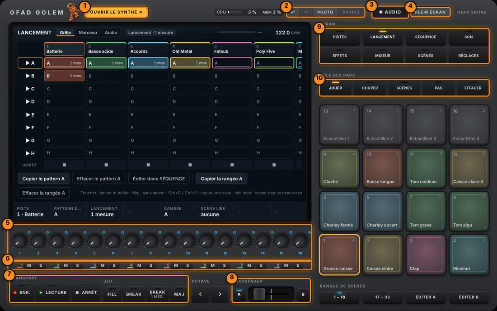<figcaption>Where the main controls are</figcaption></figure>

1. **Open the synth**: the track's instrument panel, full size.
2. **Undo / Redo** (Ctrl + Z / Ctrl + Y), **Photo** and **Recall** of all settings, **Knob mods**.
3. **Audio**: the AUDIO screen — record the master, tracks, returns or the input, with an effects chain (long press: start right away).
4. **Full screen** (F11).
5. The **rail**: the **8 screens** (Track, Clips, Seq., Sound, FX, Mix., Scene, ⚙ Settings).
6. **Live** (live view: crossfader or vector, 16-track console) and **Play view** ("Jeu": pads, 16 knobs, Fill / Break, crossfader, tempo).
7. **Play** and **Stop** (space bar).
8. **Rec**: record into the pattern.
9. **Pads**: fold out the 16 pads on the right of the screen, on every screen.
10. The **values at the bottom** of the screen: drag ↑↓ to adjust, long press for the menu.

On a phone, undo / redo and **Audio** are in each screen's status bar; Photo, Recall and Knob mods are in the
**Play view**.

### Pads on the computer keyboard (AZERTY)

| Keys (top to bottom, like the pads) | Pads |
|---|---|
| **1 2 3 4** | 13 to 16 (top row) |
| **A Z E R** | 9 to 12 |
| **Q S D F** | 5 to 8 |
| **W X C V** | 1 to 4 (bottom row) |
| **Shift** + key | Accented hit (full velocity) |

The keys follow the chosen pad role (Play, Mute, Solo, Scenes, Steps), whether the pads are folded out or not.

<figure class="pads">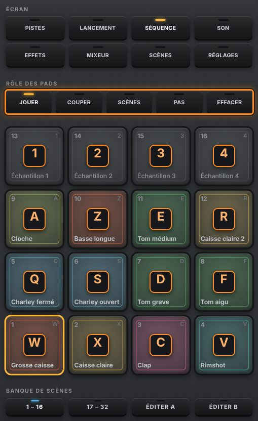<figcaption>The keyboard key on each pad (the same small letter is shown in the top right corner of each pad)</figcaption></figure>

### Knobs and values (synth panel knobs, values at the bottom of the screens, assignable knobs)

| Gesture | Action |
|---|---|
| Drag up / down | Adjust |
| **Shift** + drag | Fine adjustment |
| Mouse wheel | One step (**Shift** + wheel: fine step) |
| Double-click (double tap with a finger) | Default value |
| Arrows ↑ ↓ ← → (knob selected) | One step (**Shift**: fine step) |
| Right-click (long press with a finger) | Menu: exact value, modulation, Learn MIDI, assignable knob (and macros, on a synth panel) |
| Mixer: double-click on a fader | Default value; double-click on a group name: rename it |
| Crossfader: double-click | Back to the middle |

**The values at the bottom of the screens** (Swing, Length, Division, X, Y, Crossfader, Scene A…) are
adjusted by dragging on them. A **long press** (right-click on PC) opens their menu, the same
everywhere: exact value (list of choices or a number to type), **Learn MIDI**, **drive with knob 1 to
16**; modulation only appears for a sound, effect or mix setting. The synth **macros** are only offered
on a synth panel.

<figure class="wide">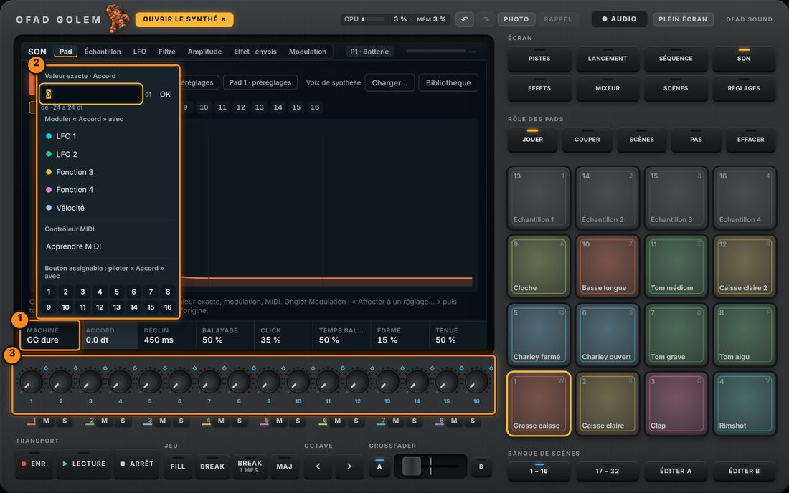<figcaption>Adjusting a value and handing it to a knob</figcaption></figure>

1. A **value at the bottom of the screen**: drag, double-click.
2. Its **menu** (long press, right-click): exact value, modulation, Learn MIDI, knob 1 to 16.
3. The **16 assignable knobs**.

**The 16 assignable knobs** replace the old encoders: they no longer change with the screen, each one
keeps the value you gave it. On PC and tablet they sit in one row of 16; on a phone, in two rows of 8.
A **blue diamond** marks them: hollow when the knob is free, filled when it drives something (its name is
written under the number). The full travel, from 0 to maximum, takes **a single gesture**.

<figure class="wide">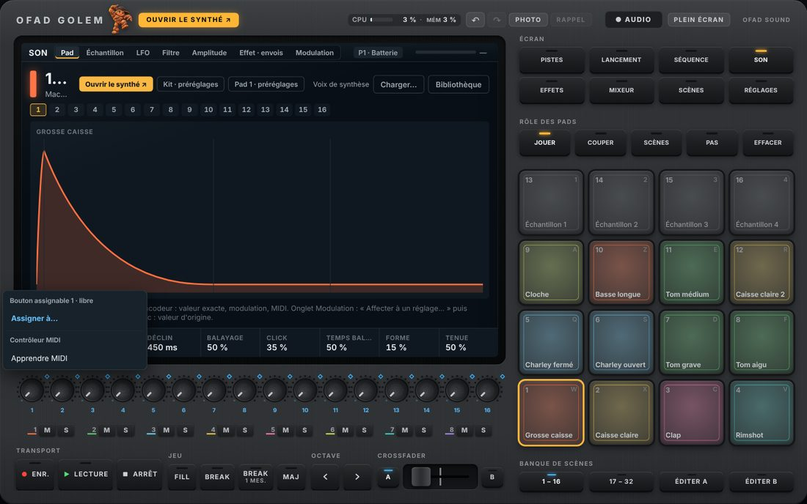<figcaption>Long press on an assignable knob</figcaption></figure>

- **Long press** (right-click) on a knob › **Assign to…**: the knob **blinks blue** and everything that
  can be driven is **underlined in dotted blue**. Touch the value you want: a value at the bottom of a
  screen, a synth or effect knob, a macro, the crossfader, the tempo, Play, Fill, an M / S… You can
  change screen or open a synth before touching. **Esc** cancels.
- **Free the knob**: it no longer drives anything.
- **Modulate the knob**: the 16 knobs have **their own modulation sources** (4 sources: LFO, function,
  follower or sequencer), independent from the synths' ones: a setting can be modulated both by the
  synth's LFO and by the knob's. The knob menu offers these 4 sources, the **depth** (−100 to +100 %)
  and "Remove modulation"; a coloured dot shows the source and the knob moves with it. Removing the
  modulation or freeing the knob puts the setting back as it was. Everything the knob drives can be
  modulated (sound, effects, mix, crossfader, vector pad, macros), except the tempo and the commands.
- **Knob mods** (next to Photo / Recall, at the top on PC, under the 16 knobs on phone and tablet) opens
  the panel of these 4 sources, the same as a synth's modulations: shape, tempo sync, speed, phase…;
  **Assign to a knob…** then touch the knobs to modulate.
- **Learn MIDI**: a knob or fader on the controller turns this knob.

<figure class="wide">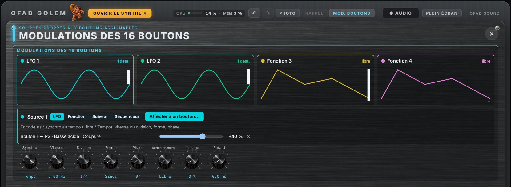<figcaption>Knob mods: the 4 sources of the 16 knobs</figcaption></figure>

<figure class="wide">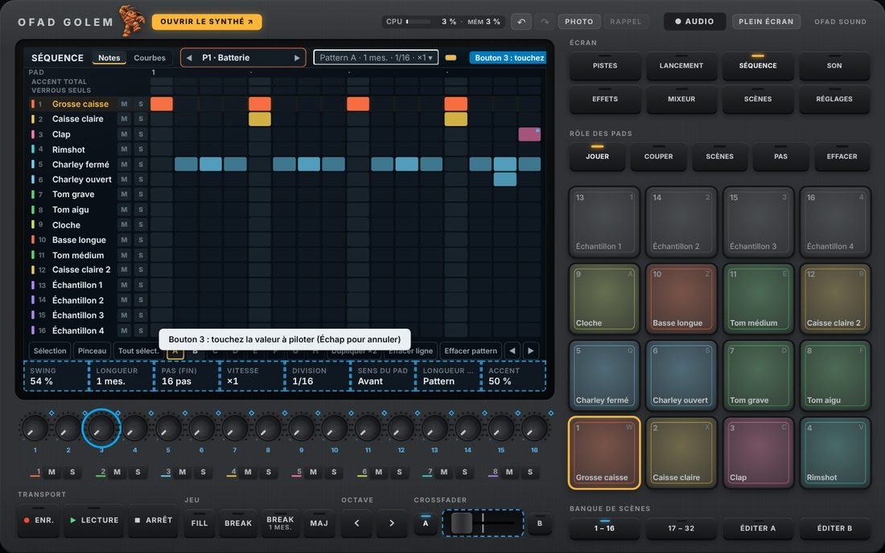<figcaption>Knob 3 is waiting: touch the value it should drive</figcaption></figure>

Values that belong to one screen (Length, Division, Family…) follow their knob while the interface is
open; after opening a project, show the screen concerned once. Sound, effects, tempo, swing,
crossfader, scenes, vector pad and macros always respond.

### SEQUENCE screen (notes and steps)

| Key or gesture | Action |
|---|---|
| Click on a cell | Add / remove a step (or a note) |
| **P** | Brush: dragging writes one step per cell crossed |
| **Ctrl** + click | Add to / remove from the selection |
| Drag from an empty cell | Selection rectangle (**Shift**: adds) |
| Drag a selection | Move it; **Ctrl** (or Alt) + drag: copy it |
| **Ctrl + A** | Select all |
| **Ctrl + C / Ctrl + X / Ctrl + V** | Copy / cut / paste under the mouse |
| **Ctrl + D** | Duplicate right after |
| **Delete** (or Backspace) | Clear the selection |
| **Esc** | Empty the selection |
| Arrows ← → | Move by one step (**Shift**: by one bar) |
| Arrows ↑ ↓ | Note: one semitone (**Shift**: one octave); drums: next pad |
| Right-click on a step | Step settings (velocity, duration, condition, locks) |
| Touch an **Accent** / **Slide** cell | Turn the step's accent or slide on / off |
| Long press (right-click) on an **Accent** / **Slide** cell | The step's value: accent strength, slide time |
| ◀ ▶ next to the pattern (or the small dots) | Turn pages (one page = 16 steps) |
| **Shift** + Octave ◀ ▶ (Play view) | Previous / next page |
| **Rec** then play | The notes you play are written into the pattern (quantise: Settings) |
| Touch a **lane name** (drum kit, T1 to T8, T1 to T4) | Select the lane and **hear its sound** while the finger stays down |
| Long press (right-click) on **A … P** under the sequence | Assign that pattern to the MIDI controller (it launches it on the chosen track) |
| **◀ Pads** | Fold out the pads next to the sequence to play while writing |

<figure class="wide">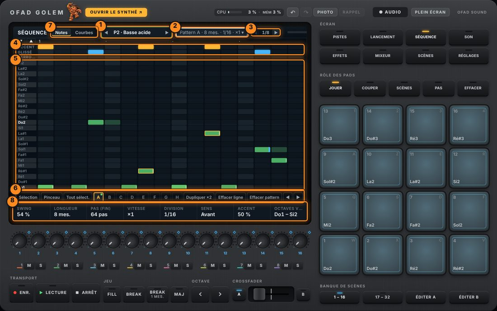<figcaption>The SEQUENCE screen of a melodic instrument (here the acid bass)</figcaption></figure>

1. The **track** shown (◀ ▶ or the list).
2. The **pattern**: number of bars (1 to 32), division (1/16, triplets…), speed.
3. **Turn pages**: ◀ ▶ and "page / total" (dots up to 4 pages).
4. The **Accent** and **Slide** lines (and "Locks only": the step sets its settings without playing).
   Long press on a cell: its value (see "A step's value").
5. The **piano roll**: each step gets whatever note you want, up to 4 notes per step (chords).
6. **Select**, **Brush**, select all, patterns **A to P** (8 at a time; the small "I–P" / "A–H" chip shows the other page), duplicate, clear.
7. **Notes / Curves**: the knob movements recorded with **REC** in this pattern.
8. The **track settings** when no step is selected (swing, length, speed…) — see "3. Writing a sequence".

### CLIPS screen › Grid

| Key or gesture | Action |
|---|---|
| Touch a cell | Launch and edit the pattern |
| **Shift** (button) + touch | Edit without launching |
| **Ctrl + C** then a cell, **Ctrl + V** | Copy a pattern to another cell (same track or another track) |
| ▶ at the head of a row | Launch the same letter on all tracks (and the scene linked to the row) |

<figure class="wide">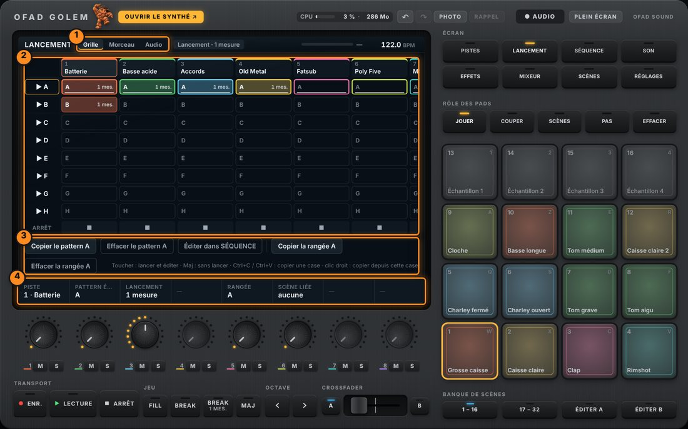<figcaption>CLIPS › Grid</figcaption></figure>

1. The **Grid**, **Song**, **Audio** tabs.
2. The **grid**: one column per track, one cell per pattern; ▶ launches a row, ■ stops a track. The 16 rows (A to P)
   are shown 8 at a time: **A–H** / **I–P** in the top left corner.
3. Copy, clear or edit the selected pattern or row.
4. The values at the bottom: track, edited pattern, **launch quantise**, row, **linked scene**.

### CLIPS screen › Song and curves

| Key or gesture | Action |
|---|---|
| **Ctrl** + wheel | Zoom the timeline |
| Curve editor: **Shift** + drag | Draw a straight line |
| Curve editor: right-click + drag | Erase |

<figure class="wide">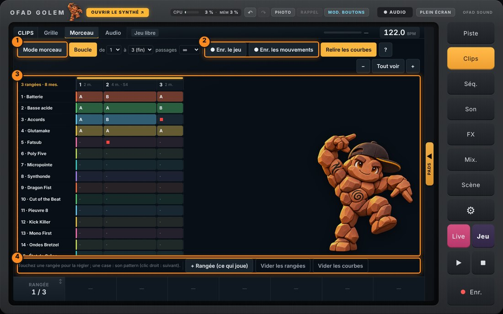<figcaption>CLIPS › Song</figcaption></figure>

1. **Song mode** (the rows play one after another) or **Loop** (the grid plays).
2. **● Rec performance** (your playing becomes rows) and **● Rec motion** (knobs, faders, mutes, solos, crossfader as curves).
3. The **rows** played one after the other; the **curves** below.
4. Add what is playing as a row, clear the rows or the curves.

### CLIPS screen › Audio (arrangement)

| Key or gesture | Action |
|---|---|
| Drag a clip | Move it (also to another track) |
| Drag the edge of a clip | Trim it |
| **Ctrl** (or Shift) + click | Select several clips |
| Drag a rectangle in empty space | Select the clips it touches (**Ctrl**: adds) |
| **Ctrl + A** | Select all clips |
| Right-click on a clip | Menu: split here, copy, duplicate, volume to 0 dB, delete |
| Right-click in empty space | Menu: paste here, playhead here, select all |
| ✂ tool, or **S** key | Split (S: at the playhead) |
| **Ctrl + C / Ctrl + V** | Copy / paste at the playhead |
| **Ctrl + D** | Duplicate right after |
| **Delete** (or Backspace) | Delete |
| **Ctrl + Z / Ctrl + Y** | Undo / redo (arrangement) |
| Click on the ruler (drag: move it) | Place the playhead — the next take lands there |
| Right-click (or **Shift**) + drag on the ruler | New loop |
| Drag the orange loop bar | Move the loop; its edges: lengthen or shorten it |
| **Loop** on + "● Record a take" | The take lasts exactly the loop and **stops by itself** at its end |

<figure class="wide">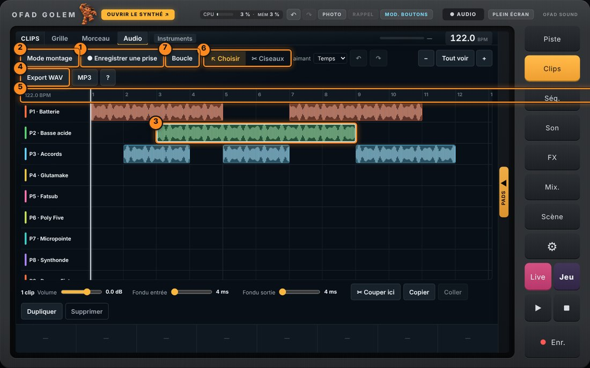<figcaption>CLIPS › Audio (arrangement)</figcaption></figure>

1. **● Record a take** (it lands at the playhead, or at the start of the loop when Loop is on).
2. **Arrange mode**: playback plays the clips instead of the instruments.
3. A **clip**: drag, trim by the edges, right-click: menu.
4. **WAV / MP3 export** of the finished arrangement.
5. The **ruler**: click = playhead; right-click (or Shift) + drag = loop (orange bar).
6. **Select** / **Scissors** tools and snap (bar, beat, 1/16, free).
7. **Loop**: when it is on during a take, it sets the take's length to the step.

## Getting started

- At launch, the mascot shows while loading, then the **home screen**: resume the last session, new
  empty project, **Techno demo** or **Tribe demo** (1.1), open a file, or a project from the folder. (Settings › "Home screen at
  startup" to show it or not.)
- **Language**: French or English, chosen when installing (Windows) or at the first launch (Android); change
  it at any time in Settings › Project (**Français / English**).
- Sound card: **Options** (top left of the window) › Audio/MIDI Settings. For the lowest latency: the
  sound card's ASIO driver or "Windows Audio (Low Latency Mode)", buffer of 128 to 256 samples.

<figure>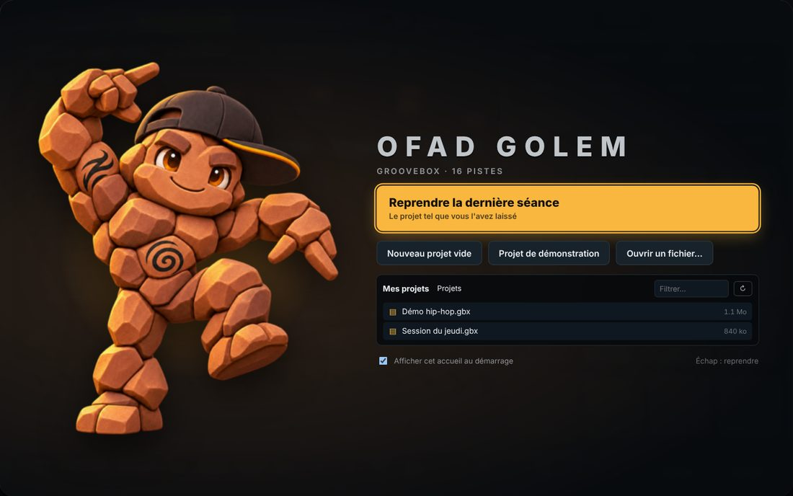<figcaption>The home screen at launch: resume, new project, demo, open, projects in the folder</figcaption></figure>

## The device: a single view

Since 1.0, GOLEM has **a single view**, the same on computer, tablet and phone: **the screen takes all the space**
and a **rail** on the right gives everything else.

- **Rail**: the **8 screens** (Track, Clips, Seq., Sound, FX, Mix., Scene, ⚙ Settings), **Live** and **Play view**,
  **Play / Stop**, and **Rec** at the bottom.
- **Fold-out pads**: the yellow **◀ Pads** tab, on its own strip at the right edge of the screen, folds out the 16
  pads next to the chosen screen, on every screen. Edit the sequence, the mixer or the sound on the left and play
  the track on the right. **▶ Pads** folds them back; GOLEM remembers the choice.
- The pad panel: the **played track** (◀ ▶ or list), the **pad role** (Play, Mute, Solo, Scenes, Steps), the 16
  pads, the **scene bank** (1 – 16, 17 – 32) and **Edit A / B**. On a drum kit in Mute or Solo, "Drum sounds /
  16 tracks" chooses what the pads mute.
- **Values at the bottom** of each screen: adjust them with a finger or the mouse (drag ↑↓), long press for the menu.
- **Top bar** (computer): "Open the synth", CPU load, undo / redo, Photo, Recall, Knob mods, Audio recording,
  full screen. On a phone, undo / redo and Audio are in each screen's status bar.
- The **computer keyboard** always plays the pads (even folded): space, B, N and the pad keys.

<figure class="wide">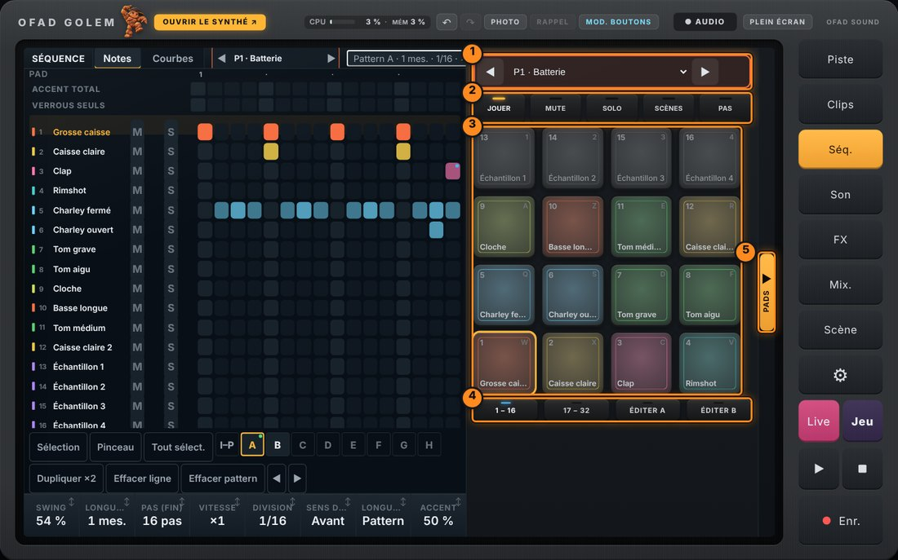<figcaption>The pads folded out next to the Sequence screen</figcaption></figure>

1. The played track. 2. The pad role. 3. The 16 pads. 4. Scene bank, Edit A / B. 5. Fold the pads back.

<figure>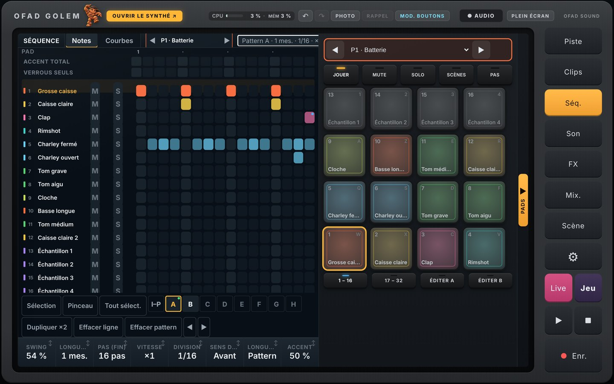<figcaption>Sequence and pads side by side (computer)</figcaption></figure>

<figure>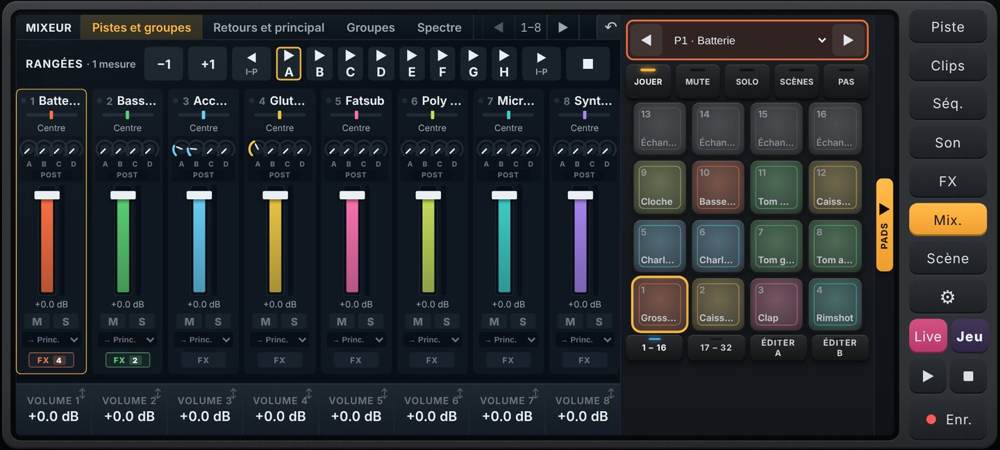<figcaption>The mixer with the pads folded out (phone)</figcaption></figure>

### The Play view

**Play view** ("Jeu" on the rail) replaces the screen with a full playing surface: the played track (◀ ▶), **rows A
to H**, the 16 pads and their role, the **16 assignable knobs**, **Photo / Recall / Knob mods**, **Fill, Break,
Break 1 bar, Shift**, octave and **crossfader**, the **tempo** (− / value / + / Tap). Touch **Play view** again, or a
screen on the rail, to close it.

In the Play view, **Mute** and **Solo** act on the **16 mixer tracks**; each pad keeps its **track colour** (greyed:
muted; blue frame: solo). Elsewhere, on a drum kit, the FM Player or Pieuvre 8, they can mute the sounds or the
inner tracks.

<figure class="wide">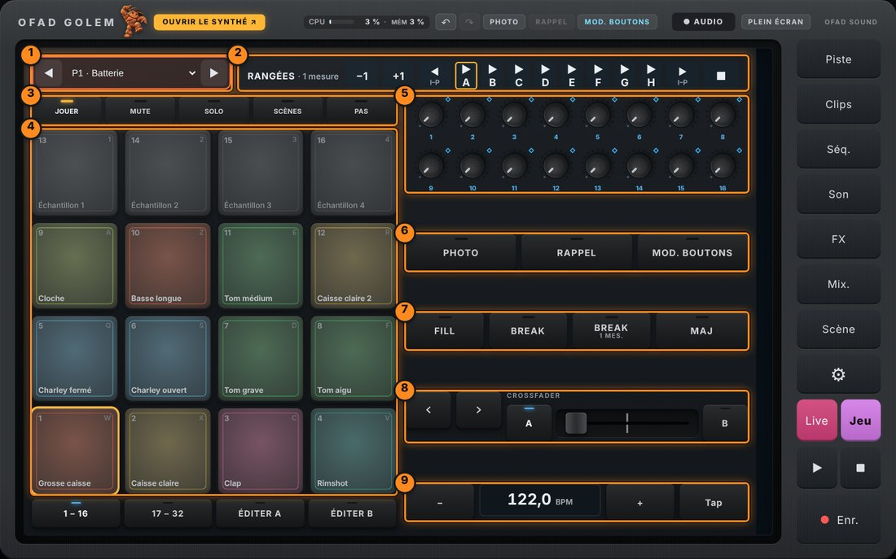<figcaption>The Play view</figcaption></figure>

1. Played track. 2. Rows A to H. 3. Pad role. 4. The 16 pads (Mute / Solo: the 16 tracks). 5. The 16 assignable
knobs. 6. Photo, Recall, Knob mods. 7. Fill, Break, Break 1 bar, Shift. 8. Octave and crossfader. 9. Tempo.

<figure>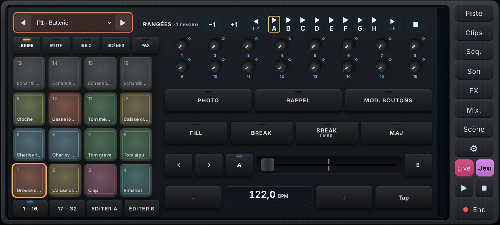<figcaption>The Play view on a phone</figcaption></figure>

## Editing basics

### 1. Choosing a sound

TRACKS screen: choose the instrument of each track (or "⇄ Instrument" on the panel, with pictures).
**Presets** are chosen by category.

<figure>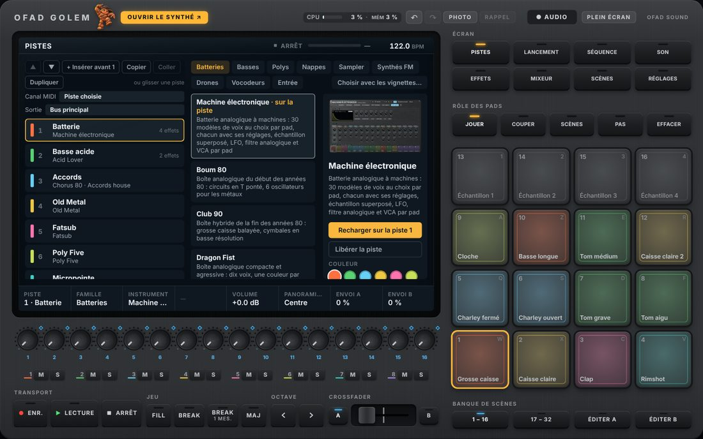<figcaption>TRACKS screen: the instrument, name and colour of each track</figcaption></figure>

### 2. Playing

The pads, the computer keyboard, the panel's keyboard or a MIDI controller (notes go to the track
shown). "Open the synth" shows the instrument panel full size.

<figure>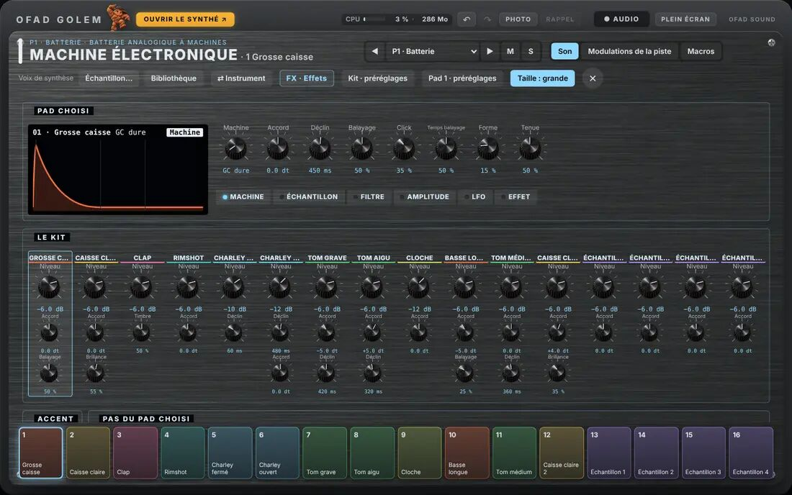<figcaption>An instrument panel (here the drum machine kit): all its settings, its pads or its keyboard</figcaption></figure>

**The header of every panel** always has three lines, on PC as on a phone: 1. the instrument name, the
transport (● ▶ ■), the track selector (◀ ▶, M, S) and ✕ to close; 2. the pages (Sound, Steps, Track
modulations, Macros…), which scroll sideways when there are many; 3. the tools: sample and library (if
the instrument has them), ⇄ Instrument, FX · Effects, Presets.

### 3. Writing a sequence

Each track has **16 patterns** (A to P), from 1 to 32 bars. A sequence can be written in three ways, as
you like — it is **always the same sequence**: a step set on the panel shows up at once in the SEQUENCE
screen, and the other way round.

- **With the mouse**, SEQUENCE screen: one line per pad (drums) or a piano roll (melodic instrument),
  where **each step gets whatever note you want** (up to 4 notes per step for chords).
- **By playing**: **Rec**, then play the pads, the panel's keyboard, the computer keyboard or the MIDI
  controller, in time. The notes are written into the pattern while it loops (quantise from 0 to 100 %
  in Settings; the rest of the timing offset is kept). **REC** also records the **movements** of the
  track's knobs as curves in the pattern (Curves tab).
- **On the synth panel**, in "Sequence steps", with two writing modes to choose from ("Writing"):
  **Acid** or **Locks**. The choice is kept, and the same everywhere. On melodic synths, the chosen row
  is also **above the keyboard**, on every page of the panel: you write your steps without leaving the
  Sound page. **Hide ▾** folds it away (more room for the settings), **Show ▴** brings it back.
- **Step** pad role: the 16 pads set or remove the steps of the page shown, like a drum machine's step
  programming.

<figure class="wide">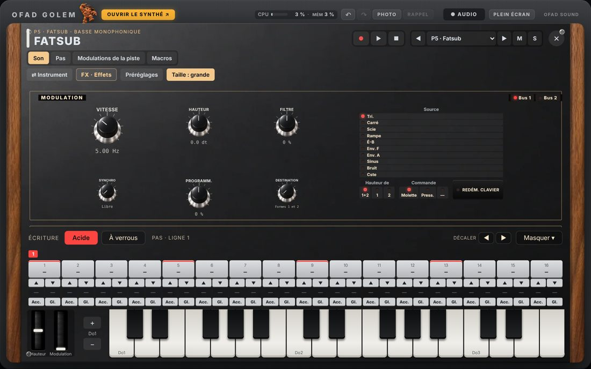<figcaption>The step row above the keyboard: Writing Acid or Locks, Nudge, Hide</figcaption></figure>

**The acid sequencer** (basses and synths): the 80s step row, step by step.

<figure class="wide">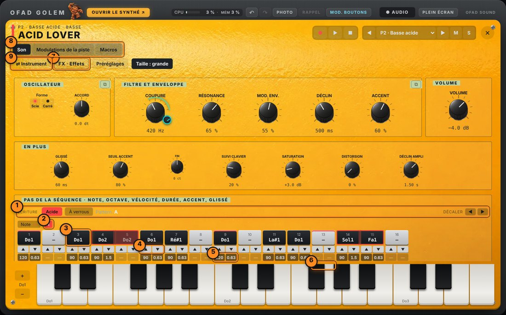<figcaption>Bass panel: "Acid" writing</figcaption></figure>

1. **Writing**: Acid or Locks.
2. The **pages** of 16 steps (one button per page when the pattern is longer).
3. The step's **note**: touch to set or remove the step; drag up or down (or the wheel) to change the
   note by a semitone.
4. **▲ ▼**: one octave up or down.
5. Step **velocity** and **duration** (drag on the value).
6. **Acc.** (accent: the step plays louder and with more "bite", set by the Accent knob) and **Sl.**
   (slide: the note holds until the next step and glides to it; same note: tied, without
   retriggering). Touch: on / off; **long press**: the step's value (see below).
7. **FX · Effects**: the track's effects as pedals (see 5).
8. **Sound · Track modulations · Macros**: the other pages of the panel.
9. **⇄ Instrument**: change instrument with pictures.

**A step's menu**: a **long press** on the note of a set step opens its menu under the row, in large
buttons (handy on a phone): **Accent** and **Slide** (touch: on / off; "…": their amount), **Octave**
▼ ▲, **note**, velocity, length, offset, condition, probability, repeats. The selected step gets an
**orange frame** and "**Step 3 selected ✕**" lights up above the row: its settings change that step only.
The keyboard does not change its note (use **Note** ◀ ▶, or drag the note up or down); it picks the note of
the steps you place next. ✕, or touching another step, closes the menu.

<figure class="wide">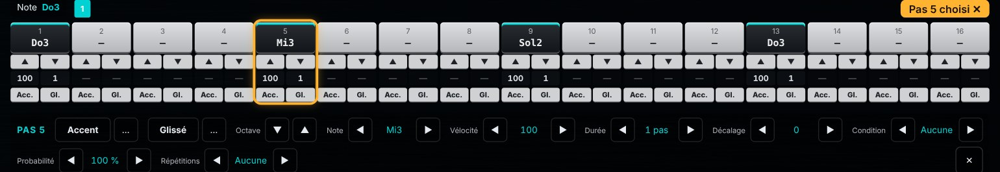<figcaption>Acid writing: step 5 selected, orange frame, "Step 5 selected ✕" lit</figcaption></figure>

<figure class="wide"><figcaption>Long press on a step: its menu, with large Accent and Slide</figcaption></figure>

**The locks sequencer**: each step can keep its own settings (cutoff, resonance, effects…), on top of
its note.

<figure class="wide">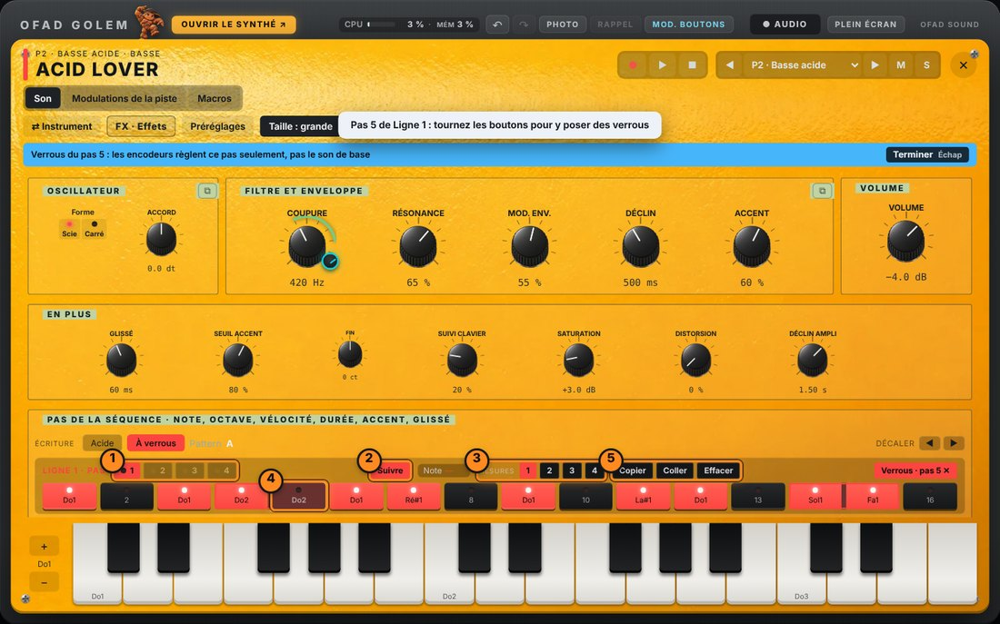<figcaption>Bass panel: "Locks" writing, step 5 selected</figcaption></figure>

1. **Pages 1 to 4** (16 steps each): touch a page to show it.
2. **Follow**: the page turns by itself with playback (touching a page stops following).
3. **Bars**: length of the line, 1 to 4 bars (the pattern grows if needed).
4. A **selected step** (long press on the step, or the **Locks** button then touch the step): turn any
   knob on the panel, the pedalboard or the SOUND screen — the value is **locked on that step** only.
   The step gets an orange frame and the **Locks** button lights up with its number ("**Locks · step 5 ✕**",
   visible even on a phone); a banner at the top reminds you too. Touching Locks, Esc or "Done" releases the
   step; so does placing or removing a note on another step. In **Acid** writing, the same "Locks · step 5 ✕"
   button lights up above the row while that step is selected.
5. **Copy / Paste / Clear** the locks of the selected step ("No locks": all those of the line).
6. **Glide** and **Mute** (as soon as the line has locks): **Glide** makes the settings travel smoothly from one
   lock to the next, over the step's length, instead of jumping at the start of the step; **Mute** silences the
   line's locks without deleting them (the steps play the base sound) — touch **Muted** to bring them back. Both
   are saved with the project. A lock only plays on a step that holds a note.

<figure class="wide">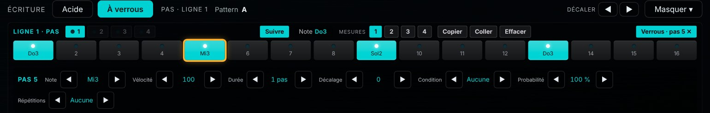<figcaption>"Locks" writing: step 5 selected, "Locks · step 5 ✕" button lit</figcaption></figure>

On synths, the locks row writes **the last note played** (pads, the panel's keyboard, or a MIDI keyboard
while stopped): it is shown ("**Note** F1") and each step set shows its note instead of its number. A
selected step (long press) opens its **menu** under the row: note, velocity, length, offset, condition,
probability, repeats. The keyboard does not change the note of a step already set: **Note** ◀ ▶ in its menu.

<figure class="wide"><figcaption>"Locks" writing: the selected step's menu</figcaption></figure>

**Note length**: in Acid and Locks writing, a note lasting several steps gets a large frame along its
whole length, filled inside, and the steps it covers show its note in small. You can see a note is
still sounding, and place another note on top. To lengthen or shorten a note: **length** in the step's
menu.

<figure class="wide"><figcaption>Acid writing: a three-step note, framed along its whole length</figcaption></figure>

<figure class="wide"><figcaption>"Locks" writing: the same frame</figcaption></figure>

**Removing a note** resets its step: length, offset, accent, slide, condition, probability, repeats and
locks. The next note placed there starts from fresh settings.

**Nudge ◀ ▶**: the whole writing slides one step left or right, wrapping around (the step that falls off
comes back on the other side); notes, accents, slides, conditions and locks follow. On the panel: to the
right of "Writing" (drums: **All** or the selected **Pad** only), or in the locks row (that line only);
in the SEQUENCE screen: ◀ ▶ after "Clear pattern" (**Shift**: the selected line only).

**Panel transport**: on the first line of every panel, just left of the track selector, **●** record,
**▶** play (**❚❚** to stop), **■** stop — without leaving the instrument.

**A step's value: accent and slide.** In the SEQUENCE screen (**Accent** and **Slide** lines) as on the
panel (**Acc.** and **Sl.**), a touch turns the step's function on or off; a **long press** (right-click on
PC) opens its value, full size:

- **Accent**: the strength of this step's accent, from 1 to 100 %. With no value, the step takes the
  track's accent (the Accent setting at the bottom of the screen).
- **Slide**: the glide time to the next note, from 1 to 100 % of the step (the higher, the longer the
  glide), on synths that have portamento. With no value: the instrument's portamento.
- **▲ ▼** (held, the value scrolls), **drag** your finger on the value, or **Type…**; **Default** goes back
  to the track's or instrument's value. Every change is heard at once, and the window stays open while you
  adjust. Setting a value turns the step's function on.
- A cell that has its own value shows it (for example "54"). Values follow copy, nudge and undo, and are
  saved in the project.

<figure class="wide">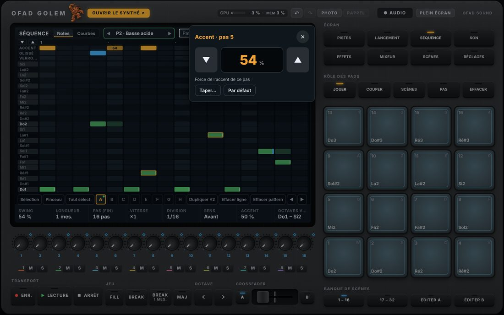<figcaption>The accent strength of a step</figcaption></figure>

In the SEQUENCE screen, right-clicking a step opens the same settings: velocity, duration, offset,
**note**, condition (probability, A:B, Fill…), repeats, flam, and the **Locks** button.

**Turning pages**: a page shows 16 steps (one bar in 1/16). In the SEQUENCE screen, ◀ ▶ at the top (or
the dots), or **Shift** + Octave ◀ ▶ on the transport; on the panel, the page buttons (and **Follow** in
Locks writing); for the pads in Step role, the page shown is the one being written.

#### Track settings (no step selected)

The values at the bottom of the screen set the track's pattern:

| Value | Action |
|---|---|
| **Swing** | Shifts every other step (50 %: straight, up to 75 %) |
| **Length** | Number of bars of the pattern (1 to 32) |
| **Steps (end)** | Length to the step (e.g. 15 steps for an odd loop) |
| **Speed** | ×1/8 to ×2: the pattern plays slower or faster than the tempo |
| **Division** | Length of a step: 1/4, 1/8, 1/16, 1/32, 1/64, or triplets |
| **Direction** (drums: **Pad direction**) | Forward, backward, ping-pong, random |
| **Pad length** (drums) | A line that loops on its own length (polyrhythms) |
| **Accent** | Strength of the steps on the Accent line |
| **Visible octaves** (melodic) | The octaves shown in the piano roll |

#### Step settings

A **first click** on a set step **selects** it (it gets a frame); a second click removes it. With the
step selected, the values at the bottom of the screen set **that step only**:

<figure class="wide">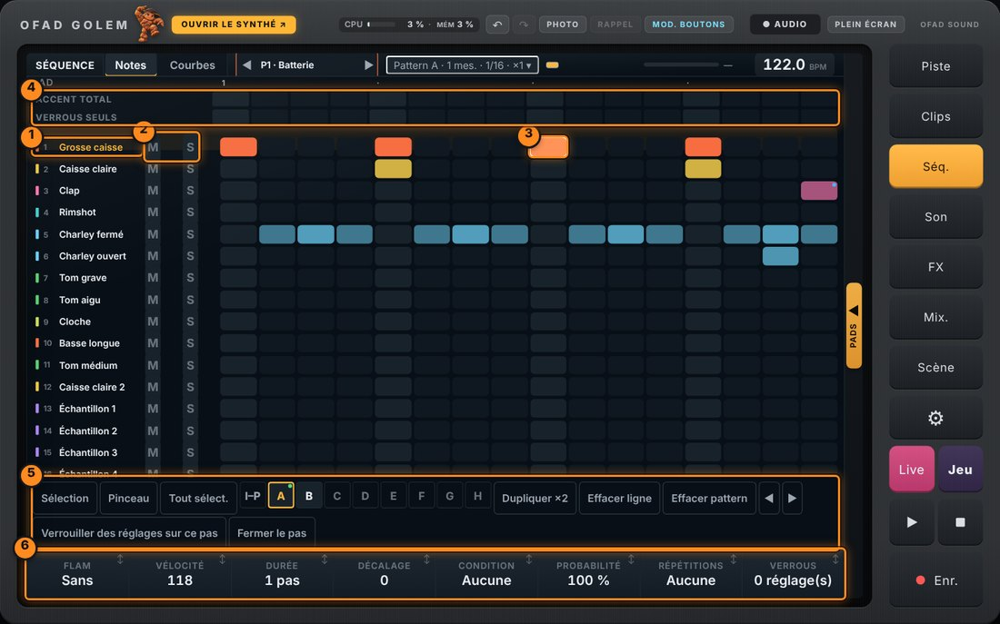<figcaption>A kick drum step selected: its settings at the bottom</figcaption></figure>

1. The **line** (a pad of the kit): touching its name selects it and all its steps (once more: deselects
   them).
2. **M / S** of the line: mute or solo a line.
3. The **selected step**.
4. The **Accent** lines (here "Total accent": every sound of the step louder) and **Locks only**.
5. The **tools**: Select, Brush, Select all, patterns A to P (right-click: launch it), Duplicate ×2,
   Clear line, Clear pattern, ◀ ▶ Nudge; for the selected step: "Lock settings on this step", "Close
   the step", "Remove condition and locks".
6. The **step settings**:

| Value | Action |
|---|---|
| **Note** (melodic) or **Flam** (drums) | The step's note; or a small hit just before the main one (8 to 60 ms) |
| **Velocity** | The **volume** of the hit (1 to 127) |
| **Duration** | How long the note holds (from 1/8 of a step to several bars) |
| **Offset** | Push the step slightly early or late (± 32/64 of a step): "human" feel |
| **Condition** | When the step plays (see the table below) |
| **Probability** | Chance that the step plays (0 to 100 %), on top of the condition |
| **Repeats** | 2 to 8 hits within the step (rolls), at equal, decreasing ↘ or increasing ↗ strength |
| **Locks** | Turn it right: the knobs of every screen write into this step |

**Step sound (1.1)**: in the **Locks** row under the keyboard, a step's details have a **Sound** list. Pick a
preset of the instrument (numbered as for program change: "Init" = 1, the factory sounds bank by bank, then
yours): **this step plays with that sound**, and the track goes back to its own sound at the next step without
a locked sound. The step shows "S12". Locks on the same step override the chosen sound. "— track's sound —"
removes the step sound. On a **MIDI track**, it is the device's sound (program), and the bank is locked too, with
the **Bank** list of the top bar (see § 14).

<figure>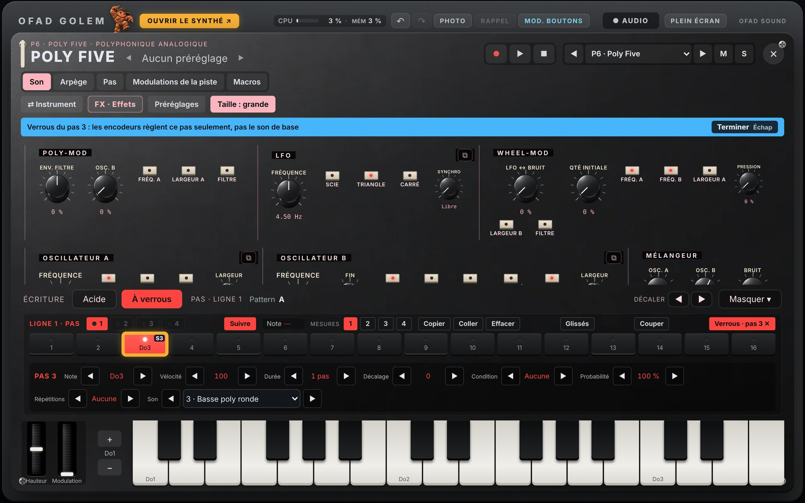<figcaption>Step sound: step 3 plays the instrument's sound no. 3 ("S3" mark)</figcaption></figure>

#### Conditions: steps that don't play every time

A condition makes a step play only in certain cases: that is what brings a short loop to life, with
variations and small fills without writing other patterns.

| Condition | The step plays… |
|---|---|
| **None** | every time |
| **A:B** (1:2, 2:2, 1:4, 3:4…) | on pass A out of B: 1:2 = every other loop (the 1st), 4:4 = on the 4th loop only |
| **FILL** | only while **Fill** is held (or Break): the fills |
| **NOT FILL** | only while Fill is **not** held (what goes silent during the fill) |
| **PRE** / **NOT PRE** | if the last conditional step on the same line played / did not play |
| **NEIGHBOUR** / **NOT NEIGHBOUR** | if the last conditional step on the line above played / did not play |
| **1ST** / **NOT 1ST** | only on the pattern's first loop / on every loop except the first |

#### Fill and Break: live fills and drops

- **Fill** (Play view, live view, or **N** key held): while it is held, the **FILL** steps play and the
  **NOT FILL** steps go silent. In the same pattern you can prepare a snare fill, a tom roll (with
  **Repeats** ↗), an open hi-hat… which only appear when you press: mini-breaks on demand.
- **Break** (button, or **B** key held): applies the **Break scene** while it is held — it's a scene like
  any other (set in the SCENES screen): for example kick muted, filter closed, echo pushed. Break **also
  triggers Fill**: FILL steps play at the same time.
- **Break · N bars** (timed Break): Break for 1, 2, 4, 8 or 16 beats, then it stops by itself on a beat
  (**Shift** + press: change the length).
- With **Shift** on, Fill and Break latch instead of being held.

#### Selecting, clearing, deleting everything

<figure class="wide">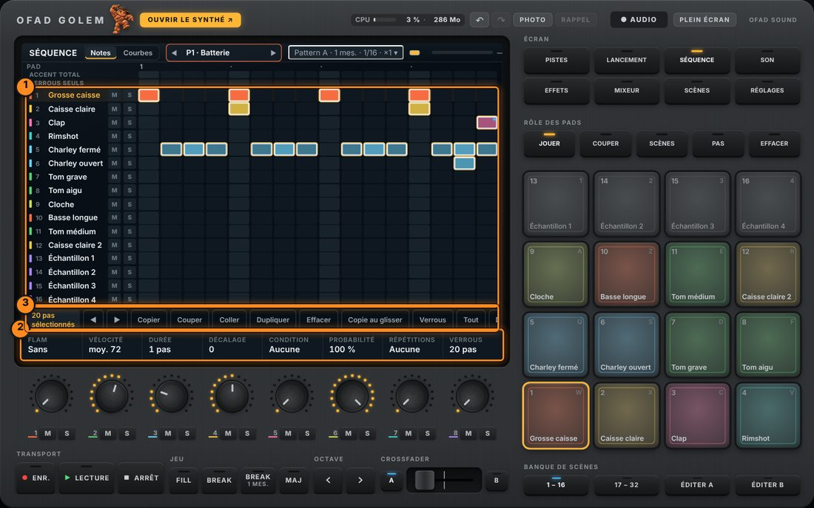<figcaption>"Select all": the 20 steps of the pattern selected</figcaption></figure>

1. The **selection**: selected steps are framed.
2. The values at the bottom set **all the selected steps at once**: velocity (average; the differences
   between steps are kept), duration, offset, condition, probability, repeats, locks; on melodic
   instruments, "Transpose".
3. The **selection bar**: ◀ ▶ (nudge one step), Copy, Cut, Paste, Duplicate, Clear, Copy on drag,
   Locks, All.

**A single selected step** (Select mode or rectangle) opens **its menu**, like a chosen step: note,
velocity, length, offset, condition, probability, repeats, locks.

The gestures:

- **Select**: **Ctrl + A** or "Select all" (the whole pattern); the name of a line (all its steps);
  **Ctrl** + click (one step more or less); drag a rectangle from an empty cell; with a finger, the
  **Select** button then touch the steps.
- **Clear the selection**: **Delete** (or "Clear" in the bar).
- **Clear a line**: "Clear line" (the selected line: the pad, on drums).
- **Delete everything**: "**Clear pattern**" empties the whole pattern shown (notes, conditions, locks);
  the other patterns are untouched.
- A step keeps its note but loses its conditions and locks: "Remove condition and locks".
- A mistake? **Ctrl + Z** undoes (50 steps).

<figure>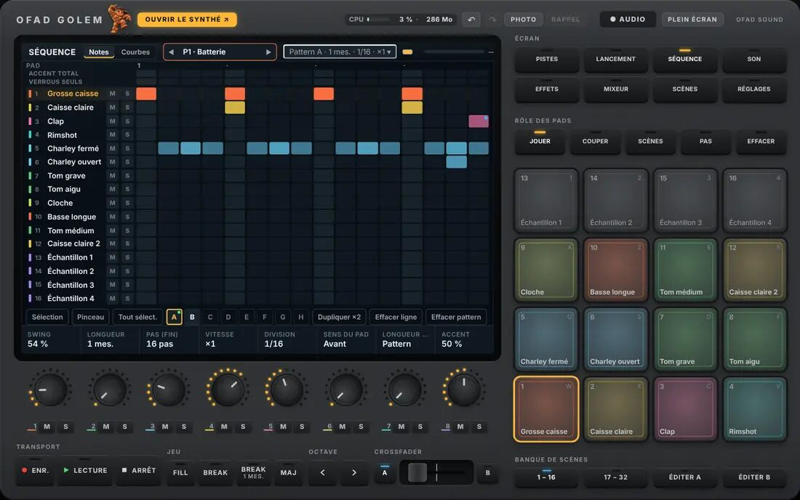<figcaption>SEQUENCE screen: one line per pad (drums) or a piano roll (melodic instrument)</figcaption></figure>

### 4. Launching

CLIPS › Grid screen: each cell launches a pattern (at the start of the next bar); ▶ at the head of a row
launches the same letter on all tracks; ■ stops a track.

**16 rows, on two pages.** Each track has 16 patterns: the rows go from **A to P**. The **Rows** bar
(Mixer, Scenes, live view) shows them on a single line, 8 at a time:

- **◀ / ▶** (labelled "I–P" or "A–H") turn the page. They get a yellow outline when the row that is
  playing is on the other page.
- **−1 / +1** launch the previous or next row and **turn the page by themselves** (from H, +1 goes to I).
  They **skip empty rows**: if I to P are not written, +1 from H goes back to A.
- The page follows the row launched, also from the MIDI controller or the song, and it is the same
  everywhere (rows bar, CLIPS grid).
- From a MIDI controller, each of the 16 rows can be learned (right-click on its button), like −1 / +1 and ■.

### 5. Shaping the sound

**One instrument, three views, the same settings.** A track's sound is set:

- on the **synth panel** ("Open the synth"): all its knobs, like on the machine;
- in the **SOUND screen**: the same settings in tabs, at the bottom of the screen, with the presets;
- as **pedals** ("FX · Effects" on the panel): the track's 4 insert effects as a pedalboard, over the
  instrument (Esc goes back to the instrument); the **EFFECTS screen** shows the same effects in signal
  order.

Everything is linked: turning the cutoff on the panel also turns it in the SOUND screen, an effect
changed as a pedal also changes in the EFFECTS screen. Step locks, scenes, modulations, macros and MIDI
learn work the same way from all three views.

<figure>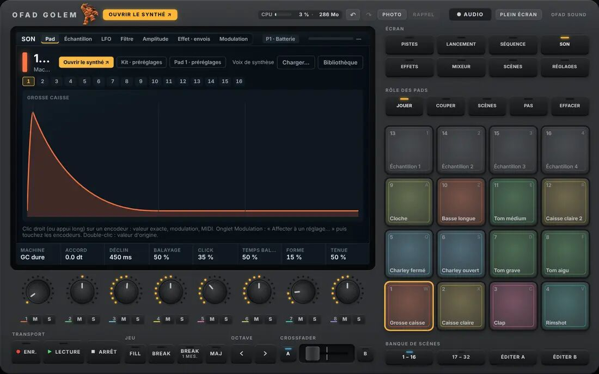<figcaption>SOUND screen: the instrument settings in tabs, with its presets</figcaption></figure>

<figure>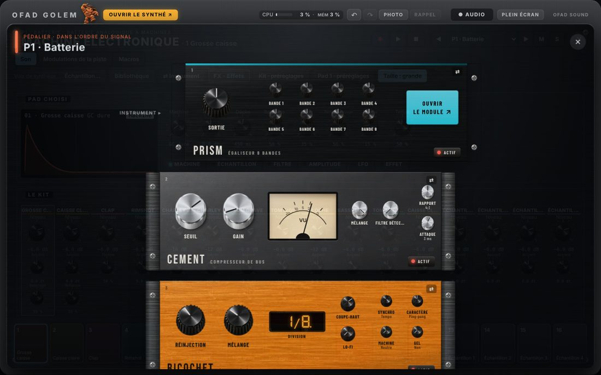<figcaption>“FX · Effects” from the panel: the track's effects as pedals, over the instrument</figcaption></figure>

<figure>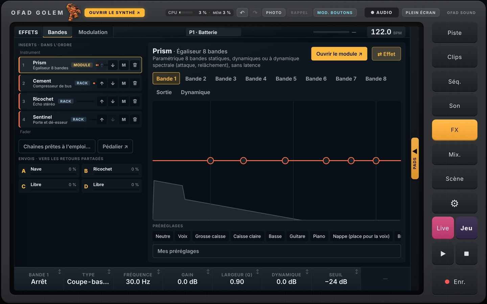<figcaption>EFFECTS screen: the channel's 4 insert effects, in signal order</figcaption></figure>

**The curves of the SOUND screen can be adjusted with a finger (1.1).** Envelopes, filters and waveforms follow
the real values, and **their points can be dragged**: attack, decay, sustain, release (and the rate and level
envelopes of the FM synths), cutoff across and resonance up and down for a filter, pulse width of an oscillator.
A dragged point writes its setting **where the encoders write** (base sound, step lock, scene). While playing, a
**point runs along the envelope**; with a modulation (LFO…), a ghost point and a dotted curve show the sound being
played, and a line shows the whole range. The "M1 +30 %" depth under an encoder is set by dragging it.
**Settings › Display**: animated or still curves; above 90 % audio load for 1.5 s, the animation switches itself
off to leave room for the sound (message, turn it back on by hand).

<figure>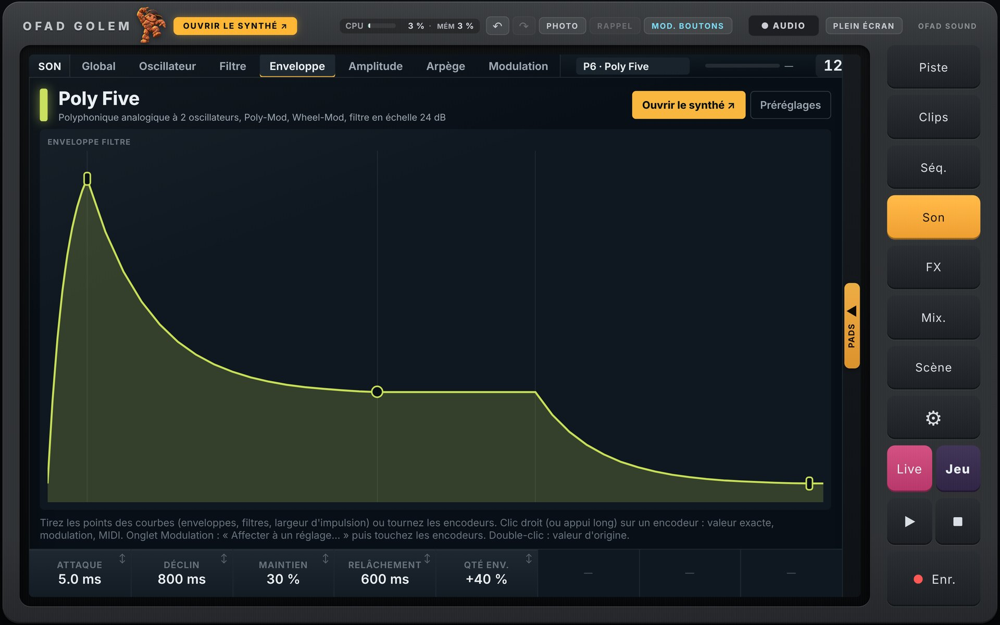<figcaption>SOUND screen: drag the envelope points, the encoders follow</figcaption></figure>

**Golem Titan FX (1.1)**: nine high-end effects, a compact black-metal face in the pedalboard (with the time
settings, sync and freeze) and a **full interface** through "Open the module" (full screen on a phone):

| Effect | What for |
|---|---|
| **Titan Vintage** | Digital reverbs from the 70s–80s (12 models) and 3 vintage colours |
| **Titan Espace** | Mixing reverb: one "Space" knob (room → large hall), decay per band, output EQ, ducking, freeze |
| **Titan Limiteur** | Mastering limiter: 8 styles, 0–5 ms lookahead (compensated), true peak, oversampling, unity-gain listening |
| **Titan Écho** | Creative echo: two tape lines, ping-pong, "tape" or "stretch" time changes; filters, saturation, lo-fi, diffusion and pitch in the loop |
| **Titan Décapiteur** | Analogue saturation: 5 circuits (tube tape machine, console, germanium, triode, pentode), thump, high cut |
| **Titan Saturne** | Multiband saturation: 1 to 4 bands, 16 styles per band (tubes, tapes, transformer, amps, fuzz…) |
| **Titan Phaseur** | Phaser from 2 to 24 stages, 8 circuit styles; LFO, rhythm, steps, envelope |
| **Titan Flanger-Doubleur** | Two-tape flanger (through-zero) and voice doubler |
| **Titan Filtre** | 2 filters (series, parallel, stereo), 8 types, 6 to 48 dB/oct, self-oscillation, 9 styles; LFO, rhythm, follower |

**Restoration (1.1)**: seven tools to clean up sound, to insert like any effect or, better, in the **sample
editor** and the **AUDIO** screen (offline processing, maximum quality): **Denoiser**, **De-hum** (50 / 60 Hz
mains), **De-click**, **Spectral de-esser**, **De-plosive**, **De-clip** (redraws clipped peaks) and
**De-reverb** (removes room echo). Each tool has a **Listen** to what it removes.

**Latency**: some tools (denoiser, lookahead limiter…) delay the sound. GOLEM **compensates by itself**: the
other tracks, the groups and the returns wait, nothing drifts. The **Latency xx ms** indicator in the top bar
shows it; touch it to see which tools, on which track.

<figure>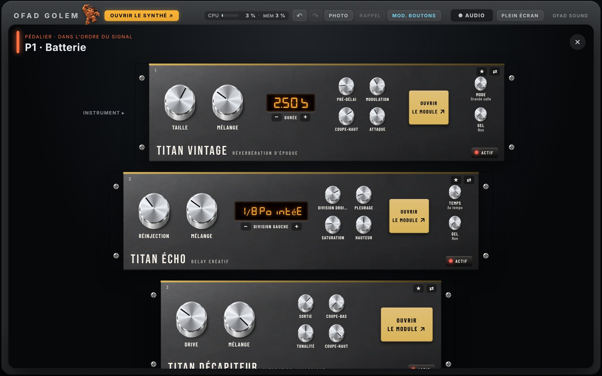<figcaption>Golem Titan FX in the pedalboard: adjustable displays, sync and freeze on the face</figcaption></figure>

<figure>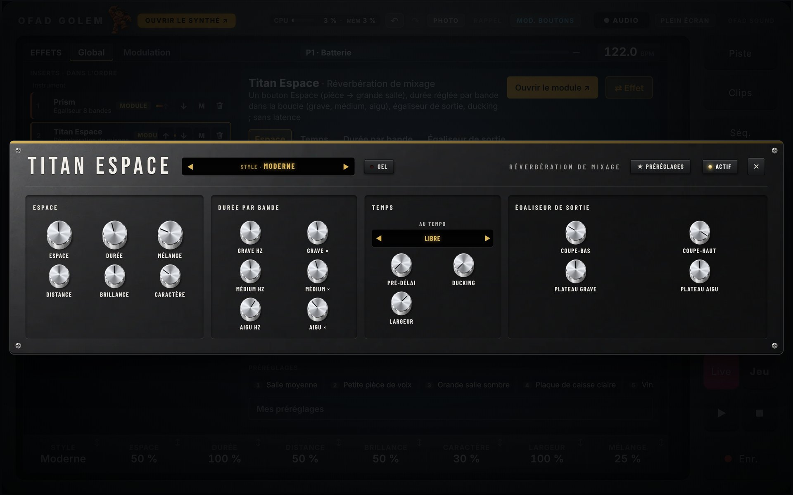<figcaption>Titan Espace, full interface</figcaption></figure>

<figure>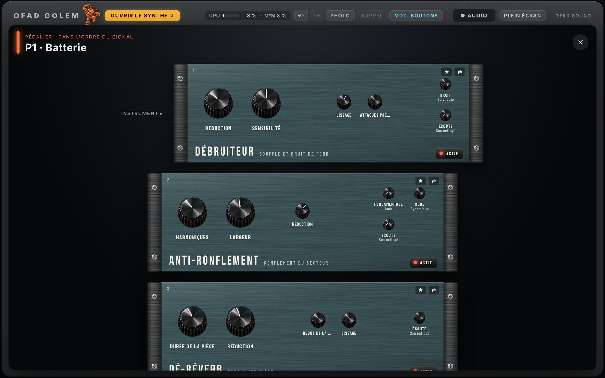<figcaption>Restoration: Denoiser and De-hum as pedals</figcaption></figure>

### 6. Mixing

MIXER screen: volume, pan, mute (M), solo (S), sends to returns A to D, 7 groups and the master. The **sends A, B, C, D** are
knobs (tracks: in place of the EQ; groups: EQ and sends), also in the live view; **long press** (right-click):
exact value.
A strip's EQ acts after its insert effects; on the **master** it acts before them: a limiter in the last
insert stays the last stage of the sound and keeps its ceiling.

<figure>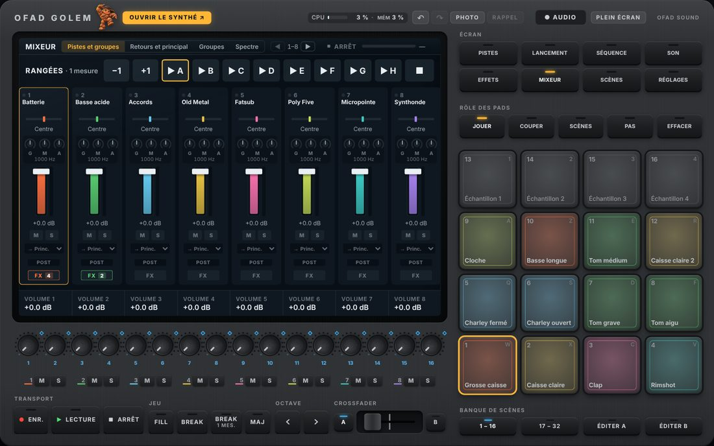<figcaption>MIXER screen: tracks and groups, returns and master</figcaption></figure>

### 7. Scenes

A **scene** is a list of settings (from any track, effect or mixer) with their values. There are
**32 scenes** (two banks of 16) and a **Break scene**. Two scenes sit on either side of the
**crossfader**: scene **A** on the left, scene **B** on the right. As you push the crossfader, the
settings move **smoothly** from A's values to B's (stepped settings switch in the middle). Only the
settings stored in A or B move: everything else stays as it is.

<figure class="wide">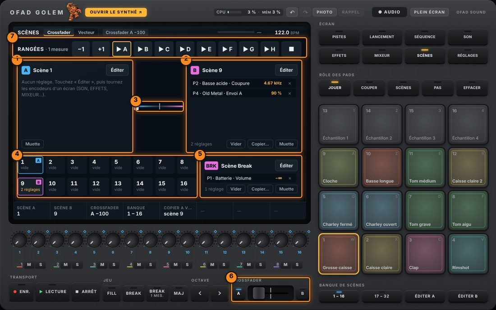<figcaption>SCENES screen</figcaption></figure>

1. **Scene A**: "Edit", then turn knobs on any screen (SOUND, EFFECTS, MIXER, panel, pedals): each
   setting you touch is added to the scene with its value. "Done" to exit. Values can also be adjusted in
   the list (drag), × removes a setting.
2. **Scene B**: the same, on the other side.
3. The A ↔ B **crossfader** (touch or drag; also in the Play view, the live view and from the MIDI controller).
4. The **scene grid**: touching a scene places it **on the side you hear** (where the crossfader is); with
   **Shift**, it goes **to the other side**, ready to be brought in with the crossfader. Right-click:
   mute scene. The "Scene A" / "Scene B" values at the bottom also choose the scene on each side.
5. The **Break scene**: applied while **Break** (or the **B** key) is held.
6. **Rows A to P**: launching a row also launches its **linked scene** (set in CLIPS).

**Playing several scenes in a chain**: crossfader on the left on scene 1. **Shift** + scene 2: it goes to
B. Push the crossfader to the right: the sound glides from scene 1 to scene 2. **Shift** + scene 3: it
goes to A (the side you no longer hear). Bring the crossfader back to the left: the sound glides to scene
3. And so on, as many scenes as you like, without a gap. Crossfader movements are recorded in the song
("Rec motion"). From a MIDI controller, Program Change 0 to 31 launch scenes 1 to 32 (on a channel no track is set to).

<figure class="wide">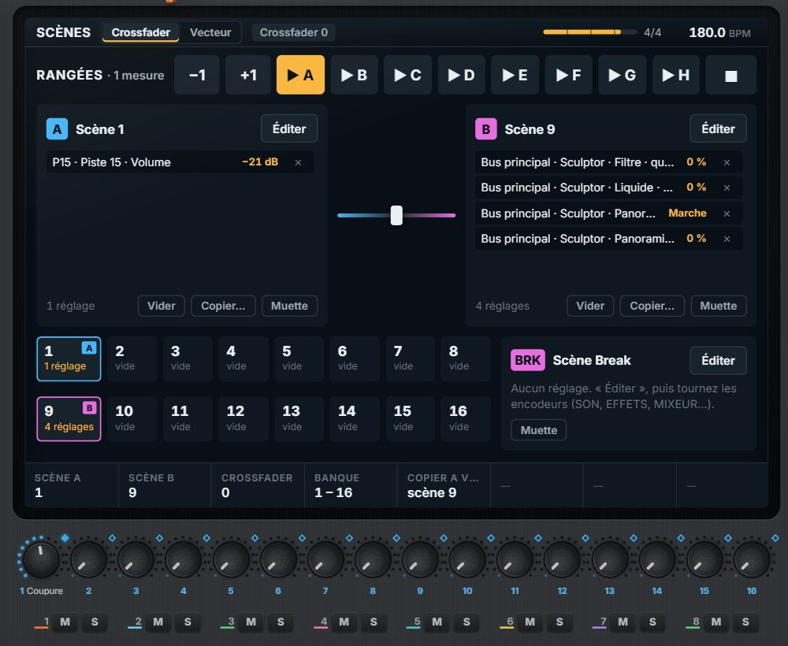<figcaption>SCENES › Crossfader (PC): scene 1 in A, scene 9 in B, the crossfader between them</figcaption></figure>

**The vector pad** (SCENES screen, **Vector** tab; the **Crossfader** tab keeps the A / B crossfader).
Four scenes, one per corner (**A B C D**, chosen in "Corners"), blend according to the position of the
dot on the pad: in the centre, all four in equal parts; in a corner, that corner's scene.

- **Pad active**: the pad replaces the A / B crossfader. Touching the pad activates it and places the dot;
  double-click: back to the centre. **X** and **Y** are also set at the bottom of the screen.
- **Motion**: the dot moves by itself around its place — Circle, Infinity, Diamond, Square, Triangle,
  Bounce, Random, or **Drawn** ("Draw a shape": draw it with your finger). The chosen shape is shown on
  the pad.
- **One cycle in**: from 1/2 to 128 bars, locked to the tempo. **Size**: the extent of the motion.
  **Height**: flattens or stretches the shape (from 5 % to 200 %): the circle becomes an oval, the square
  a rectangle, the infinity sign squashes or stretches. **Rotation**: turns the shape (0°, 45°, 90°,
  135° in one touch; Infinity turns vertical at 90°). A drawn shape keeps its place and direction.
- **Shaping the motion on the pad**: dragging **moves** it (without jumping). On PC, **right-click drag**
  up or down: size; left or right: rotation; **wheel**: size, **Shift + wheel**: rotation. With fingers,
  **two fingers**: pinch for size, twist for rotation.
- All these values can be handed to an assignable knob or to the MIDI controller.

<figure class="wide">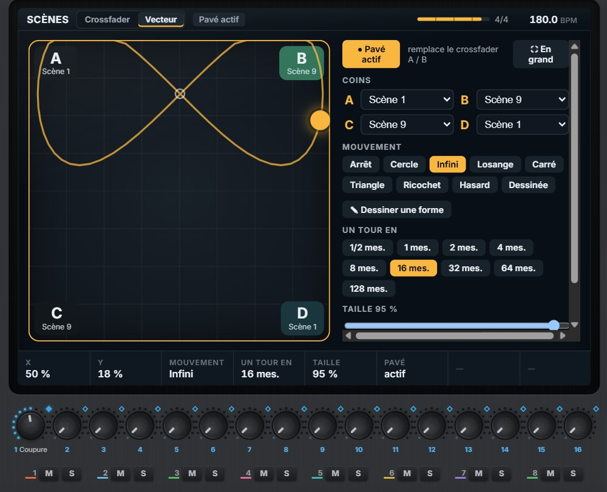<figcaption>SCENES › Vector (PC): the "Infinity" motion travels through the four scenes</figcaption></figure>

**Live** (raspberry button on the rail, or ⛶ Live view next to the Crossfader / Vector tabs): the whole performance on a
single screen, the showcase for playing live. At the top: Back, ● ▶ ■, **Crossfader** or **Vector** mode
(with, in Vector, the motion, cycle length, Draw), the selected track and **Open the instrument**; then
the **16 assignable knobs with the name of their function**; the **rows** (see below).

- **Crossfader mode**: scene A and its settings, a big crossfader (A, B, double-click: middle), scene B;
  next to it, the scene grid (banks 1–16 / 17–32, touch: launch) and the Break scene.
- **Vector mode**: the square pad and all its settings (corners, motion, length, size, height, rotation,
  drawing). **Crossfader** and **Vector** choose the view: switching to Crossfader stops the pad, switching
  to Vector does not start it. You set it up (you can even place the dot with your finger) without the
  sound changing, then **Pad stopped / Pad active** (green while it plays) starts or stops it.
- The live view's **scene cards** are for playing: the scene name and its settings. You edit them
  beforehand, in the SCENES screen.
- **Console** (PC): the 16 tracks with volume fader, peak meter, **FX** (the track's effects, as pedals),
  **M / S**; **Tracks / Groups** shows the mixer groups, and in Tracks view the groups in use take the
  place of tracks with no instrument. Touching a track's name or fader selects it (Open the instrument,
  effects, knobs to assign); ✕ in the instrument or the effects brings you back to the live view.
- At the bottom: the **position** (bar, beat, loop, song row), **Fill, Break, Break 1 bar, Shift** and **Photo / Recall / Knob mods**.
- On a phone, the console becomes the track list (name: select, M / S).

<figure class="wide">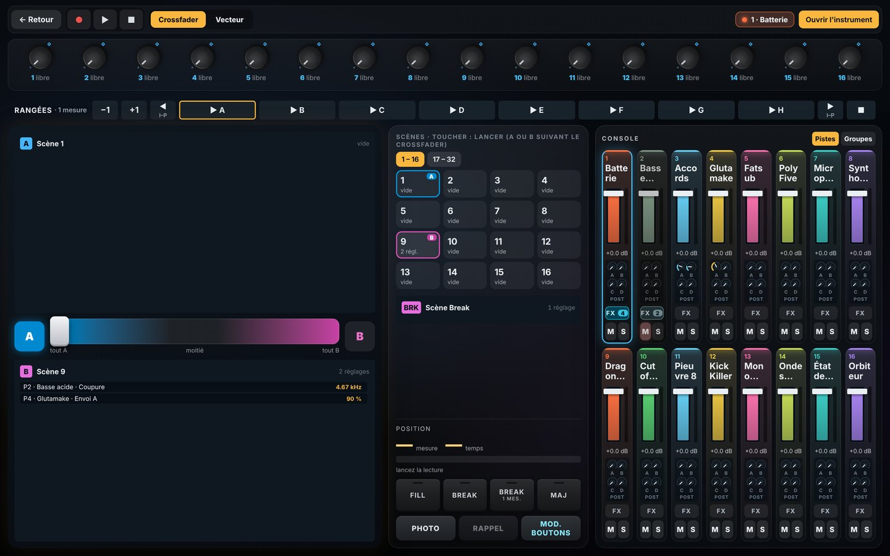<figcaption>Live view · Crossfader</figcaption></figure>

<figure class="wide">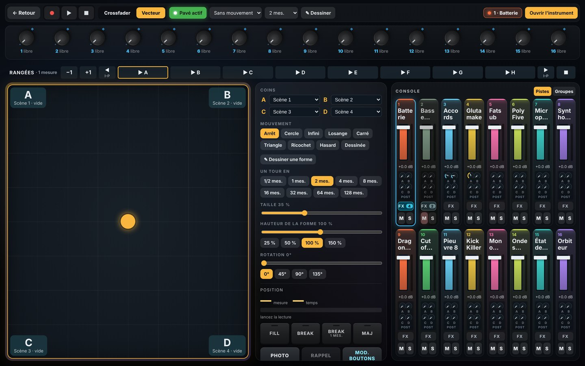<figcaption>Live view · Vector</figcaption></figure>

<figure>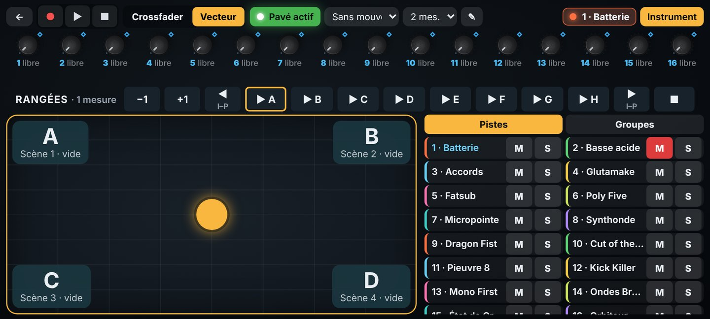<figcaption>Live view on a phone</figcaption></figure>

### 8. Song

CLIPS › Song screen: **rows** played one after another in song mode. "Rec performance" turns your
playing into rows; **REC** (or "Rec motion") records the movements: knobs, faders, EQs, mutes, solos,
groups, crossfader. In song mode they go to the song; in loop mode, a track's settings go into its
pattern's loop.

<figure>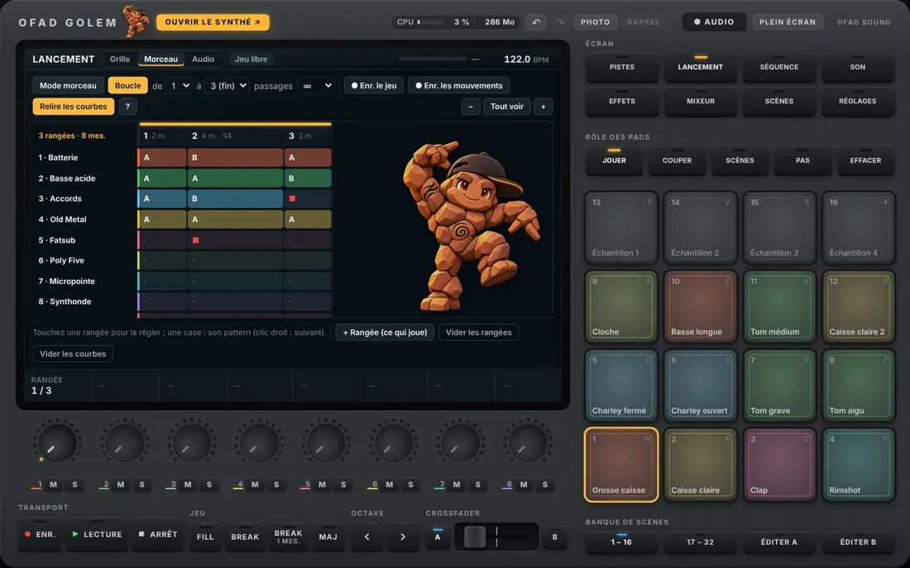<figcaption>CLIPS › Song: the rows (pattern of each track) and, below, the recorded curves</figcaption></figure>

### 9. Audio arrangement

CLIPS › Audio screen: place the playhead, "● Record a take", play (the take starts at the beginning of
the next bar and lands at the playhead); at the end, each track becomes audio clips, to split, move,
duplicate; **Arrange mode** to hear them; WAV or MP3 export of the finished track.

**Recording a loop, right on the bar**: place the loop on the ruler (right-click + drag, "Bar" snap),
turn **Loop** on, then "● Record a take". The take starts at the beginning of the next bar, lasts
**exactly** the length of the loop, **stops by itself** at its end (to the sample) and lands at the start
of the loop: each track played becomes a clip exactly the length of the loop. No more stopping by hand at
the right moment.

**AUDIO screen ("● Audio" button at the top, 1.1)**: a whole screen to record and process. A **long press**
on "● Audio" starts right away with the last settings.

- **What is recorded**: the **Master**, the **Processed master**, ticked **tracks** (one file per track, or "A
  single track" = their sum), returns A to D, the **input** (mic / line, with its meter). While listening, you
  only hear what you record.
- **Start and end**:
  - **Synced**: the take starts with playback (or at the next loop cycle) and stops **exactly**, to the sample:
    end of the song, STOP, or end of the current cycle when you press "■ Audio" again;
  - **Perfect loop**: one run-up cycle plays first (echoes and compression settle), then the take lasts
    **exactly one cycle**, with a crossfaded join: the loop replays **without a click** (prefer WAV);
  - **Bars**: exactly N bars; **Free**: everything, even without playback, until "■ Audio".
- **Format**: 24-bit WAV, 32-bit float WAV, 320 kbit/s MP3 (no silence added at the start).
- **Recording chain**: **4 effects** of your choice (Restoration or any effect), applied **after the take**
  (maximum quality; the raw take is kept) or **during the take** (file processed and realigned as it is
  written). **Listen to the processing** sends the output through the chain, latency shown.
- **Where it goes**: **Recordings**, **Processed sound** (files named "Track – 128 BPM – 4 bars – processed"),
  **Into a pad** (first free slot of the chosen track), or **Replace the original** (can be undone).

<figure>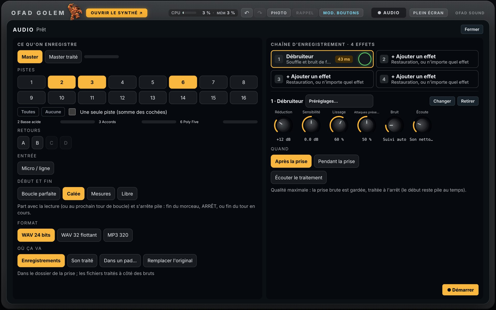<figcaption>AUDIO screen: sources, start and end, format, destination, 4-effect chain</figcaption></figure>

Takes are stored in **Library › My recordings**.

**Exporting the arrangement**: "Export" offers **the loop** (the ruler area) or **the whole arrangement**,
exactly to length, as 24-bit WAV or 320 kbit/s MP3. **Several clips at once**: tap a lane's name to select
all its clips, **Ctrl+A** selects everything, and dragging the edge of a selected clip adjusts every selected
clip.

<figure>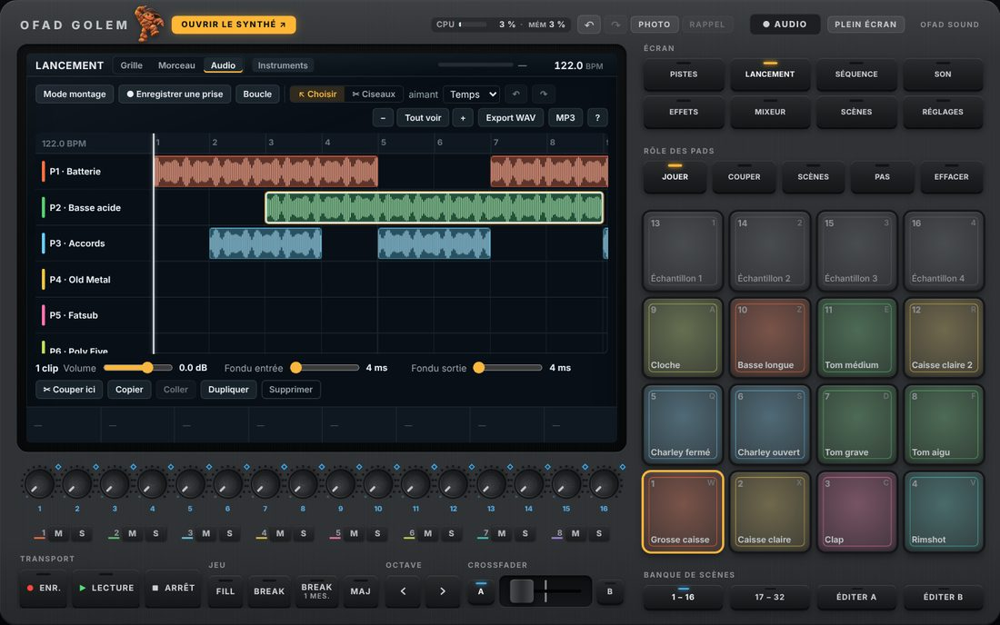<figcaption>CLIPS › Audio: the clips of each track, the ruler, the playhead; below, the selected clip (volume, fades, split, copy, duplicate)</figcaption></figure>

### 10. Saving

SETTINGS › Project screen: Save (a .gbx file with sounds, samples, sequences, scenes) or "As template"
(settings and sounds, without the writing). **Techno demo**, **Tribe demo**, **New empty project** and **Open…** light
up yellow when touched, and a message confirms the loading. The Tribe demo (1.1, 180 BPM) has 5 instruments, 4 scenes, the
vector pad on a circle and a short song (intro, build-up, break, drop): just press Play. The Techno demo is deliberately light (7
instruments, 11 effects) to run on every phone. It also shows the vector pad in motion (Circle, one
cycle in 16 bars) and assignable knob 1 linked to the filter cutoff of Kick Killer. The audio arrangement
is stored in the "&lt;project name&gt; - audio" folder next to the file.

<figure>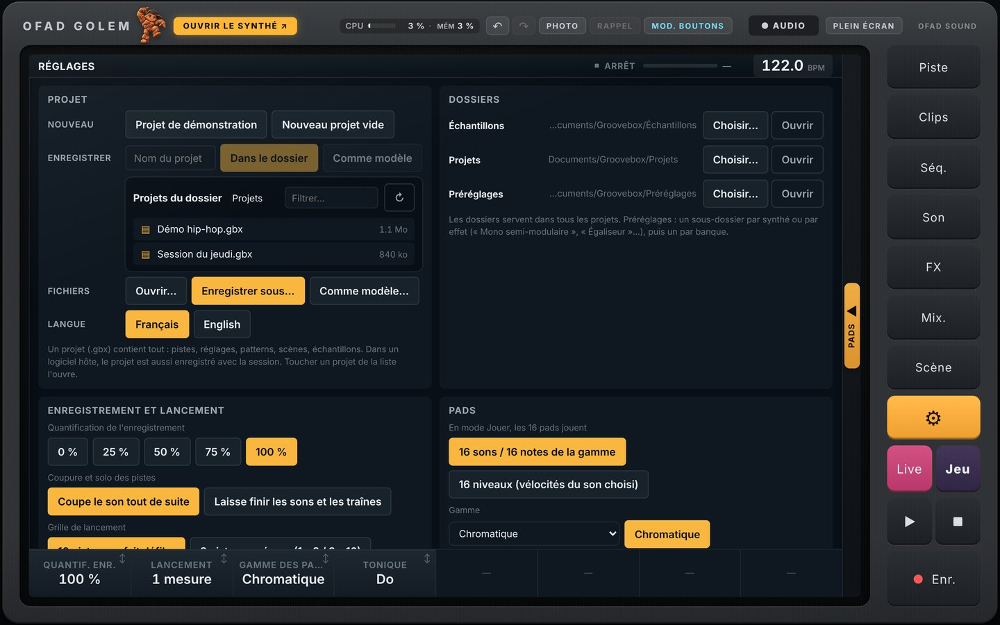<figcaption>SETTINGS screen: project (demo, empty, open, save, template), folders, recording, MIDI</figcaption></figure>

**On tablets and phones**: projects are saved and opened **inside the app** ("Saved projects" list, tap
to open; any name, otherwise the date). **Export a copy…** and **Import a file…** use the system file picker
(Downloads, Drive…) to exchange a project.

**Undo and photo**: ↶ ↷ (Ctrl+Z, Ctrl+Y) undo up to 50 steps. **Photo** freezes all settings; **Recall**
goes back to it in one gesture (and can be undone with Ctrl+Z).

### 11. Samples and Library

**Do this first: tell GOLEM where your sounds are.** The Library (pads, samplers, "Sample…") opens in the
samples folder; set it right and you land straight on your sounds.

- **On a computer (Windows, Mac)**: **SETTINGS** screen (⚙ on the rail) › **Folders** block › **Samples** row ›
  **Choose…**, then pick the folder where you keep your sounds (for example `Documents\My samples`). It is kept
  for every project; **Default** goes back to `Documents\Groovebox`, **Open** shows it in the file explorer. Do
  the same for **Projects** (Open… and Save… start there) and **Presets** (one subfolder per synth or effect,
  then your banks).
- **On a phone or tablet**: the system does not let the app read a folder freely, so the sounds are **copied**
  once. **SETTINGS › Folders › Samples › Personal folder…**: pick your sound folder, everything in it (subfolders
  included) is copied to **Library › Custom**; running "Personal folder…" again only adds the new ones.
  **Import files…** copies a few chosen sounds to **Library › Imported**.

- Formats accepted everywhere (pads, samplers, import, Library): **WAV, AIFF, FLAC, OGG and MP3**.
- **"Sample…"** (a sound taken from outside the Library): the sound is loaded at once on the pad or sampler,
  and **saved inside the project** (.gbx) at the next save — the project stays complete even if the original
  file moves.
  - **On a computer**, the original file stays where it is: nothing is copied. To find it in the Library, put it
    in your samples folder (see above).
  - **On a phone or tablet**, it is also copied to **Library › Imported**, so you can pick it again later without
    the file picker.
- **Settings › Personal folder…**: copies every sound of a folder of the phone or computer (subfolders
  included) into **Library › Custom**; doing it again only adds the new ones.
- **Library › My recordings**: your audio takes ("● Audio" button).

**Sample editor (1.1)**: the same everywhere — sampler panels, drum kit pads, TRACKS screen (**long press** or
**right-click** on a track that plays samples), a take sent into a pad. Waveform and selection; **Invert**,
**Normalize**, **Fade in / out**, **Trim**, **Silence**; and **Process…**: a chain of **4 effects** (Restoration
included) computed **offline** (no latency while playing), **previewed**, then applied **in place of** the sample
— the pads and patterns that play it don't change. **Undo** keeps 8 versions.

### 12. Three special instruments

- **Glutamake** (wavetables and physics): two wavetable oscillators (A/B mix, morphs, modifiers); **Physics**
  page: a **ball** rolls on a surface (tilt, friction, bump, edges that absorb or bounce back). **Hold it with a
  finger** and **release it with a flick**, or let each note throw it; its motion (X, Y, distance, angle, hits)
  feeds the matrix. **Motion sequence** page: 4 lanes of 16 steps (loop, direction, division, smoothing,
  probability).
- **Good Doctor** (hybrid wavetables): three oscillators **A, B, C**; for each, the **Table**, the **Position**,
  **two warps in a row** (Warp 1 and 2 with their amount), the start **Phase** and its randomness, and the
  **Output** (both filters, F1 only, F2 only, or **Direct** for a clean low end). Sub oscillator and noise with
  their own output; **two filters** (14 types) in **series** or **parallel**; per-voice distortion; 32-slot
  matrix and 8 macros.
- **Pieuvre 8** (performance sampler with 8 lines T1 to T8): the last note played (keyboard, pads, MIDI while
  stopped) is written to the steps you place; **lengthen a note** by dragging a step's right edge; a selected
  step opens its **menu** (note, velocity, length, offset, condition, probability, repeats, locks).

<figure><figcaption>Good Doctor: three wavetable oscillators, two warps each, two filters</figcaption></figure>

<figure><figcaption>Glutamake: the ball, the wavetables, the filter</figcaption></figure>

### 13. FM Player: M-VAVE FM-1 firmwares

The **FM Player** runs inside GOLEM the **firmwares** (`.fwsc` files) written for the M-VAVE **FM-1** synth
box: its processor is **emulated**, and each firmware becomes a GOLEM instrument, played by the sequencer, the
piano, the pads and MIDI, with its screen and controls on the panel. It also works inside music software (VST3 /
AU plugin).

- **15 free firmwares included**, copied once to **Library › Samples › Firmwares** at first launch: B1, FIZZ,
  FM-106, FMini-1, Felucca, Frodhes, GR!MM, JIANT FM, MYCELIUM, Melodee, OberVave, SLOOP, X0X, sloopDX, zp12
  (authors, GPL-3.0 / MPL-2.0 licences and sources in `FIRMWARES-LICENCES.md`). **Firmware…** loads another
  `.fwsc` file (your own, or a community firmware).
- **The machine**: the live screen, KNOB 1 to 4, SELECT, PRESETS, ALGORITHM, the MASTER pot, the 14 function
  keys (FX… REC, OCT − / +) and the 27 small keys with their LEDs (in the firmwares' SEQ mode they act as steps).
  Knobs are set by dragging up or down, or **by turning** around the knob.
- **Tracks T1 to T4** (under the piano, as on Pieuvre 8): each T plays on **its own MIDI channel** — T1's channel
  ("T1 channel", Auto by default), then the next ones. Multi-track firmwares (SLOOP, sloopDX, JIANT…) thus play
  their 4 tracks. The selected T is the one you write (**Acid** and **Locks** rows, **SEQUENCE** screen with 4 lines
  and "T in notes ♪") and the one played by the piano, the pads and MIDI.
- **⤢ Big**: the machine on the whole screen area (phone and tablet), with GOLEM's piano and T1 to T4 at the
  bottom, **M / S** above each T, the chosen T's **step row** (locks, bars, shifting the T or everything; Copy /
  Paste / Clear and **Locks** under the screen) and **Library** to switch firmware. **✕ Close** goes back to the
  panel.
- **Background of your choice**: the dots next to "Big" — **Amber**, **Night**, **Emerald** or **Plain** (kept on
  the device).
- **Settings**: Level, Transpose, **Lead** (how far ahead the emulation runs, 40 ms by default: raise it if the
  sound crackles on a slow device), **MIDI clock** (the firmwares' sequencers follow GOLEM's tempo), **Notes played
  by** (Auto, MIDI, or the box's keys for firmwares that don't read MIDI).
- **The box's 8 controls on your controller**: KNOB 1 to 4, SELECT, PRESETS, ALGORITHM and MASTER are also
  instrument settings. **Long press** (or right-click) a knob: **MIDI learn**, assignable button, modulation, as
  on every synth. On the **SOUND** screen, the **Box** section puts them under the **8 encoders**. The knobs go
  from **0 to 100 %**: by finger, the whole travel in one drag (or by turning).
- **Knob travel** (Firmware panel, folded): how many firmware clicks go from minimum to maximum, knob by knob —
  **128** for KNOB 1 to 4, **4** for ALGORITHM (a quarter turn per algorithm), 256 for SELECT and PRESETS.
  Firmwares don't all count the same: if a setting reaches its end too early, lower its travel. At **0 %** and
  **100 %**, GOLEM re-aligns the firmware on its end stops.
- **The box's 14 keys** (FX, SCL, ENV, LFO, EDIT, GLO, HOME, SAVE, ARP, SEQ, PLAY, REC, OCT − and OCT +):
  **right-click** or **long press** to learn them — a controller button then presses the box key (it lights up
  blue while learning).
- **MIDI controller controls** that GOLEM has not learned go straight to the firmware.
- **Paused** after 20 s without playing (saves battery): a note or a key wakes it up.

<figure>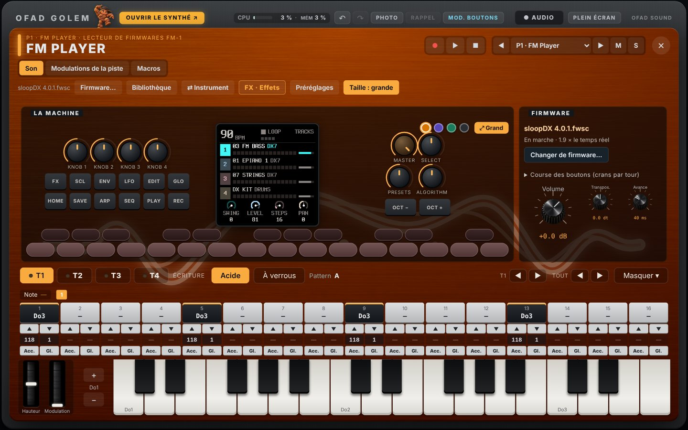<figcaption>FM Player (Amber background): the machine, T1 to T4 and the Acid row under the piano</figcaption></figure>

<figure>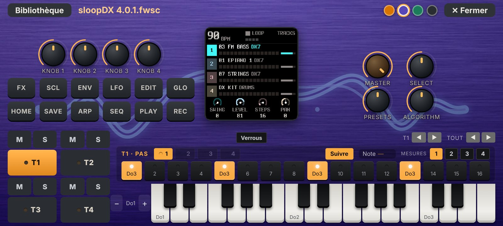<figcaption>Big mode on a phone (Night background): screen, knobs, piano and T1 to T4</figcaption></figure>

<figure>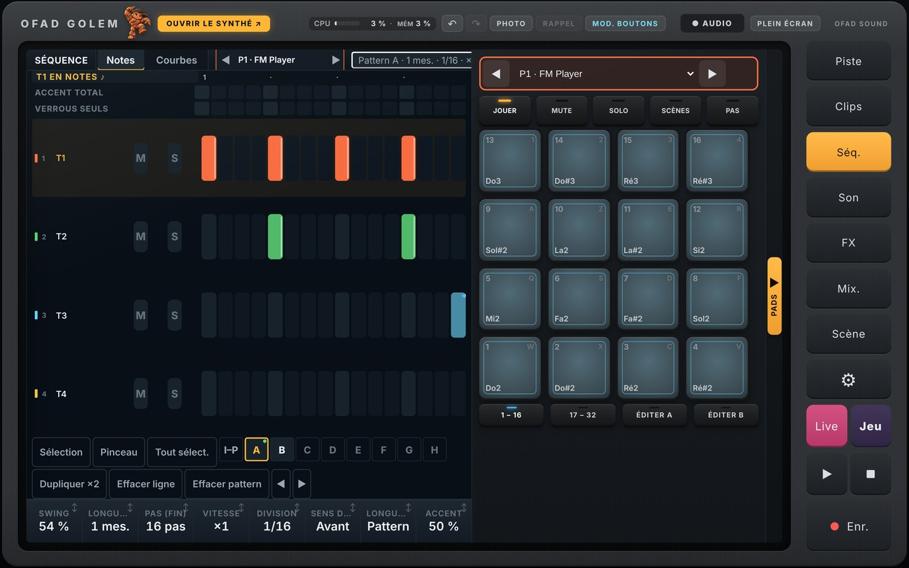<figcaption>Sequence screen: one line per T track (one firmware MIDI channel each), pads folded out to play</figcaption></figure>

<figure>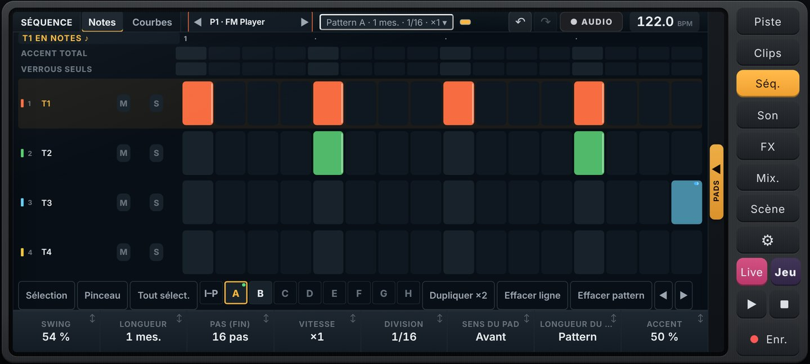<figcaption>The same sequence on a phone</figcaption></figure>

M-VAVE and FM-1 are trademarks of their respective owners. OFAD GOLEM is not affiliated with, endorsed or
sponsored by M-VAVE; these names are used only to state compatibility with firmware written for the FM-1.
Emulation is based on fm1-emu (Joakim Eriksson, MIT licence). No original M-VAVE software is included: the bundled
firmwares are free community works, with their authors and sources credited.

### 14. MIDI track: playing an external synth or drum machine (1.1)

The **MIDI track** instrument (**External MIDI** family, TRACKS screen) makes no sound: it **plays the connected
device** (synth, drum machine, module). Everything a track has works on it: sequencer (Acid, Locks, SEQUENCE),
locks, scenes, modulations, launching, song, piano, pads and controller.

- **The top bar** (lists): **Device** (the MIDI output; ↻ reads the list again; the link type — USB, Bluetooth,
  network — is shown when the system reports it), **Send** (channel 1 to 16), **Receive** (the channel that
  plays this track from a keyboard), **Bank** and **Sound** (CC 0, CC 32 = 0, then program change, like the
  remote). On a phone, **Bluetooth…** opens pairing.
- **32 knobs in 4 sections of 8**: each knob sends its value as a **CC**. **Touch a section title to rename it**
  ("Filter", "Envelopes"…): the names are kept in the project. A knob's small **⚙ wheel** opens its settings:
  **Learn** (touch it, turn the synth's knob: its CC number and channel are set), **CC** (0 to 119),
  **Channel**. Nothing is sent on loading: the device's sound is not overwritten; "Send at start" sends the
  values again at playback.
- **CC numbers and channels are fixed**: set them once and for all. A scene, a lock, an LFO or a curve can
  **never** change them (only the knob's value moves), and CC 120 to 127 (device commands: all off, reset)
  are never sent.
- **16 pads**, set up with their ⚙ wheel like those of the remote: **CC held** (127 while pressed), **CC on /
  off**, **CC steps** (each press moves to the next value, 2 to 8 values) or **Note**.
- **Sequencer**: the step row is under the keyboard as on the synths. Long press on a step, then: turning one
  of the 32 knobs sets a **CC lock**; touching a pad **locks** it on that step (pressed for the step's note
  length, every time round); the **Bank** and **Sound** lists set the **step sound** (the program change goes out
  just before the note).
- **MIDI effects**: arpeggiator (20 modes, octaves, rate, length, hold, swing), chord and spread, scale and
  root, note echo (fading repeats, transposition), probability, fixed or random velocity, transposition.
- **Mute and solo**: notes in progress stop, nothing goes out while the track is muted.
- **Output**: in the application (PC, Mac, phone), the output chosen in "Device" (one output shared by all MIDI
  tracks, each on its own channel). In music software, the **plug-in's MIDI output**.
- **Possible links**: **USB** everywhere; **Bluetooth MIDI** on phones and tablets (Bluetooth…) and on Mac (the
  system pairing window); on Windows PC, through a bridge driver that creates a standard MIDI port; **network**
  through a driver such as rtpMIDI, which shows up as a device in the list. What the device sends back to GOLEM
  does not replay the track (no MIDI loop).

<figure><figcaption>MIDI track: the top bar, the 32 knobs in 4 renamed sections, the 16 pads</figcaption></figure>

<figure><figcaption>A knob's ⚙ wheel: Learn, CC number, channel</figcaption></figure>

<figure><figcaption>Step sound: step 5 sends sound 12 to the device just before its note</figcaption></figure>

## MIDI controller

### Plugging in a controller: plug and play

- **USB**: plug in the keyboard or controller, it is recognised by itself, with nothing to set up — in
  the PC application as on an Android phone or tablet (with a USB-C "OTG" cable or hub). You can plug it
  in or unplug it while the Groovebox is running.
- **Bluetooth (Android)**: Settings › "**Pair a Bluetooth controller…**". The first time, Android asks
  for Bluetooth permission; then choose your wireless MIDI keyboard or controller from the list: it plays
  like a USB controller.
- **On Mac**, pair the device in the system's Bluetooth MIDI window (Audio MIDI Setup).
- **On PC**, a Bluetooth controller only works if Windows presents it as a MIDI port (bridge driver): USB is
  the simplest.
- **In a host application** (VST3): the host receives the controller and sends it to the Groovebox.
- Notes play the selected track (or the tracks set to a channel, Settings › MIDI); on a drum kit, notes 36
  to 51 play the 16 pads. On **Pieuvre 8** and the **FM Player**, the keyboard plays the chosen T **across all its
  octaves**, and each T can have **its own channel** (TRACKS screen, "T1 … T8"): an external keyboard or sequencer
  then plays several Ts at once. The mod wheel, pitch bend and sustain pedal follow the track being played.
- Phone with a single USB-C port: a USB-C hub with charging (PD) lets you plug in the keyboard, the USB
  audio output to the mixing desk and the charger at the same time.

### Assigning the controller's controls

- Right-click (long press) on a setting › **Learn MIDI**, then touch the control on the controller. This
  also works for the **values at the bottom of the screens** and the global settings: tempo, swing,
  crossfader, scenes A and B, vector pad (X, Y, motion, size…) and macros.
- The **16 assignable knobs** can be learned too: map a row of knobs on the controller to knobs 1 to 16,
  then hand them whatever you want (Assign to…).
- Right-click on the buttons (M / S, rows, Photo, Recall, transport…): assign them to the controller.
- Settings › MIDI: notes channel, commands channel, a channel for each track.
- **Changing sounds over MIDI**: on a track set to a channel, bank select (CC 0 / CC 32) + program change
  call the sound number shown in front of each preset ("Init" = 1, your sounds after them); CC 102 to
  105 change the sound of the effect in inserts 1 to 4. Details are in the **MIDI implementation**
  document (MIDI-IMPLEMENTATION).
- In the Android app: Settings › "**Pair a Bluetooth controller…**" (wireless MIDI keyboard or
  controller); a USB keyboard is recognised by itself.

<figure><figcaption>Long press (right-click) on a bottom value: exact value, modulation, Learn MIDI, knob 1 to 16</figcaption></figure>

## Remote: the phone controls GOLEM (1.1)

A phone (or a tablet) running GOLEM becomes the **remote** of GOLEM on the PC, of an FM-1, or of another MIDI
device. Way in: the **Remote** button on the home screen, or Settings › MIDI controller › "Remote mode…";
**‹ GOLEM** goes back to GOLEM without restarting. The phone's sound is paused by default.

- **Connection**:
  - **USB cable** (the safest): connect the phone to the PC, choose "MIDI" in the USB notification, then turn on
    the phone's MIDI input in GOLEM on the PC;
  - **Wi-Fi** (no driver): phone and PC on the same network; on the PC, Settings › "**Accept a Wi-Fi remote**";
    on the phone, touch the PC's name. Local network only, one remote at a time;
  - **Bluetooth**: for a wireless MIDI device (Pair, then touch it).
- **Mix**: the 16 tracks (2 pages of 8), volume, M, S, groups, master; names, colours and levels come from the PC.
- **Knobs**: GOLEM's 16 assignable knobs (name and value sent back by the PC), crossfader, Fill, Break, Shift,
  play, stop, record.
- **Chaos**: the vector pad, with the motion shape chosen on the PC. Each corner drives 4 GOLEM knobs or 4 CCs;
  "Take the current sound", **Spring** (the orb returns to the centre).
- **FM-1** (or any MIDI device): keyboard and wheels, pads (CC held, CC on / off, note), 8 CC knobs, sound − / +,
  bank, channel, firmware profiles, sending a .syx file. For GOLEM on the PC, the sound changes the instrument or
  the effect of insert 1 to 4 of the track.
- **Learn**: with a device connected, the small "Learn" button next to a CC setting; touch it, turn the device's
  knob (or play the note), the number and channel are set.
- **Profiles**: save the setup (knobs, pads, Chaos pad, device tab) under a name ("Bass synth profile"…) and recall
  it with one touch.

<figure><figcaption>Remote · Connection</figcaption></figure>

<figure><figcaption>Remote · Mix</figcaption></figure>

<figure><figcaption>Remote · Chaos</figcaption></figure>

<figure><figcaption>Remote · FM-1</figcaption></figure>

## Where your files are

- Projects, samples, presets: Documents\Groovebox (folders can be changed in Settings).
- Audio recordings and arrangement exports: Documents\Groovebox\Enregistrements.
- Takes from a project's arrangement: the "&lt;project name&gt; - audio" folder next to the .gbx.
