# OFAD GOLEM — Notice de prise en main

Cette notice donne les bases ; le détail des instruments et des effets est dans le **Catalogue**.

## Raccourcis clavier et souris

### Partout

| Touche ou geste | Effet |
|---|---|
| **Barre d'espace** | Lecture / arrêt |
| **Ctrl + Z** | Annuler |
| **Ctrl + Y** (ou Ctrl + Maj + Z) | Rétablir |
| **F11** | Plein écran / retour en fenêtre |
| **Échap** | Refermer la fenêtre ouverte : façade du synthé, pédalier, choix d'instrument ou d'effet, préréglages, menu, accueil |
| **B** maintenu | Break : scène de Break tant que la touche est tenue (et Fill en même temps) |
| **N** maintenu | Fill : les pas à condition FILL jouent, les NON FILL se taisent |
| Clic droit (appui long au doigt) sur un bouton à diode, Photo, Rappel, M / S… | Affecter au contrôleur MIDI |
| Toucher le **tempo** (barre d'état, ou rangée Tempo du téléphone) | Taper le tempo au clavier (40 à 240 BPM, au dixième) |

<figure class="wide">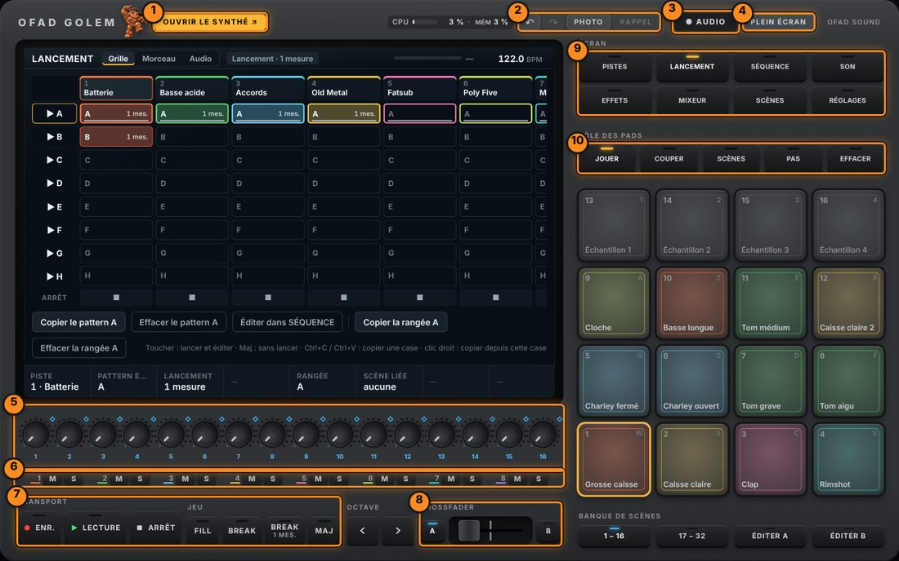<figcaption>Où sont les commandes générales</figcaption></figure>

1. **Ouvrir le synthé** : la façade de l'instrument de la piste, en grand.
2. **Annuler / Rétablir** (Ctrl + Z / Ctrl + Y), **Photo** et **Rappel** de tous les réglages.
3. **Audio** : enregistrer ce qui sort (master ou pistes séparées).
4. **Plein écran** (F11).
5. Les **16 boutons assignables** (losange bleu) : chacun pilote la valeur qu'on lui a donnée (voir plus bas).
6. **M / S** : coupure et solo des pistes affichées.
7. **Transport** : Enr., Lecture, Arrêt (barre d'espace) ; Fill (N), Break (B), Break temporisé, Maj.
8. **Crossfader** des scènes A / B (double-clic : retour au milieu).
9. Les **8 écrans**.
10. Le **rôle des pads** : Jouer, Couper, Scènes, Pas, Effacer.

### Pads au clavier de l'ordinateur (AZERTY)

| Touches (de haut en bas, comme les pads) | Pads |
|---|---|
| **1 2 3 4** | 13 à 16 (rangée du haut) |
| **A Z E R** | 9 à 12 |
| **Q S D F** | 5 à 8 |
| **W X C V** | 1 à 4 (rangée du bas) |
| **Maj** + touche | Coup accentué (pleine vélocité) |

Les touches suivent le rôle des pads choisi à droite : Jouer, Couper, Scènes, Pas, Effacer.

<figure class="pads">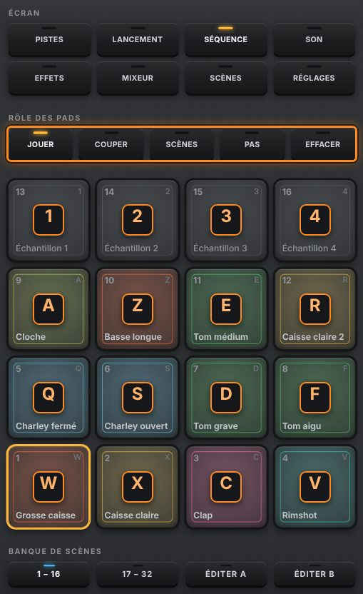<figcaption>La touche du clavier sur chaque pad (la même petite lettre est rappelée en haut à droite de chaque pad)</figcaption></figure>

### Boutons et valeurs (boutons des façades, valeurs du bas des écrans, boutons assignables)

| Geste | Effet |
|---|---|
| Glisser vers le haut / le bas | Régler |
| **Maj** + glisser | Réglage fin |
| Molette | Un cran (**Maj** + molette : cran fin) |
| Double-clic (double tape au doigt) | Valeur d'origine |
| Flèches ↑ ↓ ← → (bouton choisi) | Un cran (**Maj** : cran fin) |
| Clic droit (appui long au doigt) | Menu : valeur exacte, modulation, Apprendre MIDI, bouton assignable (et macros, sur la façade d'un synthé) |
| Mixeur : double-clic sur un fader | Valeur d'origine ; double-clic sur le nom d'un groupe : le renommer |
| Crossfader : double-clic | Retour au milieu |

**Les valeurs du bas des écrans** (Swing, Longueur, Division, X, Y, Crossfader, Scène A…) se règlent en
glissant dessus. Un **appui long** (clic droit sur PC) ouvre leur menu, le même partout : valeur exacte
(liste des choix ou nombre à taper), **Apprendre MIDI**, **piloter avec un bouton 1 à 16** ; la
modulation n'apparaît que pour un réglage de son, d'effet ou de mixage. Les **macros** du synthé ne se
proposent que dans la façade d'un synthé.

<figure class="wide">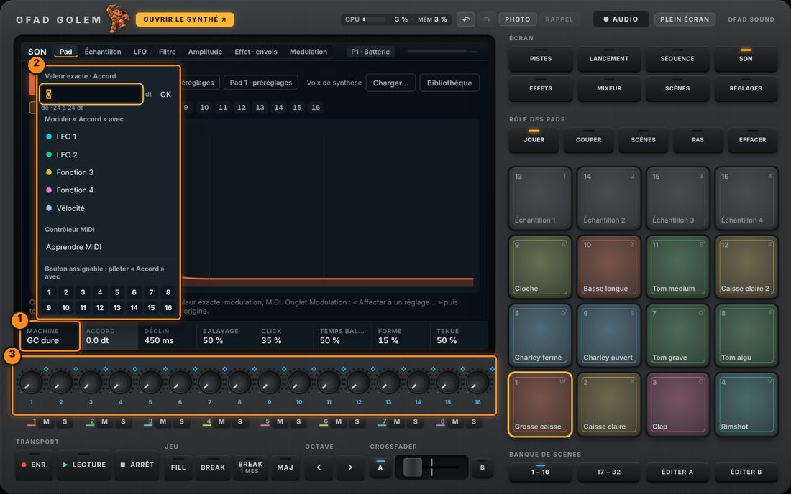<figcaption>Régler une valeur et la confier à un bouton</figcaption></figure>

1. Une **valeur du bas de l'écran** : glisser, double-clic.
2. Son **menu** (appui long, clic droit) : valeur exacte, modulation, Apprendre MIDI, bouton 1 à 16.
3. Les **16 boutons assignables**.

**Les 16 boutons assignables** remplacent les anciens encodeurs : ils ne changent plus avec l'écran,
chacun garde la valeur qu'on lui a confiée. Sur PC et tablette ils sont en une rangée de 16 ; sur
téléphone, en deux rangées de 8. Un **losange bleu** les signale : creux quand le bouton est libre,
plein quand il pilote quelque chose (son nom s'écrit sous le numéro). Toute la course, de 0 au
maximum, se fait **en un seul geste**.

<figure class="wide">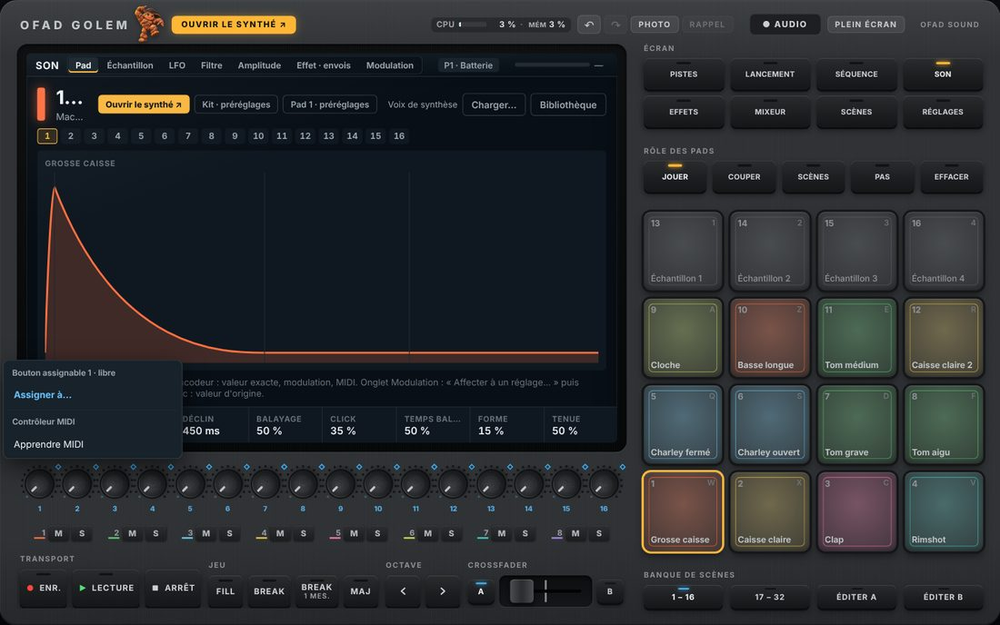<figcaption>Appui long sur un bouton assignable</figcaption></figure>

- **Appui long** (clic droit) sur un bouton › **Assigner à…** : le bouton **clignote en bleu** et tout
  ce qu'on peut piloter est **souligné en pointillés bleus**. Touchez la valeur voulue : une valeur du
  bas d'un écran, un bouton d'un synthé ou d'un effet, une macro, le crossfader, le tempo, Lecture,
  Fill, un M / S… On peut changer d'écran ou ouvrir un synthé avant de toucher. **Échap** annule.
- **Libérer le bouton** : il ne pilote plus rien.
- **Moduler le bouton** : les 16 boutons ont **leurs propres sources de modulation** (4 sources : LFO,
  fonction, suiveur ou séquenceur), indépendantes de celles des synthés : un réglage peut être modulé
  à la fois par le LFO du synthé et par celui du bouton. Le menu du bouton propose ces 4 sources, la
  **profondeur** (−100 à +100 %) et « Retirer la modulation » ; une pastille de couleur montre la source
  et le bouton bouge avec elle. Retirer la modulation ou libérer le bouton rend le réglage tel qu'il
  était. Tout ce que le bouton pilote se module (son, effets, mixage, crossfader, pavé, macros), sauf le
  tempo et les commandes.
- **Mod. boutons** (à côté de Photo / Rappel, en haut sur PC, sous les 16 boutons sur téléphone et
  tablette) ouvre le panneau de ces 4 sources, le même que les modulations d'un synthé : forme, synchro
  au tempo, vitesse, phase… ; **Affecter à un bouton…** puis toucher les boutons à moduler.
- **Apprendre MIDI** : un bouton ou un fader du contrôleur fait tourner ce bouton.

<figure class="wide">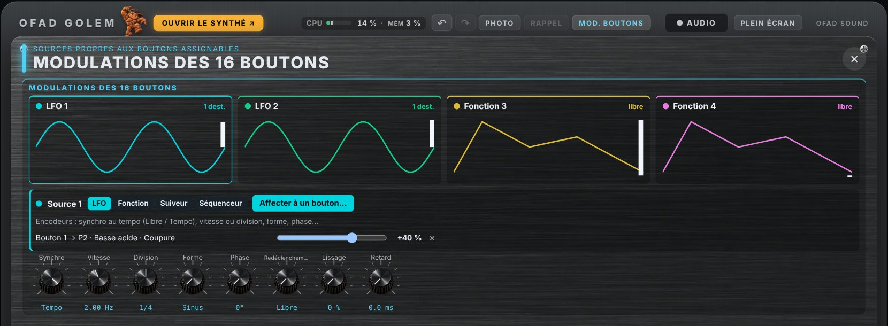<figcaption>Mod. boutons : les 4 sources propres aux 16 boutons</figcaption></figure>

<figure class="wide">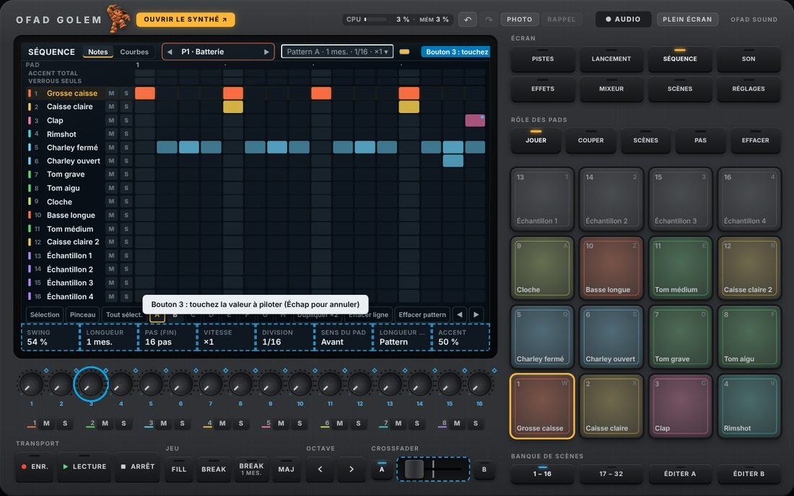<figcaption>Le bouton 3 attend : touchez la valeur qu'il doit piloter</figcaption></figure>

Les valeurs propres à un écran (Longueur, Division, Famille…) suivent leur bouton tant que l'interface
est ouverte ; après l'ouverture d'un projet, affichez une fois l'écran concerné. Le son, les effets, le
tempo, le swing, le crossfader, les scènes, le pavé et les macros répondent toujours.

### Écran SÉQUENCE (notes et pas)

| Touche ou geste | Effet |
|---|---|
| Clic sur une case | Poser / retirer un pas (ou une note) |
| **P** | Pinceau : glisser écrit un pas par case survolée |
| **Ctrl** + clic | Ajouter / retirer de la sélection |
| Tirer depuis une case vide | Rectangle de sélection (**Maj** : ajoute) |
| Tirer une sélection | La déplacer ; **Ctrl** (ou Alt) + tirer : la copier |
| **Ctrl + A** | Tout choisir |
| **Ctrl + C / Ctrl + X / Ctrl + V** | Copier / couper / coller sous la souris |
| **Ctrl + D** | Dupliquer juste après |
| **Suppr** (ou Retour arrière) | Effacer la sélection |
| **Échap** | Vider la sélection |
| Flèches ← → | Déplacer d'un pas (**Maj** : d'une mesure) |
| Flèches ↑ ↓ | Note : un demi-ton (**Maj** : une octave) ; batterie : pad voisin |
| Clic droit sur un pas | Réglages du pas (vélocité, durée, condition, verrous) |
| Toucher une case **Accent** / **Glissé** | Allumer / éteindre l'accent ou le glissé du pas |
| Appui long (clic droit) sur une case **Accent** / **Glissé** | La valeur du pas : force de l'accent, durée du glissé |
| ◀ ▶ à côté du pattern (ou les petites pastilles) | Tourner les pages (une page = 16 pas) |
| **Maj** + ◀ ▶ d'Octave (transport) | Page précédente / suivante |
| **Enr.** puis jouer | Les notes jouées s'écrivent dans le pattern (quantification : Réglages) |

<figure class="wide">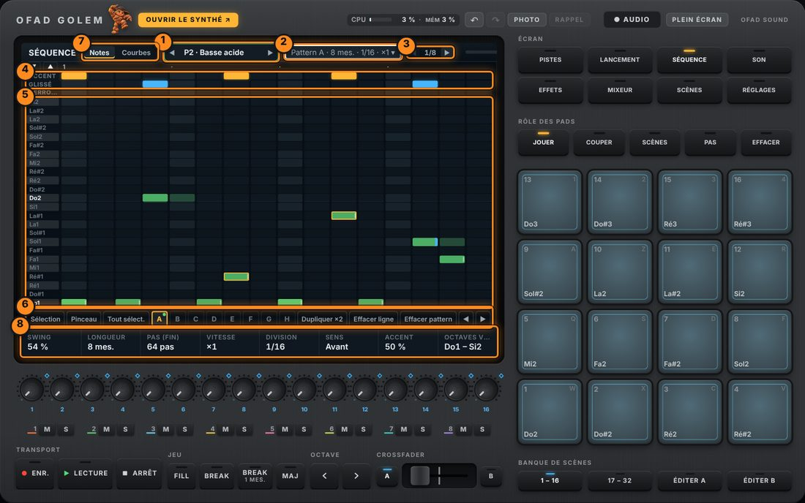<figcaption>L'écran SÉQUENCE d'un instrument mélodique (ici la basse acide)</figcaption></figure>

1. La **piste** affichée (◀ ▶ ou la liste).
2. Le **pattern** : nombre de mesures (1 à 32), division (1/16, triolets…), vitesse.
3. **Tourner les pages** : ◀ ▶ et « page / total » (pastilles jusqu'à 4 pages).
4. Les lignes **Accent** et **Glissé** (et « Verrous seuls » : le pas pose ses réglages sans jouer).
   Appui long sur une case : sa valeur (voir « La valeur d'un pas »).
5. Le **rouleau de notes** : chaque pas reçoit la note qu'on veut, jusqu'à 4 notes par pas (accords).
6. **Sélection**, **Pinceau**, tout choisir, patterns **A à P** (8 à la fois ; la petite puce « I–P » / « A–H » montre l'autre page), dupliquer, effacer.
7. **Notes / Courbes** : les mouvements de boutons enregistrés avec **ENR.** dans ce pattern.
8. Les **réglages de la piste** quand aucun pas n'est choisi (swing, longueur, vitesse…) — voir « 3. Écrire
   une séquence ».

### Écran LANCEMENT › Grille

| Touche ou geste | Effet |
|---|---|
| Toucher une case | Lancer et éditer le pattern |
| **Maj** (bouton) + toucher | Éditer sans lancer |
| **Ctrl + C** puis case, **Ctrl + V** | Copier un pattern vers une autre case (même piste ou autre piste) |
| ▶ en tête de rangée | Lancer la même lettre sur toutes les pistes (et la scène liée à la rangée) |

<figure class="wide">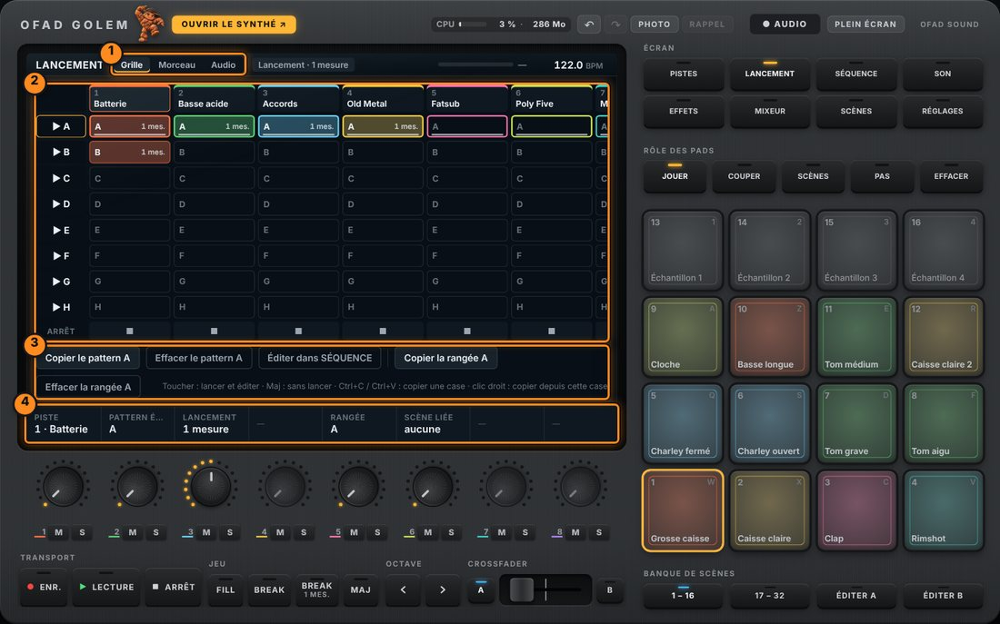<figcaption>LANCEMENT › Grille</figcaption></figure>

1. Les onglets **Grille**, **Morceau**, **Audio**.
2. La **grille** : une colonne par piste, une case par pattern ; ▶ lance une rangée, ■ arrête une piste. Les 16 rangées (A à P)
   se montrent 8 à la fois : **A–H** / **I–P** dans le coin en haut à gauche.
3. Copier, effacer ou éditer le pattern ou la rangée choisis.
4. Les valeurs du bas : piste, pattern édité, **quantification du lancement**, rangée, **scène liée**.

### Écran LANCEMENT › Morceau et courbes

| Touche ou geste | Effet |
|---|---|
| **Ctrl** + molette | Zoom de la ligne de temps |
| Éditeur de courbe : **Maj** + tirer | Tracer une ligne droite |
| Éditeur de courbe : clic droit + tirer | Gommer |

<figure class="wide">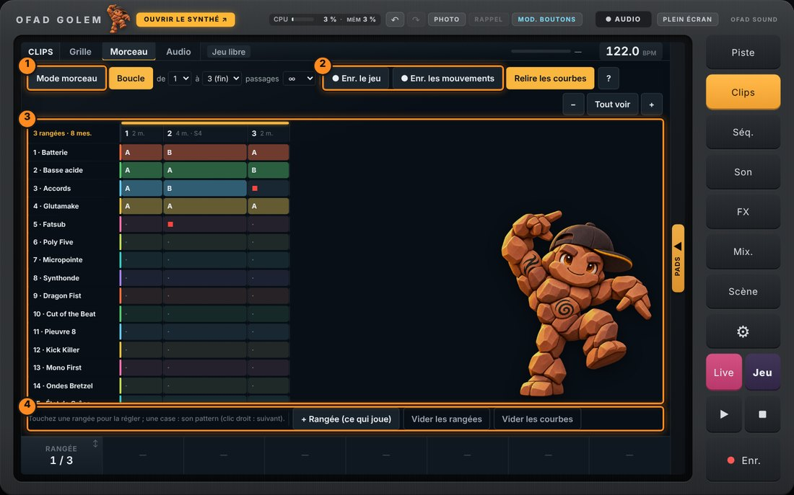<figcaption>LANCEMENT › Morceau</figcaption></figure>

1. **Mode morceau** (les rangées s'enchaînent) ou **Boucle** (la grille joue).
2. **● Enr. le jeu** (votre jeu devient des rangées) et **● Enr. les mouvements** (boutons, faders, mutes, solos, crossfader en courbes).
3. Les **rangées** jouées l'une après l'autre ; les **courbes** en dessous.
4. Ajouter ce qui joue comme rangée, vider les rangées ou les courbes.

### Écran LANCEMENT › Audio (montage)

| Touche ou geste | Effet |
|---|---|
| Glisser un clip | Le déplacer (aussi vers une autre piste) |
| Glisser le bord d'un clip | Le rogner |
| **Ctrl** (ou Maj) + clic | Choisir plusieurs clips |
| Tirer un rectangle dans le vide | Choisir les clips qu'il touche (**Ctrl** : ajoute) |
| **Ctrl + A** | Choisir tous les clips |
| Clic droit sur un clip | Menu : couper ici, copier, dupliquer, volume à 0 dB, supprimer |
| Clic droit dans le vide | Menu : coller ici, tête de lecture ici, tout choisir |
| Outil ✂, ou touche **S** | Couper (S : à la tête de lecture) |
| **Ctrl + C / Ctrl + V** | Copier / coller à la tête de lecture |
| **Ctrl + D** | Dupliquer à la suite |
| **Suppr** (ou Retour arrière) | Supprimer |
| **Ctrl + Z / Ctrl + Y** | Annuler / rétablir (montage) |
| Clic sur la règle (glisser : la déplacer) | Placer la tête de lecture — la prochaine prise s'y pose |
| Clic droit (ou **Maj**) + glisser sur la règle | Nouvelle boucle |
| Glisser la barre orange de la boucle | Déplacer la boucle ; ses bords : l'agrandir ou la raccourcir |
| **Boucle** allumée + « ● Enregistrer une prise » | La prise dure exactement la boucle et **s'arrête toute seule** à sa fin |

<figure class="wide">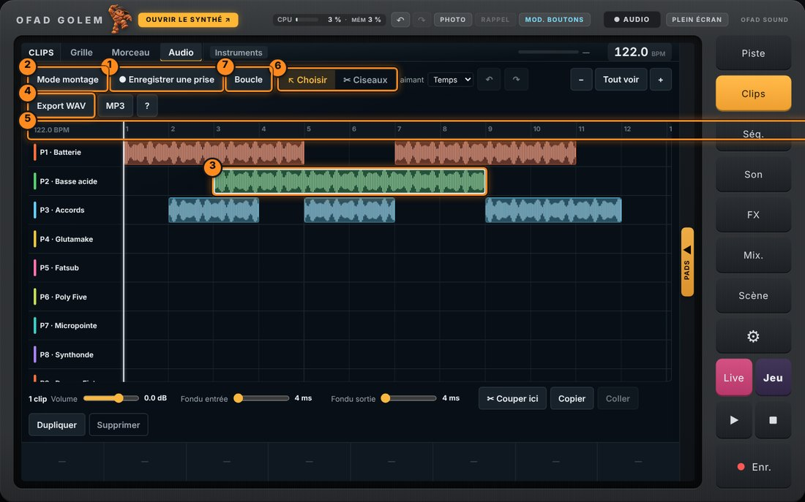<figcaption>LANCEMENT › Audio (montage)</figcaption></figure>

1. **● Enregistrer une prise** (elle se pose à la tête de lecture, ou au début de la boucle si la Boucle est allumée).
2. **Mode montage** : la lecture joue les clips à la place des instruments.
3. Un **clip** : glisser, rogner par les bords, clic droit : menu.
4. **Export WAV / MP3** du montage fini.
5. La **règle** : clic = tête de lecture ; clic droit (ou Maj) + glisser = boucle (barre orange).
6. Outils **Choisir** / **Ciseaux** et aimant (mesure, temps, 1/16, libre).
7. **Boucle** : allumée pendant une prise, elle fixe sa longueur au pas près.

## Démarrer

- Au lancement, la mascotte s'affiche pendant le chargement, puis l'**accueil** : reprendre la dernière
  séance, nouveau projet vide, projet de démonstration, ouvrir un fichier, ou un projet du dossier.
  (Réglages › « Accueil au démarrage » pour l'afficher ou non.)
- Carte son : **Options** (en haut à gauche de la fenêtre) › Audio/MIDI Settings. Pour la latence la plus faible :
  pilote ASIO de la carte son ou « Windows Audio (Low Latency Mode) », tampon de 128 à 256 échantillons.

<figure><figcaption>L'accueil au lancement : reprendre, nouveau projet, démonstration, ouvrir, projets du dossier</figcaption></figure>

## L'appareil

- **8 écrans** (boutons à droite) : Pistes, Lancement, Séquence, Son, Effets, Mixeur, Scènes, Réglages.
- **16 boutons assignables** sous l'écran : chacun pilote la valeur qu'on lui a confiée (voir « Boutons
  et valeurs »). Les valeurs de l'écran se règlent en bas de l'écran, directement.
- **16 pads** à droite : leur rôle (Jouer, Couper, Scènes, Pas, Effacer) se choisit au-dessus d'eux.
- **Transport** en bas : Enr. (enregistrement dans le pattern), Lecture, Arrêt ; Fill, Break, Maj ; octave ;
  crossfader des scènes A / B.
- **Sur téléphone** : à côté de l'écran, deux onglets. **Commandes** : les écrans, les 16 boutons, le
  transport, Fill et Break, le crossfader, Photo / Rappel et la rangée **Tempo** (− / valeur à toucher
  pour la taper / + / **Tap** : touchez en rythme, le tempo suit). **Pads** : le rôle des pads, les 16
  pads, la banque de scènes.
- **Barre du haut** : « Ouvrir le synthé » (la façade de l'instrument en grand), charge du processeur,
  annuler / rétablir, Photo et Rappel des réglages, enregistrement Audio, plein écran.

<figure>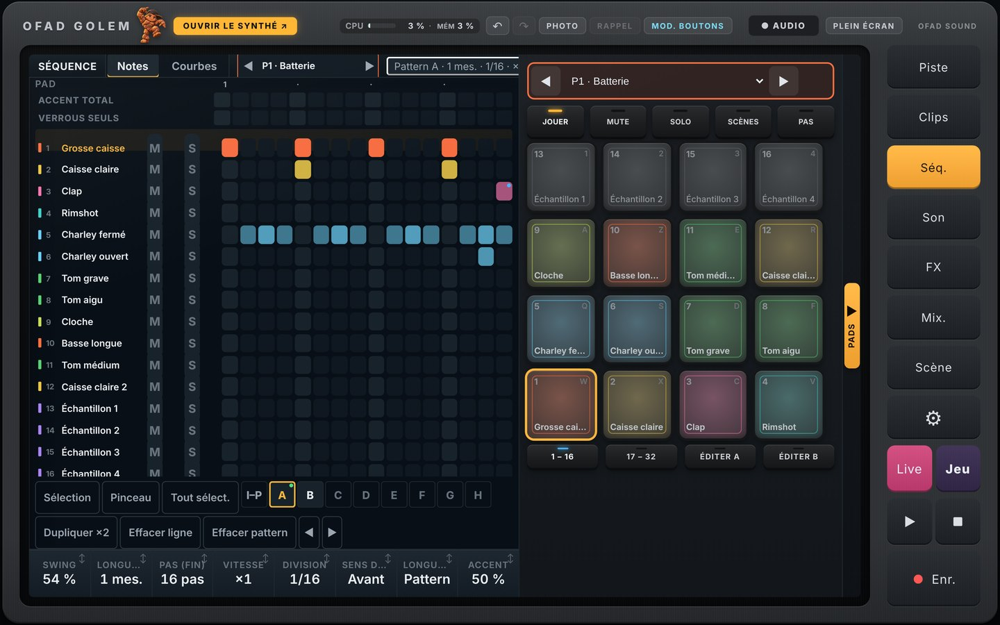<figcaption>L'appareil : l'écran (ici LANCEMENT › Grille), les 16 boutons assignables, les M / S, le transport, les 8 écrans et les 16 pads</figcaption></figure>

## Les bases de l'édition

### 1. Choisir un son

Écran PISTES : choisir l'instrument de chaque piste (ou « ⇄ Instrument » sur la
façade, par les images). Les **préréglages** se choisissent par catégories.

<figure>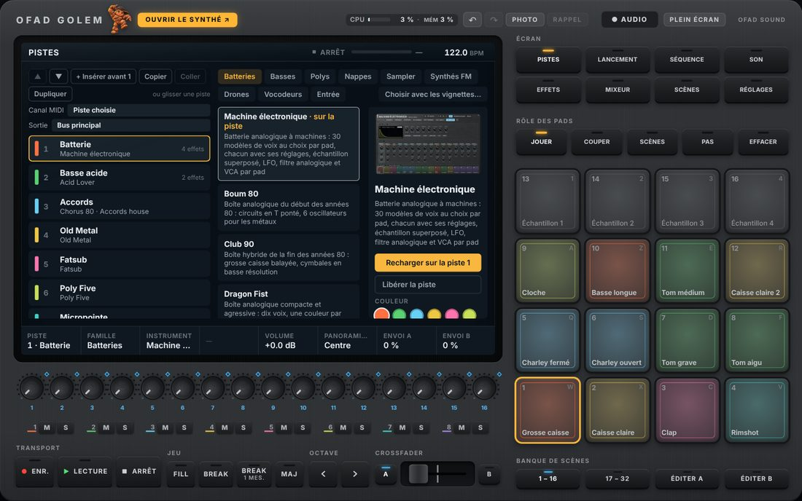<figcaption>Écran PISTES : l'instrument, le nom et la couleur de chaque piste</figcaption></figure>

### 2. Jouer

Les pads, le clavier de l'ordinateur, le clavier de la façade ou un contrôleur MIDI (les notes vont à la
piste affichée). « Ouvrir le synthé » montre la façade de l'instrument en grand.

<figure>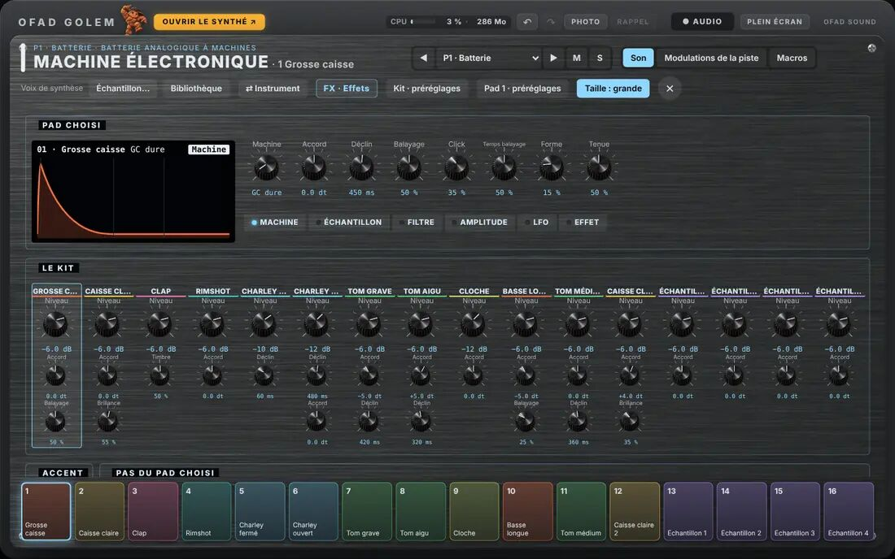<figcaption>La façade d'un instrument (ici la batterie à machines) : tous ses réglages, ses pads ou son clavier</figcaption></figure>

**L'en-tête de chaque façade** a toujours trois lignes, sur PC comme sur téléphone : 1. le nom de
l'instrument, le transport (● ▶ ■), le choix de la piste (◀ ▶, M, S) et ✕ pour refermer ; 2. les pages
(Son, Pas, Modulations de la piste, Macros…), qui défilent de côté s'il y en a beaucoup ; 3. les outils :
échantillon et bibliothèque (si l'instrument en a), ⇄ Instrument, FX · Effets, Préréglages.

### 3. Écrire une séquence

Chaque piste a **16 patterns** (A à P), de 1 à 32 mesures. Une même séquence s'écrit de trois façons,
au choix — c'est **toujours la même séquence** : un pas posé sur la façade apparaît aussitôt dans
l'écran SÉQUENCE, et inversement.

- **À la souris**, écran SÉQUENCE : une ligne par pad (batterie) ou un rouleau de notes (instrument
  mélodique), où **chaque pas reçoit la note qu'on veut** (jusqu'à 4 notes par pas pour les accords).
- **En jouant** : **Enr.**, puis jouez aux pads, au clavier de la façade, au clavier de l'ordinateur ou au
  contrôleur MIDI, en rythme. Les notes s'écrivent dans le pattern pendant qu'il tourne (quantification
  de 0 à 100 % dans Réglages ; le reste du décalage est gardé). **ENR.** enregistre aussi les
  **mouvements** des boutons de la piste en courbes dans le pattern (onglet Courbes).
- **Sur la façade du synthé**, dans « Pas de la séquence », avec deux écritures au choix
  (« Écriture ») : **Acide** ou **À verrous**. Le choix est gardé, et le même partout. Sur les synthés
  mélodiques, la rangée choisie est aussi **au-dessus du clavier**, sur toutes les pages de la façade :
  on écrit ses pas sans quitter la page Son. **Masquer ▾** la replie (plus de place pour les réglages),
  **Afficher ▴** la ramène.
- Rôle des pads **Pas** : les 16 pads posent ou retirent les pas de la page affichée, comme le pas à
  pas d'une boîte à rythmes.

<figure class="wide">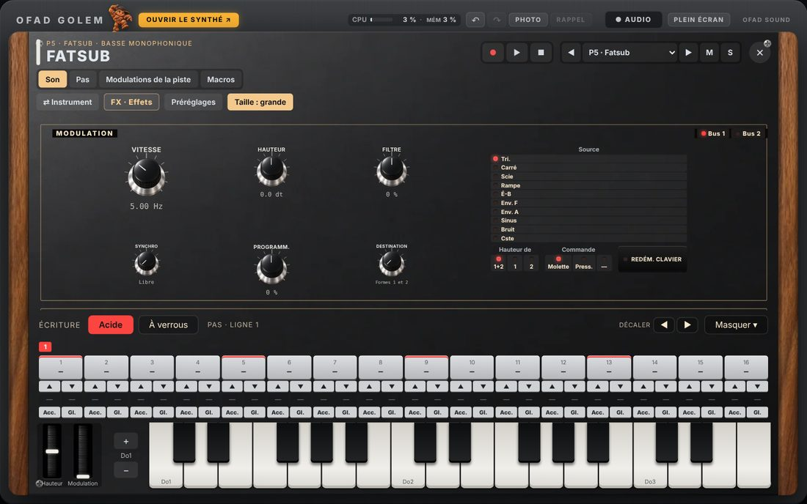<figcaption>La rangée de pas au-dessus du clavier : Écriture Acide ou À verrous, Décaler, Masquer</figcaption></figure>

**Le séquenceur acide** (basses et synthés) : la rangée des années 80, pas par pas.

<figure class="wide">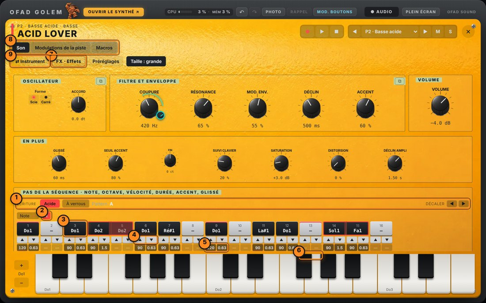<figcaption>Façade de la basse : écriture « Acide »</figcaption></figure>

1. **Écriture** : Acide ou À verrous.
2. Les **pages** de 16 pas (un bouton par page quand le pattern est plus long).
3. La **note** du pas : toucher pose ou retire le pas ; tirer vers le haut ou le bas (ou la molette)
   change la note d'un demi-ton.
4. **▲ ▼** : une octave plus haut ou plus bas.
5. **Vélocité** et **durée** du pas (glisser sur la valeur).
6. **Acc.** (accent : le pas joue plus fort et plus « mordant », dosé par le bouton Accent) et **Gl.**
   (glissé : la note tient jusqu'au pas suivant et glisse vers lui ; même note : liée, sans
   redéclencher). Toucher : allumer / éteindre ; **appui long** : la valeur du pas (voir ci-dessous).
7. **FX · Effets** : les effets de la piste en pédales (voir 5).
8. **Son · Modulations de la piste · Macros** : les autres pages de la façade.
9. **⇄ Instrument** : changer d'instrument par les images.

**Le séquenceur à verrous** : chaque pas peut garder ses propres réglages (coupure, résonance,
effets…), en plus de sa note.

<figure class="wide">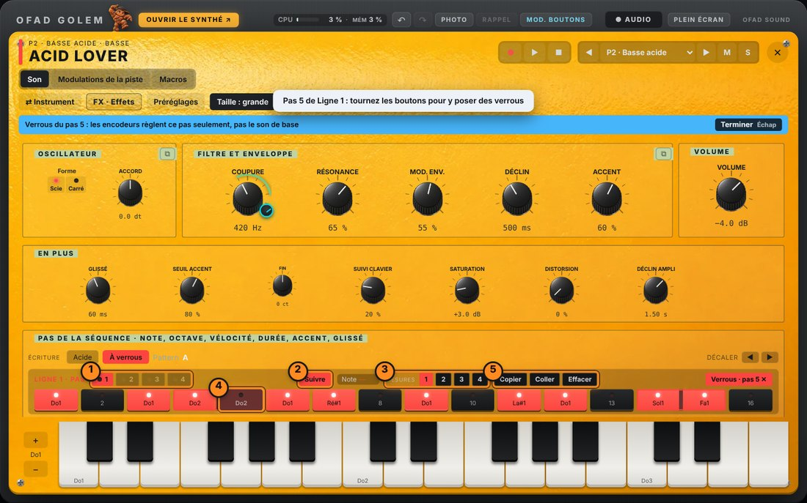<figcaption>Façade de la basse : écriture « À verrous », le pas 5 choisi</figcaption></figure>

1. **Pages 1 à 4** (16 pas chacune) : toucher une page l'affiche.
2. **Suivre** : la page tourne toute seule avec la lecture (toucher une page arrête de suivre).
3. **Mesures** : longueur de la ligne, 1 à 4 mesures (le pattern s'allonge si besoin).
4. Un **pas choisi** (appui long sur le pas, ou bouton **Verrous** puis toucher le pas) : tournez
   n'importe quel bouton de la façade, du pédalier ou de l'écran SON — la valeur est **verrouillée sur
   ce pas** seulement. Un bandeau le rappelle ; Échap ou « Terminer » en sort.
5. **Copier / Coller / Effacer** les verrous du pas choisi (« Sans verrous » : tous ceux de la ligne).

Sur les synthés, la rangée à verrous écrit **la dernière note jouée** (pads, clavier de la façade, ou
clavier MIDI à l'arrêt) : elle est affichée (« **Note** Fa1 ») et chaque pas posé montre sa note à la
place de son numéro. Un pas choisi (appui long) prend la note de la touche jouée ensuite.

**Décaler ◀ ▶** : toute l'écriture glisse d'un pas à gauche ou à droite, en boucle (le pas qui sort
revient de l'autre côté) ; notes, accents, glissés, conditions et verrous suivent. Sur la façade : à
droite de « Écriture » (batteries : **Tout** ou le **Pad** choisi seul), ou dans la rangée à verrous
(la ligne seule) ; dans l'écran SÉQUENCE : ◀ ▶ après « Effacer pattern » (**Maj** : la ligne choisie seule).

**Transport de la façade** : sur la première ligne de chaque façade, juste à gauche du choix de la
piste, **●** enregistrer, **▶** lecture (**❚❚** pour arrêter), **■** arrêt — sans quitter l'instrument.

**La valeur d'un pas : accent et glissé.** Dans l'écran SÉQUENCE (lignes **Accent** et **Glissé**) comme
sur la façade (**Acc.** et **Gl.**), toucher allume ou éteint la fonction du pas ; un **appui long**
(clic droit sur PC) ouvre sa valeur, en grand :

- **Accent** : la force de l'accent de ce pas, de 1 à 100 %. Sans valeur, le pas prend l'accent de la
  piste (le réglage Accent en bas de l'écran).
- **Glissé** : la durée du glissement vers la note suivante, de 1 à 100 % du pas (plus c'est haut, plus
  ça glisse), sur les synthés qui ont un portamento. Sans valeur : le portamento de l'instrument.
- **▲ ▼** (maintenus, la valeur défile), **glisser** le doigt sur la valeur, ou **Taper…** ; **Par
  défaut** revient à la valeur de la piste ou de l'instrument. Chaque changement s'entend tout de suite,
  la fenêtre reste ouverte tant qu'on règle. Régler une valeur allume la fonction du pas.
- Une case qui a sa valeur l'affiche (par exemple « 54 »). Les valeurs suivent la copie, le décalage et
  l'annulation, et sont gardées dans le projet.

<figure class="wide">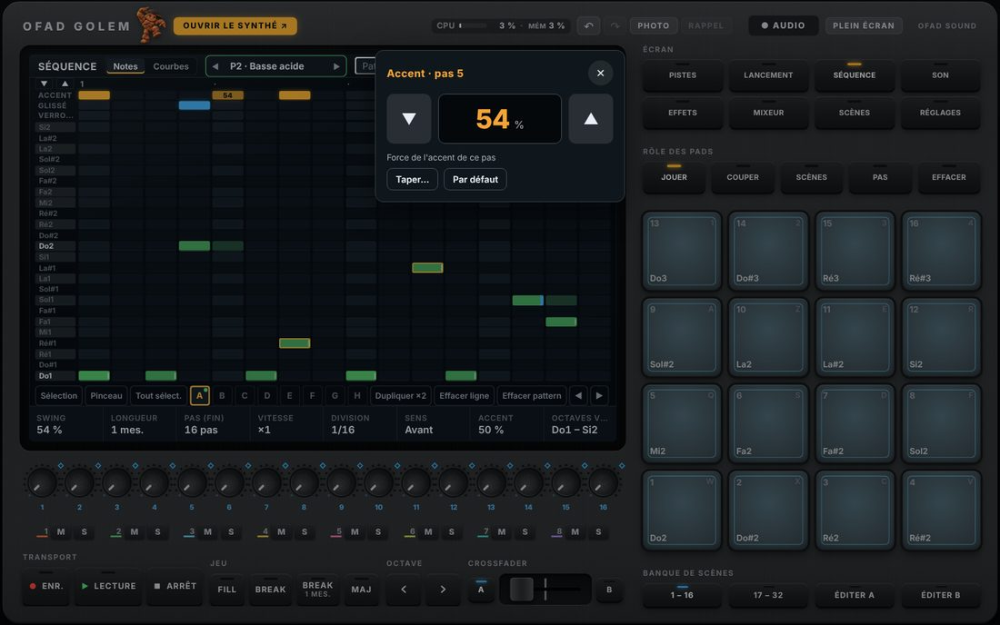<figcaption>La force de l'accent d'un pas</figcaption></figure>

Dans l'écran SÉQUENCE, le clic droit sur un pas ouvre les mêmes réglages : vélocité, durée, décalage,
**note**, condition (probabilité, A:B, Fill…), répétitions, flam, et le bouton **Verrous**.

**Tourner les pages** : une page montre 16 pas (une mesure en 1/16). Dans l'écran SÉQUENCE, ◀ ▶ en
haut (ou les pastilles), ou **Maj** + ◀ ▶ d'Octave au transport ; sur la façade, les boutons de page (et
**Suivre** en écriture À verrous) ; pour les pads en rôle Pas, c'est la page affichée qui est écrite.

#### Les réglages de la piste (aucun pas choisi)

Les valeurs du bas de l'écran règlent le pattern de la piste :

| Valeur | Effet |
|---|---|
| **Swing** | Décale un pas sur deux (50 % : droit, jusqu'à 75 %) |
| **Longueur** | Nombre de mesures du pattern (1 à 32) |
| **Pas (fin)** | Longueur au pas près (ex. 15 pas pour une boucle impaire) |
| **Vitesse** | ×1/8 à ×2 : le pattern joue plus lentement ou plus vite que le tempo |
| **Division** | Valeur d'un pas : 1/4, 1/8, 1/16, 1/32, 1/64, ou en triolets |
| **Sens** (batterie : **Sens du pad**) | Avant, arrière, aller-retour, aléatoire |
| **Longueur du pad** (batterie) | Une ligne qui boucle sur sa propre longueur (polyrythmes) |
| **Accent** | Force des pas de la ligne Accent |
| **Octaves vues** (mélodique) | Les octaves affichées dans le rouleau de notes |

#### Les réglages d'un pas

Un **premier clic** sur un pas posé le **choisit** (il s'entoure) ; un deuxième clic l'enlève. Le pas
choisi, les valeurs du bas de l'écran règlent **ce pas seulement** :

<figure class="wide">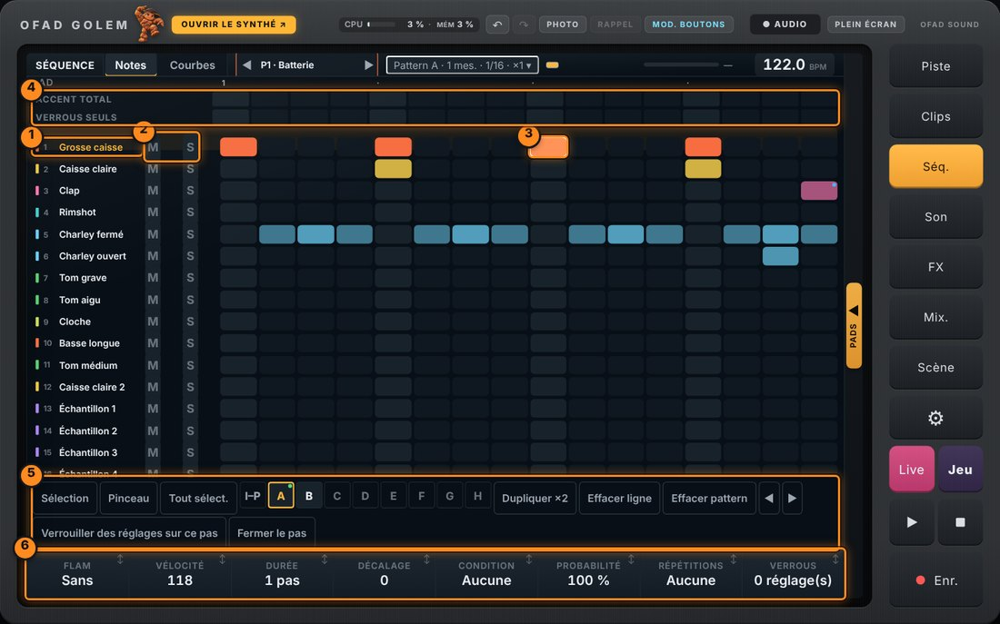<figcaption>Un pas de grosse caisse choisi : ses réglages en bas</figcaption></figure>

1. La **ligne** (un pad de la batterie) : toucher son nom la choisit et sélectionne tous ses pas
   (encore une fois : les désélectionne).
2. **M / S** de la ligne : couper ou écouter seule une ligne.
3. Le **pas choisi**.
4. Les lignes **Accent** (ici « Accent total » : tous les sons du pas plus forts) et **Verrous seuls**.
5. Les **outils** : Sélection, Pinceau, Tout sélect., patterns A à P (clic droit : le lancer), Dupliquer ×2,
   Effacer ligne, Effacer pattern, ◀ ▶ Décaler ; pour le pas choisi : « Verrouiller des réglages sur ce pas », « Fermer
   le pas », « Retirer condition et verrous ».
6. Les **réglages du pas** :

| Valeur | Effet |
|---|---|
| **Note** (mélodique) ou **Flam** (batterie) | La note du pas ; ou un petit coup juste avant le coup principal (8 à 60 ms) |
| **Vélocité** | Le **volume** du coup (1 à 127) |
| **Durée** | Combien de temps la note tient (de 1/8 de pas à plusieurs mesures) |
| **Décalage** | Avancer ou retarder le pas finement (± 32/64 de pas) : jeu « humain » |
| **Condition** | Quand le pas joue (voir le tableau ci-dessous) |
| **Probabilité** | Chance que le pas joue (0 à 100 %), en plus de la condition |
| **Répétitions** | 2 à 8 coups dans le pas (roulements), à force égale, décroissante ↘ ou croissante ↗ |
| **Verrous** | Tourner vers la droite : les boutons de tous les écrans écrivent dans ce pas |

#### Les conditions : des pas qui ne jouent pas à chaque fois

Une condition fait jouer un pas seulement dans certains cas : c'est ce qui donne de la vie à une boucle
courte, des variations et des petites relances sans écrire d'autres patterns.

| Condition | Le pas joue… |
|---|---|
| **Aucune** | à chaque fois |
| **A:B** (1:2, 2:2, 1:4, 3:4…) | au passage A sur B : 1:2 = un tour sur deux (le 1er), 4:4 = au 4e tour seulement |
| **FILL** | seulement quand **Fill** est tenu (ou Break) : les relances |
| **NON FILL** | seulement quand Fill n'est **pas** tenu (ce qui se tait pendant la relance) |
| **PRÉ** / **NON PRÉ** | si le dernier pas à condition de la même ligne a joué / n'a pas joué |
| **VOISIN** / **NON VOISIN** | si le dernier pas à condition de la ligne du dessus a joué / n'a pas joué |
| **1ER** / **NON 1ER** | seulement au premier tour du pattern / à tous les tours sauf le premier |

#### Fill et Break : relances et coupures en direct

- **Fill** (bouton du transport, ou touche **N** tenue) : tant qu'on le tient, les pas **FILL** jouent et
  les pas **NON FILL** se taisent. On prépare ainsi dans le même pattern une relance de caisse claire, un
  roulement de toms (avec **Répétitions** ↗), un charley ouvert… qui n'apparaissent que quand on appuie :
  des mini-breaks à la demande.
- **Break** (bouton, ou touche **B** tenue) : applique la **scène de Break** tant qu'on le tient — c'est une
  scène comme les autres (réglée dans l'écran SCÈNES) : par exemple grosse caisse coupée, filtre fermé,
  écho poussé. Break déclenche **aussi Fill** : les pas FILL jouent en même temps.
- **Break · N mes.** (Break temporisé) : Break pendant 1, 2, 4, 8 ou 16 temps, puis il s'arrête tout seul
  sur un temps (**Maj** + appui : changer la durée).
- Avec **Maj** allumé, Fill et Break restent enclenchés au lieu d'être tenus.

#### Sélectionner, effacer, tout supprimer

<figure class="wide">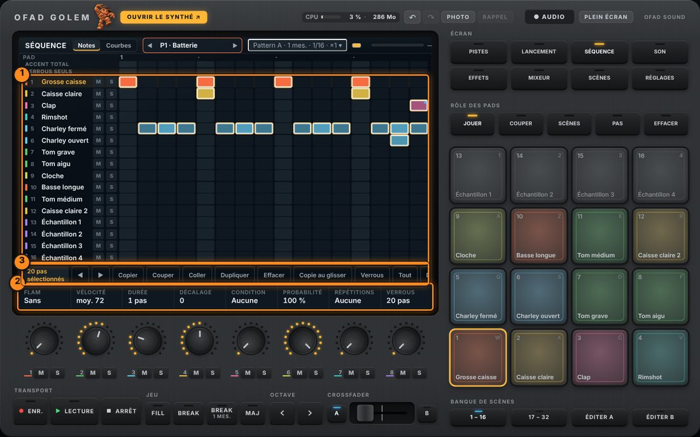<figcaption>« Tout sélect. » : les 20 pas du pattern choisis</figcaption></figure>

1. La **sélection** : les pas choisis sont entourés.
2. Les valeurs du bas règlent **tous les pas choisis à la fois** : vélocité (moyenne ; les écarts entre pas sont
   gardés), durée, décalage, condition, probabilité, répétitions, verrous ; en mélodique, « Transposer ».
3. La **barre de la sélection** : ◀ ▶ (décaler d'un pas), Copier, Couper, Coller, Dupliquer, Effacer, Copie
   au glisser, Verrous, Tout.

Les gestes :

- **Choisir** : **Ctrl + A** ou « Tout sélect. » (tout le pattern) ; le nom d'une ligne (tous ses pas) ;
  **Ctrl** + clic (un pas de plus ou de moins) ; tirer un rectangle depuis une case vide ; au doigt, bouton **Sélection** puis toucher les pas.
- **Effacer la sélection** : **Suppr** (ou « Effacer » dans la barre).
- **Effacer une ligne** : « Effacer ligne » (la ligne choisie : le pad, en batterie).
- **Tout supprimer** : « **Effacer pattern** » vide tout le pattern affiché (notes, conditions, verrous) ;
  les autres patterns ne bougent pas.
- Un pas garde sa note mais perd ses conditions et ses verrous : « Retirer condition et verrous ».
- Une erreur ? **Ctrl + Z** annule (50 étapes).

<figure>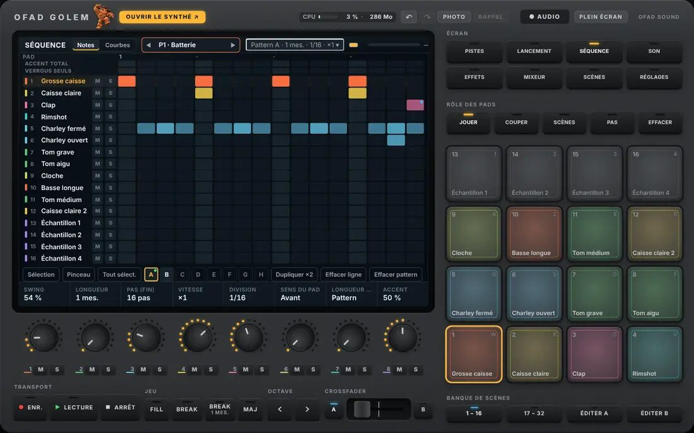<figcaption>Écran SÉQUENCE : une ligne par pad (batterie) ou un rouleau de notes (instrument mélodique)</figcaption></figure>

### 4. Lancer

Écran LANCEMENT › Grille : chaque case lance un pattern (au début de la mesure suivante) ;
▶ en tête de rangée lance la même lettre sur toutes les pistes ; ■ arrête une piste.

**Les 16 rangées, en deux pages.** Chaque piste a 16 patterns : les rangées vont de **A à P**. La bande
**Rangées** (Mixeur, Scènes, vue live) les montre sur une seule ligne, 8 à la fois :

- **◀ / ▶** (sous-titrés « I–P » ou « A–H ») tournent la page. Ils s'entourent de jaune quand la rangée
  qui joue est sur l'autre page.
- **−1 / +1** lancent la rangée précédente ou suivante et **changent de page tout seuls** (de H, +1 passe
  à I). Ils **sautent les rangées vides** : si I à P ne sont pas écrites, +1 depuis H revient à A.
- La page suit la rangée lancée, aussi depuis le contrôleur MIDI ou le morceau, et c'est la même partout
  (bande des rangées, grille de LANCEMENT).
- Au contrôleur MIDI, chacune des 16 rangées s'apprend (clic droit sur son bouton), comme −1 / +1 et ■.

### 5. Régler le son

**Un instrument, trois vues, les mêmes réglages.** Le son d'une piste se règle :

- sur la **façade du synthé** (« Ouvrir le synthé ») : tous ses boutons, comme sur la machine ;
- dans l'**écran SON** : les mêmes réglages par onglets, en bas de l'écran, avec les préréglages ;
- en **pédales** (« FX · Effets » sur la façade) : les 4 effets d'insert de la piste comme un pédalier,
  par-dessus l'instrument (Échap revient à l'instrument) ; l'**écran EFFETS** montre les mêmes effets
  dans l'ordre du signal.

Tout est lié : tourner la coupure sur la façade la tourne aussi dans l'écran SON, un effet changé en
pédale l'est aussi dans l'écran EFFETS. Les verrous de pas, les scènes, les modulations, les macros et
l'apprentissage MIDI marchent de la même façon depuis les trois vues.

<figure>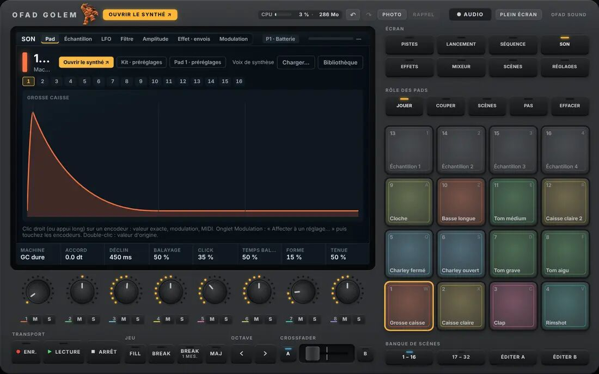<figcaption>Écran SON : les réglages de l'instrument par onglets, avec ses préréglages</figcaption></figure>

<figure>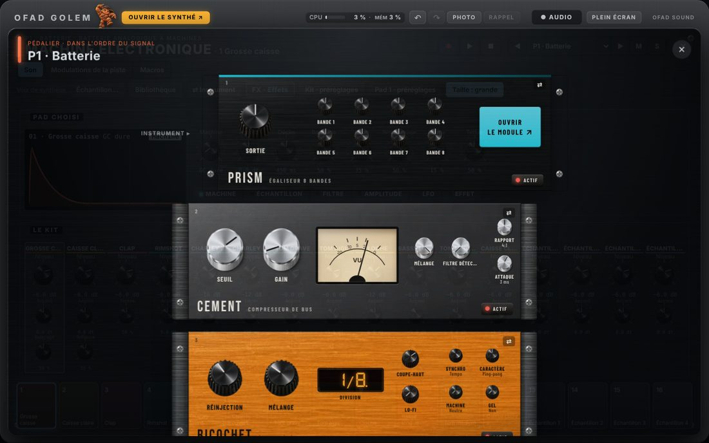<figcaption>« FX · Effets » depuis la façade : les effets de la piste en pédales, par-dessus l'instrument</figcaption></figure>

<figure>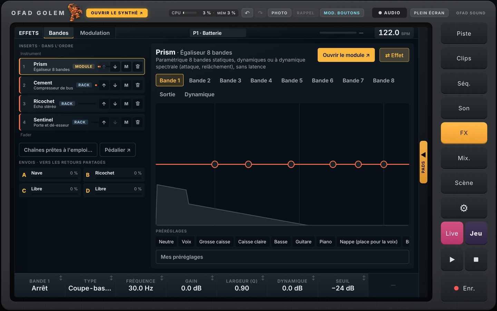<figcaption>Écran EFFETS : les 4 effets d'insert du canal, dans l'ordre du signal</figcaption></figure>

### 6. Mixer

Écran MIXEUR : volume, panoramique, coupure (M), solo (S), envois vers les retours A à D,
7 groupes et le principal.

<figure>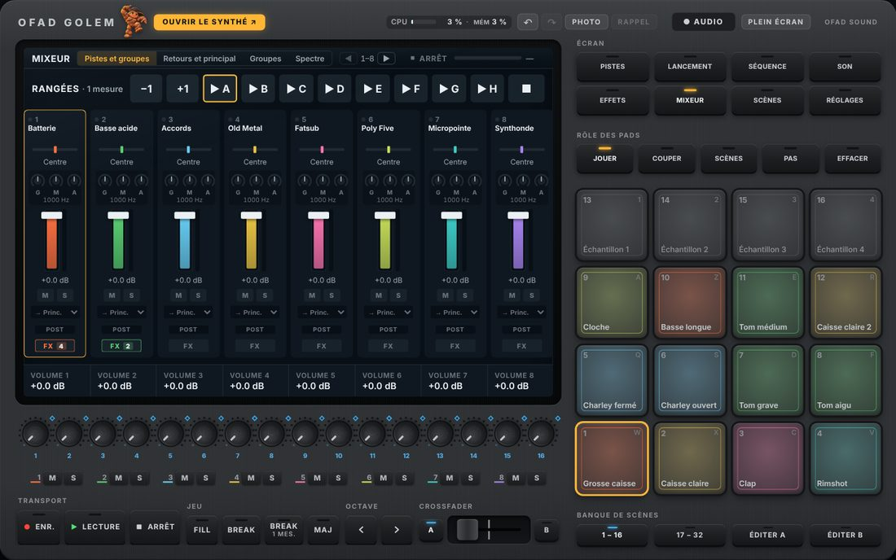<figcaption>Écran MIXEUR : pistes et groupes, retours et principal</figcaption></figure>

### 7. Scènes

Une **scène** est une liste de réglages (de n'importe quelle piste, effet ou mixeur) avec leurs
valeurs. Il y a **32 scènes** (deux banques de 16) et une **scène de Break**. Deux scènes sont placées
de part et d'autre du **crossfader** : la scène **A** à gauche, la scène **B** à droite. En poussant le
crossfader, les réglages passent **en douceur** des valeurs de A à celles de B (les réglages à crans
basculent au milieu). Seuls les réglages enregistrés dans A ou B bougent : le reste ne change pas.

<figure class="wide">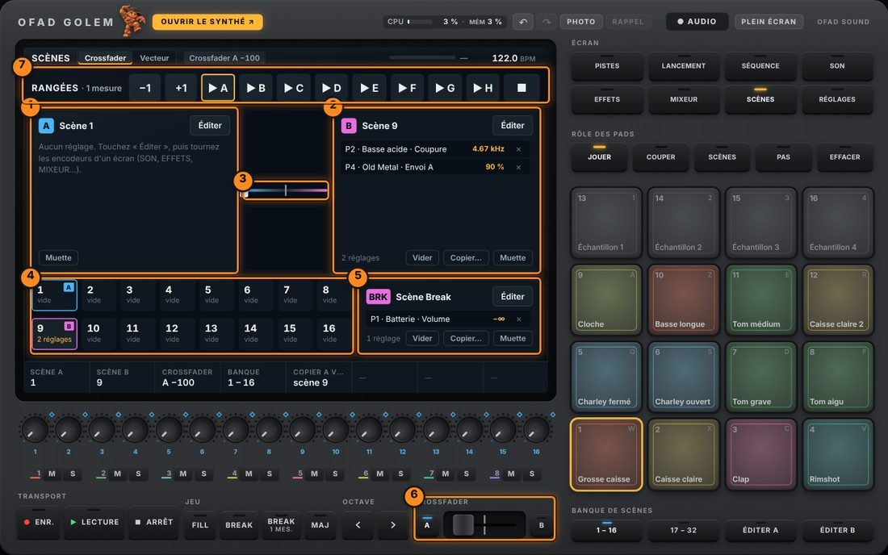<figcaption>Écran SCÈNES</figcaption></figure>

1. **Scène A** : « Éditer », puis tournez des boutons sur n'importe quel écran (SON, EFFETS, MIXEUR,
   façade, pédales) : chaque réglage touché s'ajoute à la scène avec sa valeur. « Terminer » pour sortir.
   Les valeurs se retouchent aussi dans la liste (glisser), × retire un réglage.
2. **Scène B** : pareil, de l'autre côté.
3. La **position du crossfader**.
4. La **grille des scènes** : toucher une scène la place **du côté qu'on entend** (là où est le
   crossfader) ; avec **Maj**, elle part **de l'autre côté**, prête à être amenée au crossfader. Clic
   droit : scène muette. Les valeurs « Scène A » / « Scène B » du bas choisissent aussi la scène de chaque côté.
5. La **scène de Break** : appliquée tant que **Break** (ou la touche **B**) est tenu.
6. Le **crossfader** du transport (aussi au contrôleur MIDI ; double-clic : retour au milieu).
7. Les **rangées A à P** : lancer une rangée lance aussi sa **scène liée** (réglée dans LANCEMENT).

**Jouer avec plusieurs scènes, en chaîne** : crossfader à gauche sur la scène 1. **Maj** + scène 2 : elle
se place en B. Poussez le crossfader vers la droite : le son glisse de la scène 1 à la scène 2. **Maj** +
scène 3 : elle se place en A (le côté qu'on n'entend plus). Ramenez le crossfader à gauche : le son
glisse vers la scène 3. Et ainsi de suite, autant de scènes qu'on veut, sans coupure. Les mouvements du
crossfader s'enregistrent dans le morceau (« Enr. les mouvements »). Au contrôleur MIDI, les Program
Change 0 à 31 lancent les scènes 1 à 32.

<figure class="wide">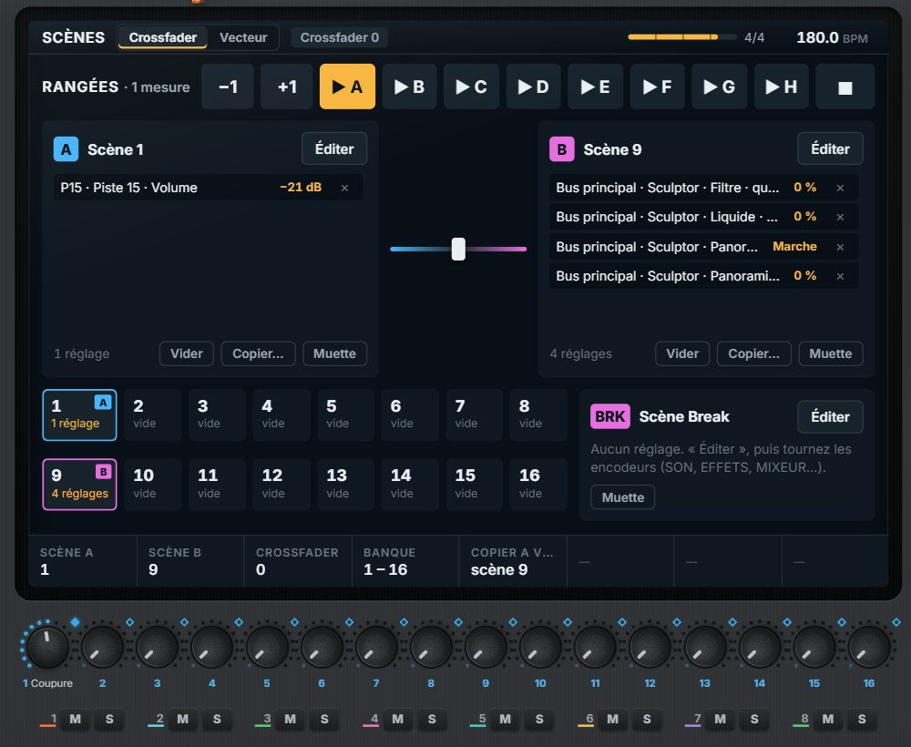<figcaption>SCÈNES › Crossfader (PC) : scène 1 en A, scène 9 en B, le crossfader entre les deux</figcaption></figure>

**Le pavé vectoriel** (écran SCÈNES, onglet **Vecteur** ; l'onglet **Crossfader** garde le crossfader A /
B). Quatre scènes, une par coin (**A B C D**, choisies dans « Coins »), se mêlent selon la position du
point sur le pavé : au centre, les quatre à parts égales ; dans un coin, la scène de ce coin.

- **Pavé actif** : le pavé remplace le crossfader A / B. Toucher le pavé l'active et place le point ;
  double-clic : retour au centre. **X** et **Y** se règlent aussi en bas de l'écran.
- **Mouvement** : le point tourne tout seul autour de sa place — Cercle, Infini, Losange, Carré,
  Triangle, Ricochet, Hasard, ou **Dessinée** (« Dessiner une forme » : tracez-la au doigt). La forme
  choisie s'affiche sur le pavé.
- **Un tour en** : de 1/2 à 128 mesures, calé sur le tempo. **Taille** : l'ampleur du mouvement.
  **Hauteur** : aplatit ou étire la forme (de 5 % à 200 %) : le cercle devient un ovale, le carré un
  rectangle, l'infini s'écrase ou s'étire. **Rotation** : fait tourner la forme (0°, 45°, 90°, 135° en un toucher ; l'Infini passe à la
  verticale à 90°). La forme dessinée garde sa place et son sens.
- **Régler la forme sur le pavé** : glisser la **déplace** (sans saut). Sur PC, **clic droit tiré**
  vers le haut ou le bas : taille ; vers la gauche ou la droite : rotation ; **molette** : taille,
  **Maj + molette** : rotation. Au doigt, à **deux doigts** : pincer pour la taille, tourner pour la
  rotation.
- Toutes ces valeurs se confient à un bouton assignable ou au contrôleur MIDI.

<figure class="wide">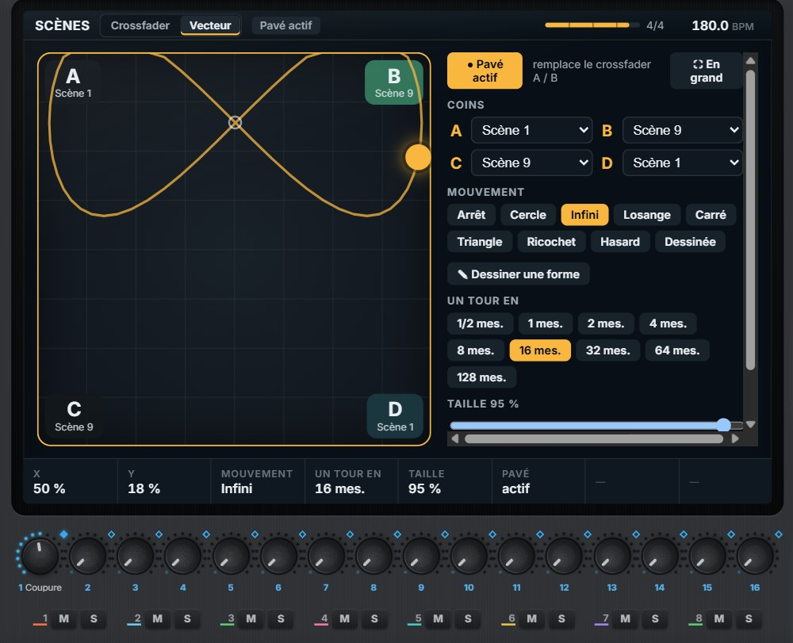<figcaption>SCÈNES › Vecteur (PC) : le mouvement « Infini » parcourt les quatre scènes</figcaption></figure>

**⛶ Vue live** (bouton framboise à côté des onglets Crossfader / Vecteur) : tout le jeu sur un seul
écran, la vitrine du direct. En haut : Retour, ● ▶ ■, le mode **Crossfader** ou **Vecteur** (avec, en
Vecteur, le mouvement, la durée d'un tour, Dessiner), la piste choisie et **Ouvrir l'instrument** ; puis
les **16 boutons assignables avec le nom de leur fonction** ; les **rangées** (voir ci-dessous).

- **Mode Crossfader** : la scène A et ses réglages, un grand crossfader (A, B, double-clic : moitié), la
  scène B ; à côté, la grille des scènes (banques 1–16 / 17–32, toucher : lancer) et la scène Break.
- **Mode Vecteur** : le pavé carré et tous ses réglages (coins, mouvement, durée, taille, hauteur,
  rotation, dessin). **Crossfader** et **Vecteur** choisissent la vue : passer au Crossfader arrête le
  pavé, passer au Vecteur ne l'allume pas. On le règle (et on place même le point au doigt) sans que le
  son bouge, puis **Pavé arrêté / Pavé actif** (vert quand il joue) le lance ou l'arrête.
- Les **cartes de scène** de la vue live servent à jouer : nom de la scène et ses réglages. On les édite
  avant, dans l'écran SCÈNES.
- **Console** (PC) : les 16 pistes avec fader de volume, crête-mètre, **FX** (les effets de la piste, en
  pédales), **M / S** ; **Pistes / Groupes** montre les groupes du mixeur, et en vue Pistes les groupes
  utilisés prennent la place des pistes sans instrument. Toucher le nom ou le fader d'une piste la
  choisit (Ouvrir l'instrument, effets, boutons à assigner) ; ✕ dans l'instrument ou les effets
  ramène à la vue live.
- En bas : la **position** (mesure, temps, boucle, rangée du morceau) et **Photo / Rappel / Mod. boutons**.
- Sur téléphone, la console devient la liste des pistes (nom : choisir, M / S).

<figure class="wide">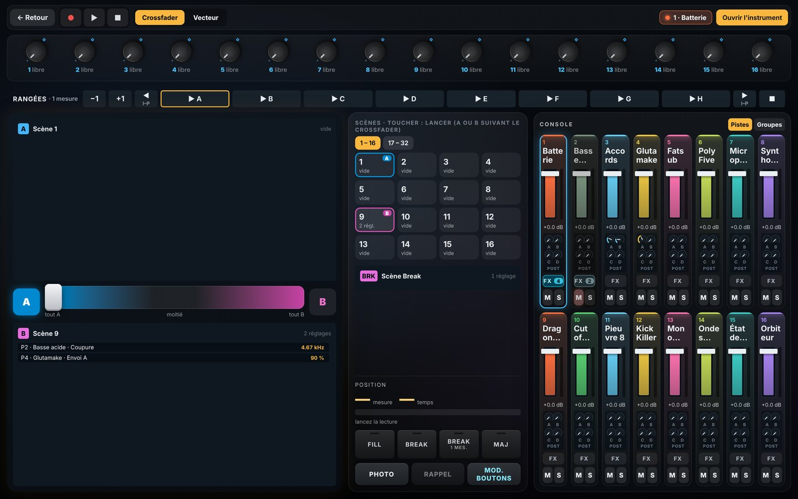<figcaption>Vue live · Crossfader</figcaption></figure>

<figure class="wide">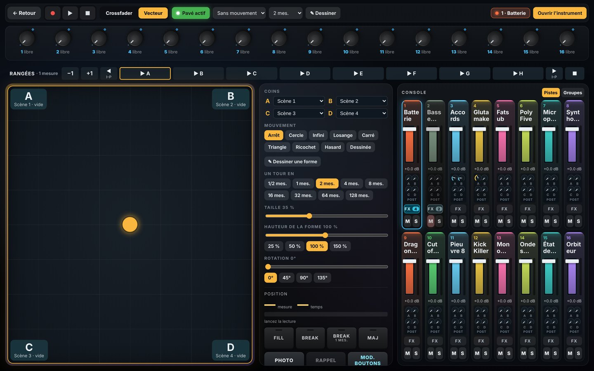<figcaption>Vue live · Vecteur</figcaption></figure>

<figure>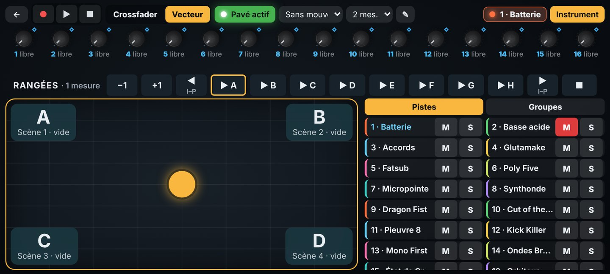<figcaption>Vue live sur téléphone</figcaption></figure>

### 8. Morceau

Écran LANCEMENT › Morceau : des **rangées** jouées l'une après l'autre en mode morceau.
« Enr. le jeu » transforme votre jeu en rangées ; **ENR.** (ou « Enr. les mouvements ») enregistre les
mouvements : boutons, faders, égaliseurs, mutes, solos, groupes, crossfader. En mode morceau ils vont au
morceau ; en boucle, les réglages d'une piste vont dans la boucle de son pattern.

<figure>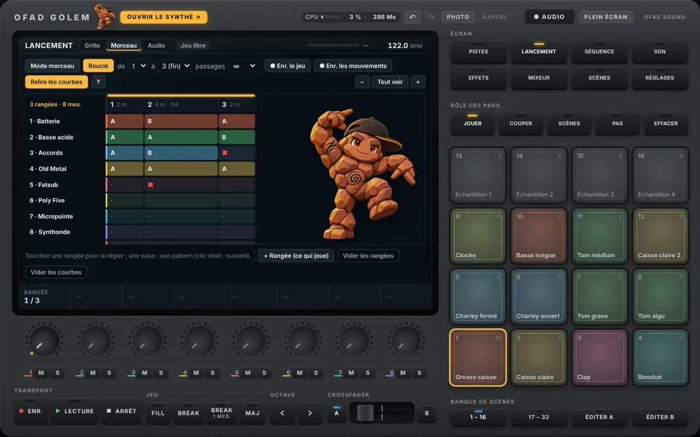<figcaption>LANCEMENT › Morceau : les rangées (pattern de chaque piste) et, en bas, les courbes enregistrées</figcaption></figure>

### 9. Montage audio

Écran LANCEMENT › Audio : placez la tête de lecture, « ● Enregistrer une prise », jouez (la prise
part au début de la mesure suivante et se pose à la tête de lecture) ; à la fin, chaque piste
devient des clips audio, à couper, déplacer, dupliquer ; **Mode montage** pour les écouter ; Export WAV
ou MP3 du morceau fini.

**Prise d'une boucle, pile à la mesure** : placez la boucle sur la règle (clic droit + glisser, aimant
« Mesure »), allumez **Boucle**, puis « ● Enregistrer une prise ». La prise part au début de la mesure
suivante, dure **exactement** la longueur de la boucle, **s'arrête toute seule** à sa fin (à l'échantillon
près) et se pose au début de la boucle : chaque piste jouée devient un clip pile de la longueur de la
boucle. Plus besoin d'arrêter à la main au bon moment.

<figure>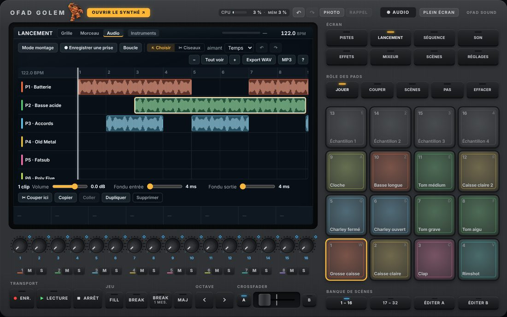<figcaption>LANCEMENT › Audio : les clips de chaque piste, la règle, la tête de lecture ; en bas, le clip choisi (volume, fondus, couper, copier, dupliquer)</figcaption></figure>

### 10. Enregistrer

Écran RÉGLAGES › Projet : Enregistrer (un fichier .gbx avec sons, échantillons, séquences,
scènes) ou « Comme modèle » (réglages et sons, sans les écritures). **Projet de démonstration**,
**Nouveau projet vide** et **Ouvrir…** s'allument en jaune quand on les touche, et un message confirme
le chargement. La démonstration est volontairement légère (7 instruments, 11 effets) pour tourner sur tous les
téléphones. Elle montre aussi le pavé vectoriel en mouvement (Cercle, un tour en 16 mesures) et le
bouton assignable 1 relié à la coupure du filtre de Kick Killer. Le montage audio est rangé dans le
dossier « &lt;nom du projet&gt; - audio » à côté du fichier.

<figure>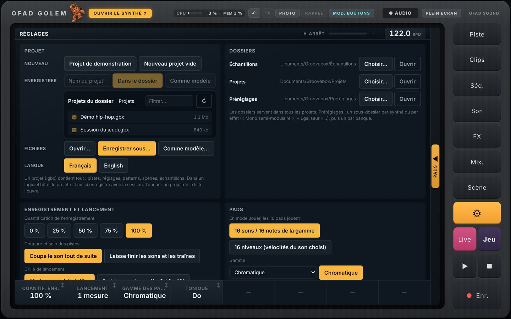<figcaption>Écran RÉGLAGES : projet (démonstration, vide, ouvrir, enregistrer, modèle), dossiers, enregistrement, MIDI</figcaption></figure>

**Annuler et photo** : ↶ ↷ (Ctrl+Z, Ctrl+Y) annulent jusqu'à 50 étapes. **Photo** fige tous les réglages ;
**Rappel** y revient d'un geste (et se défait avec Ctrl+Z).

## Contrôleur MIDI

### Brancher un contrôleur : prêt à jouer

- **En USB** : branchez le clavier ou le contrôleur, il est reconnu tout seul, sans rien régler — sur
  l'application PC comme sur le téléphone ou la tablette Android (avec un câble ou un hub USB-C « OTG »).
  On peut le brancher ou le débrancher pendant que le Groovebox tourne.
- **En Bluetooth (Android)** : Réglages › « **Appairer un contrôleur Bluetooth…** ». La première fois,
  Android demande l'autorisation Bluetooth ; choisissez ensuite votre clavier ou contrôleur MIDI sans fil
  dans la liste : il joue comme un contrôleur USB.
- **Sur PC**, un contrôleur Bluetooth ne marche que si Windows le présente comme un port MIDI : le plus
  simple reste l'USB.
- **Dans un logiciel hôte** (VST3) : c'est le logiciel hôte qui reçoit le contrôleur et l'envoie au Groovebox.
- Les notes jouent la piste choisie (ou les pistes réglées sur un canal, Réglages › MIDI) ; sur une
  batterie, les notes 36 à 51 jouent les 16 pads. La molette, le pitch bend et la pédale de maintien
  suivent la piste jouée.
- Téléphone avec un seul port USB-C : un hub USB-C avec charge (PD) permet de brancher en même temps
  le clavier, la sortie son USB vers la table de mixage et le chargeur.

### Affecter les commandes du contrôleur

- Clic droit (appui long) sur un réglage › **Apprendre MIDI**, puis toucher la commande du contrôleur.
  Cela marche aussi pour les **valeurs du bas des écrans** et les réglages généraux : tempo, swing,
  crossfader, scènes A et B, pavé vectoriel (X, Y, mouvement, taille…) et macros.
- Les **16 boutons assignables** s'apprennent aussi : branchez une rangée de boutons du contrôleur sur
  les boutons 1 à 16, puis confiez-leur ce que vous voulez (Assigner à…).
- Clic droit sur les boutons (M / S, rangées, Photo, Rappel, transport…) : les affecter au contrôleur.
- Réglages › MIDI : canal des notes, canal des commandes, canal propre à chaque piste.
- Sur l'application Android : Réglages › « **Appairer un contrôleur Bluetooth…** » (clavier ou
  contrôleur MIDI sans fil) ; un clavier USB est reconnu tout seul.

<figure>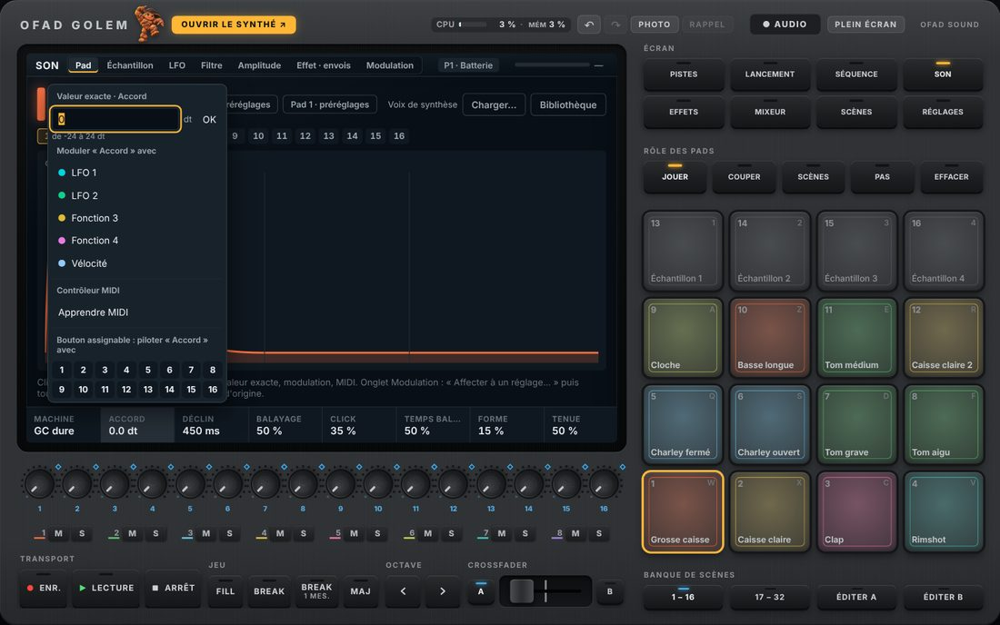<figcaption>Appui long (clic droit) sur une valeur du bas : valeur exacte, modulation, Apprendre MIDI, bouton 1 à 16</figcaption></figure>

## Où sont vos fichiers

- Projets, échantillons, préréglages : Documents\Groovebox (dossiers réglables dans Réglages).
- Enregistrements audio et exports du montage : Documents\Groovebox\Enregistrements.
- Prises du montage d'un projet : dossier « &lt;nom du projet&gt; - audio » à côté du .gbx.
