

  

<b>🇬🇧 English speakers: <a href="#english-version">full English version below ↓</a></b>

<h2 align="center">OFAD GOLEM — Groovebox 1.1.1</h2>

<b>🎹 GOLEM sort de l'ordinateur.</b> La 1.1 fait jouer <b>vos synthés et vos boîtes à rythmes externes</b> avec le séquenceur de GOLEM (<b>piste MIDI</b>), transforme le téléphone en <b>télécommande</b>, et ajoute un <b>écran AUDIO</b>, un <b>éditeur d'échantillon</b>, <b>7 outils de restauration</b> et <b>9 effets haut de gamme</b>.

🔔 <b>Suivez le projet, testez-le et partagez-le un max</b> pour que tout le monde puisse en profiter.

OFAD GOLEM, c'est une groovebox complète dans l'ordinateur, la tablette ou le téléphone, pensée pour <b>toutes les musiques électroniques</b> : techno, house, acid, hardtek et tribe, hardcore, drum & bass, électro, ambient, beatmaking… 38 instruments, 54 effets, les séquenceurs qu'on connaît tous (pas à pas, verrous, acide, conditions), 16 pistes, 16 pads, scènes, morceau et montage audio. Logiciel libre (AGPL-3.0).

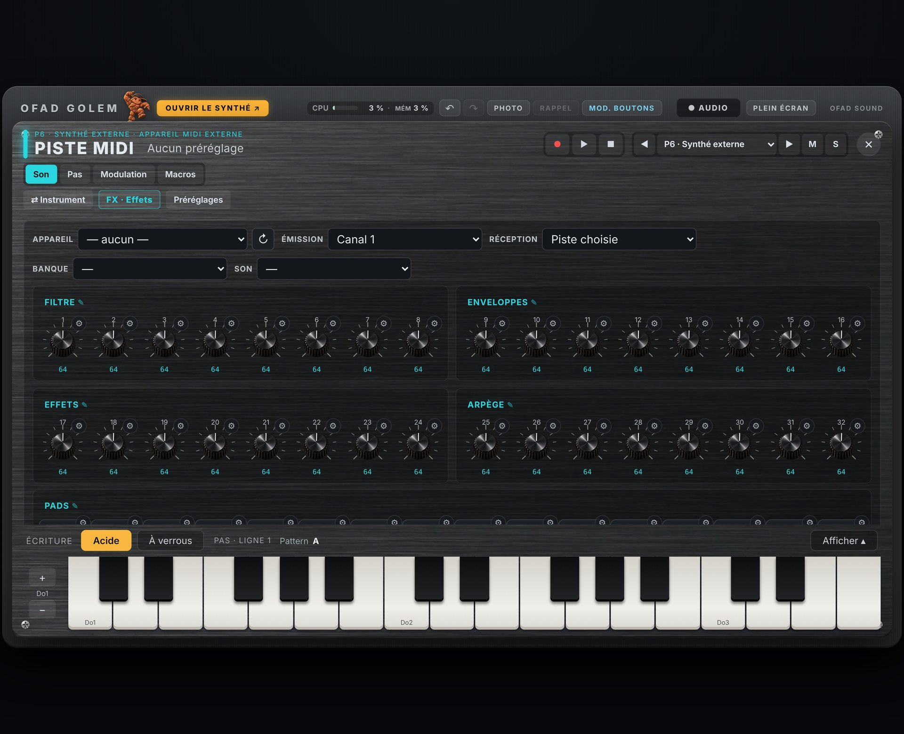

### 🔧 Nouveau dans la 1.1.1 : correctif de l'écran sur certains téléphones Android

Sur certains téléphones (signalé sur un Galaxy S25+, Android 17, en paysage), l'appareil s'affichait trop bas : une bande vide en haut, et le bas des écrans coupé. GOLEM pose maintenant l'appareil dans la partie **réellement visible** de l'écran. Et en bas des **Réglages**, la ligne **« Infos écran »** (avec un bouton **Copier**) donne les tailles annoncées par l'appareil : à coller dans un [ticket](https://github.com/cookhenri-art/ofad-golem-groovebox/issues) si un écran est encore mal ajusté chez vous. Merci à **sfrey** pour le signalement ([ticket #1](https://github.com/cookhenri-art/ofad-golem-groovebox/issues/1)).

Tout le reste ci-dessous est la 1.1 : la 1.1.1 reprend toutes ses nouveautés.

### 🎛️ En vedette : la piste MIDI — GOLEM joue vos machines

Le nouvel instrument **Piste MIDI** (famille **MIDI externe**) ne fait pas de son : il **joue l'appareil branché**, synthé, boîte à rythmes ou module. Tout ce qu'a une piste de GOLEM agit dessus : séquenceurs **Acide** et **À verrous** sous le clavier, écran **SÉQUENCE**, scènes, modulations, lancement, morceau, pads et contrôleur.

- **Le bandeau de l'appareil** : **Appareil** (la sortie MIDI, avec son type de liaison : USB, Bluetooth, réseau), **Émission** (canal 1 à 16), **Réception** (le canal qui joue la piste depuis un clavier), **Banque** et **Son**.
- **32 boutons CC en 4 sections de 8**, que l'on **renomme** (« Filtre », « Enveloppes »…). La roue ⚙ d'un bouton : **Apprendre** (on tourne le bouton du synthé, son CC et son canal se posent), numéro de CC, canal. Les numéros et canaux sont **figés** : une scène ou une LFO ne bouge que la valeur.
- **16 pads** assignables : **CC maintenu**, **CC marche / arrêt**, **CC par pas** (2 à 8 valeurs) ou **note**.
- **Verrous MIDI** : appui long sur un pas, on tourne un bouton (verrou de CC), on touche un pad (pad verrouillé sur le pas).
- **Effets MIDI** : arpège (20 modes), accord et étalement, gamme, **écho de notes**, probabilité, vélocité, transposition.
- **Liaisons** : USB partout ; **Bluetooth MIDI** sur téléphone, tablette et Mac ; réseau par un pilote type rtpMIDI ; dans un logiciel de musique, la **sortie MIDI du greffon**. Rien n'est envoyé au chargement : le son de votre machine n'est pas écrasé.

<table>
<tr>
<td align="center">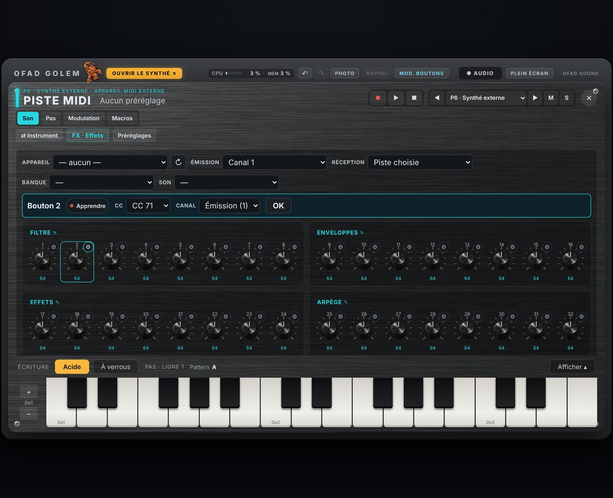 <b>Réglage d'un bouton</b> Apprendre, numéro de CC, canal</td>
<td align="center">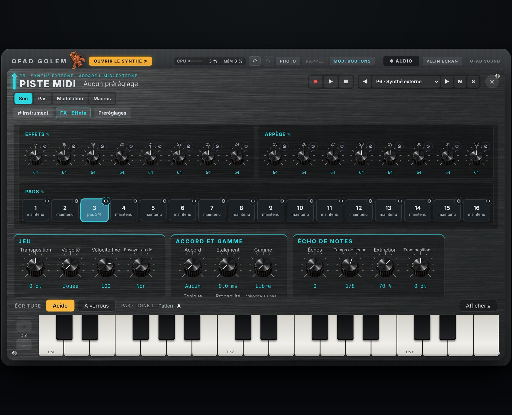 <b>16 pads</b> CC maintenu, marche / arrêt, par pas, note</td>
</tr>
<tr>
<td align="center">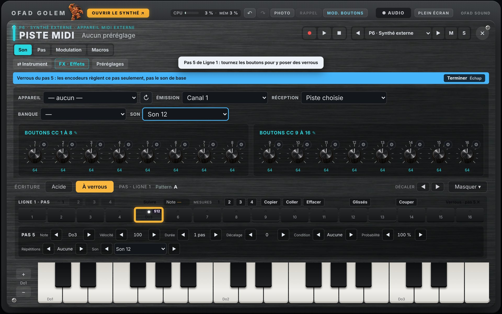 <b>Son du pas</b> le pas 5 appelle le son 12 de l'appareil</td>
<td align="center">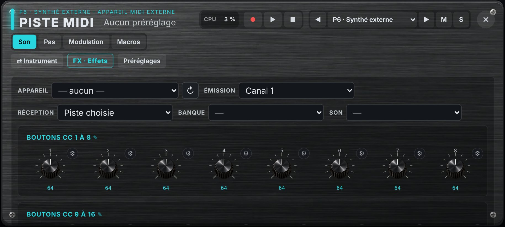 <b>Piste MIDI · téléphone</b></td>
</tr>
</table>

### 🎚️ Son du pas : un préréglage différent sur chaque pas

Dans la rangée **À verrous**, le détail d'un pas a maintenant une liste **Son** : ce pas joue avec un **autre préréglage** de l'instrument (numérotés comme pour le changement de programme), puis la piste revient à son son. Le pas affiche « S12 ». Sur une piste MIDI, c'est le son de l'appareil, **banque comprise** : le changement de programme part juste avant la note.

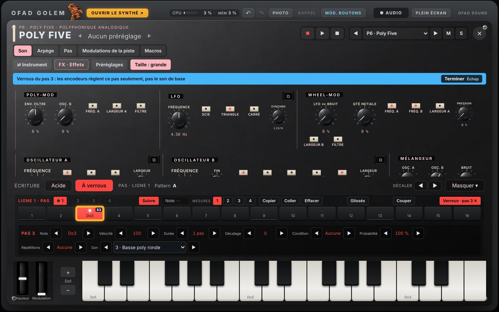

### 📱 La télécommande : le téléphone pilote GOLEM

Un téléphone avec GOLEM devient la **télécommande** de GOLEM sur le PC (**câble USB** ou **Wi-Fi**, sans pilote), d'un FM-1 ou de n'importe quel appareil MIDI (USB, Bluetooth). Bouton **Télécommande** de l'accueil ; **‹ GOLEM** revient à GOLEM sans redémarrer.

- **Mixage** des 16 pistes (noms, couleurs et niveaux renvoyés par le PC), **16 boutons** assignables, crossfader, Fill / Break / Maj, transport.
- **Chaos** : le pavé vectoriel, chaque coin mène 4 boutons de GOLEM ou 4 CC, **Ressort** pour revenir au centre.
- **FM-1** : clavier, molettes, pads, 8 boutons CC, son − / +, banque, envoi d'un fichier .syx.
- **Apprendre** depuis l'appareil branché, et **profils** pour rappeler un paramétrage d'un toucher.

<table>
<tr>
<td align="center">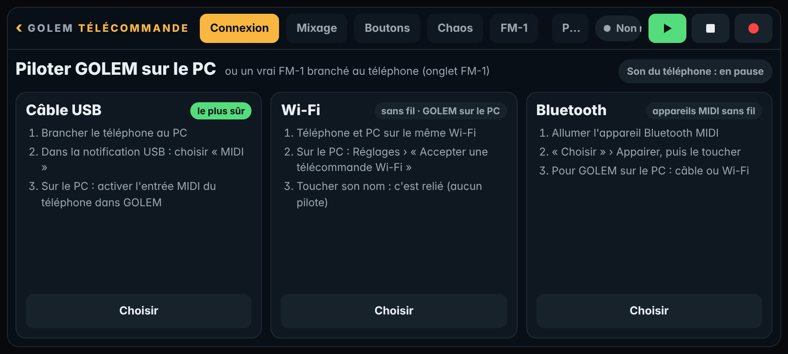 <b>Connexion</b></td>
<td align="center">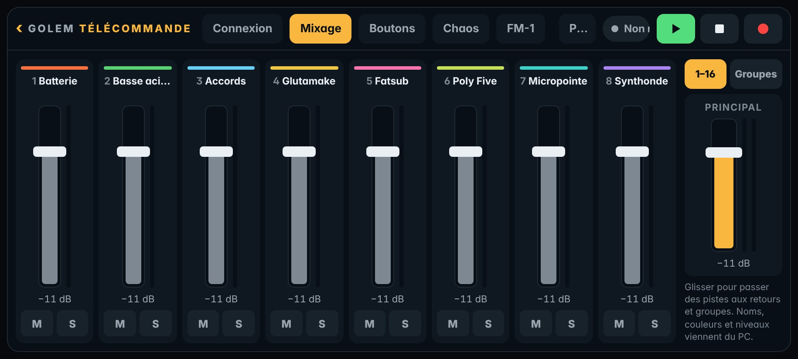 <b>Mixage</b></td>
</tr>
<tr>
<td align="center">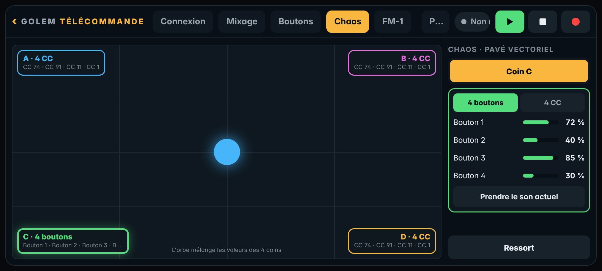 <b>Chaos</b></td>
<td align="center">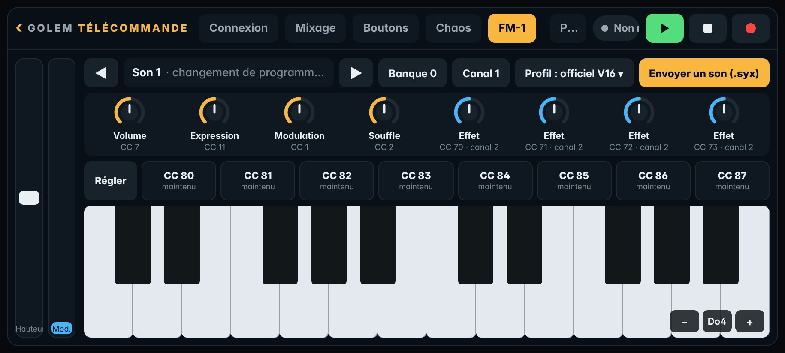 <b>FM-1</b></td>
</tr>
</table>

### 🎙️ Écran AUDIO, éditeur d'échantillon et restauration

- **Écran AUDIO** (bouton « ● Audio ») : on enregistre le **master**, le master traité, des **pistes**, des **retours** ou l'**entrée** micro / ligne. Début et fin **calés** à l'échantillon près, **boucle parfaite** (un tour d'élan, puis exactement un tour, sans clic), **N mesures** ou **libre**. WAV 24 bits, WAV 32 bits flottant ou MP3 320. Une **chaîne de 4 effets** s'applique **après la prise** (qualité maximale, la prise brute est gardée) ou **pendant**. Le résultat va dans **Enregistrements**, **Son traité**, **dans un pad**, ou **à la place de l'original** (annulable). Appui long sur « ● Audio » : départ immédiat avec les derniers réglages.
- **Éditeur d'échantillon**, le même partout (samplers, pads des batteries, appui long sur une piste) : sélection, inverser, normaliser, fondus, rogner, silence, et **Traiter…** par une chaîne de 4 effets **hors temps réel** (aucune latence pendant le jeu), pré-écoutée, annulable sur 8 versions.
- **Restauration**, 7 outils : **Débruiteur**, **Anti-ronflement** (50 / 60 Hz), **Anti-clics**, **Dé-esseur spectral**, **Anti-plosives**, **Anti-écrêtage** et **Dé-réverb**, chacun avec l'écoute de ce qu'il retire.
- **Compensation de latence** automatique : quand un outil retarde le son, les autres pistes, groupes et retours attendent. Le voyant **Latence** dit lesquels.

<table>
<tr>
<td align="center">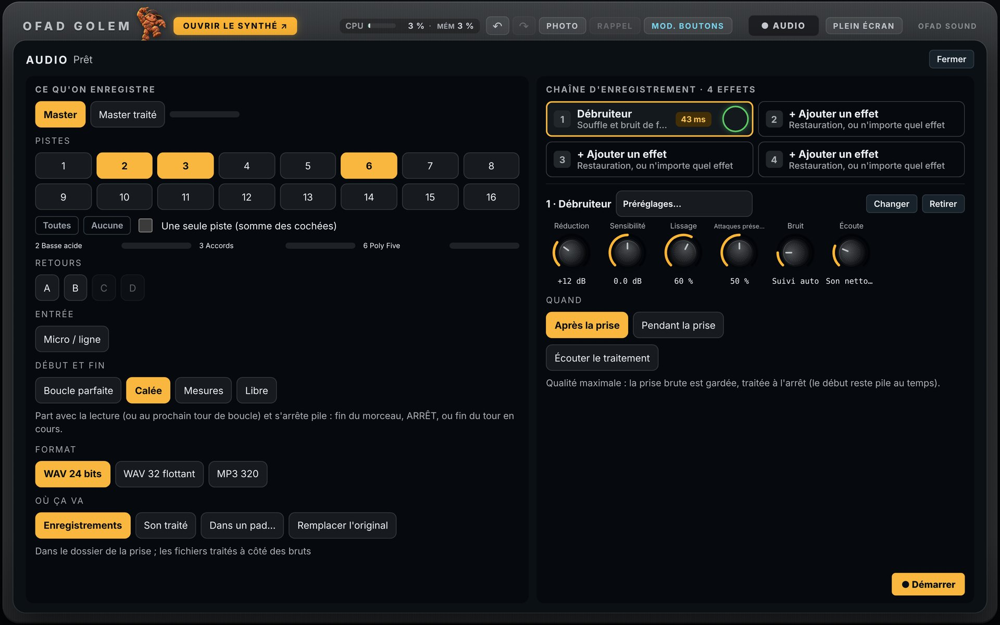 <b>Écran AUDIO</b> sources, début et fin, format, destination, chaîne</td>
<td align="center">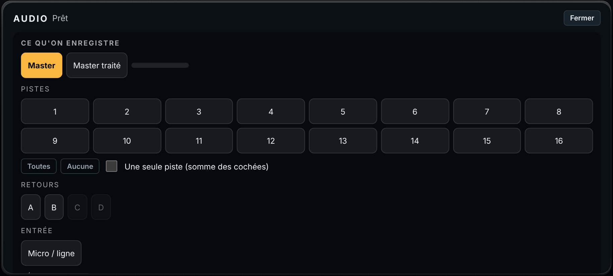 <b>Écran AUDIO · téléphone</b></td>
</tr>
<tr>
<td align="center">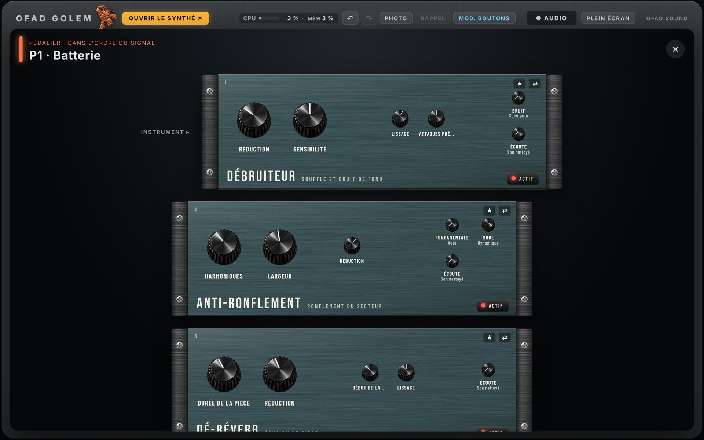 <b>Restauration</b> Débruiteur et Anti-ronflement</td>
<td align="center">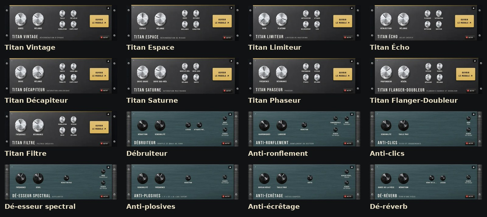 <b>Les 16 nouveaux effets</b></td>
</tr>
</table>

### ✨ Golem Titan FX : neuf effets haut de gamme

Façade compacte en métal noir dans le pédalier, **interface complète** par « Ouvrir le module » (en grand sur téléphone) :

| Effet | Pour quoi |
|---|---|
| **Titan Vintage** | Réverbérations numériques des années 70–80 (12 modèles) et 3 couleurs d'époque |
| **Titan Espace** | Réverbération de mixage : un bouton « Espace » (pièce → grande salle), durée par bande, égaliseur de sortie, ducking, gel |
| **Titan Limiteur** | Limiteur de mastering : 8 styles, anticipation compensée, crête vraie, suréchantillonnage, écoute à gain unité |
| **Titan Écho** | Écho créatif à deux lignes à bande, ping-pong ; filtres, saturation, basse-fidélité, diffusion et hauteur dans la boucle |
| **Titan Décapiteur** | Saturation analogique : 5 circuits (magnétophone à lampes, console, germanium, triode, pentode) |
| **Titan Saturne** | Saturation multibande : 1 à 4 bandes, 16 styles par bande |
| **Titan Phaseur** | Phaseur de 2 à 24 étages, 8 styles de circuits |
| **Titan Flanger-Doubleur** | Flanger à deux bandes (passage par zéro) et doubleur de voix |
| **Titan Filtre** | 2 filtres, 8 types, 6 à 48 dB/oct, auto-oscillation, 9 styles |

<table>
<tr>
<td align="center">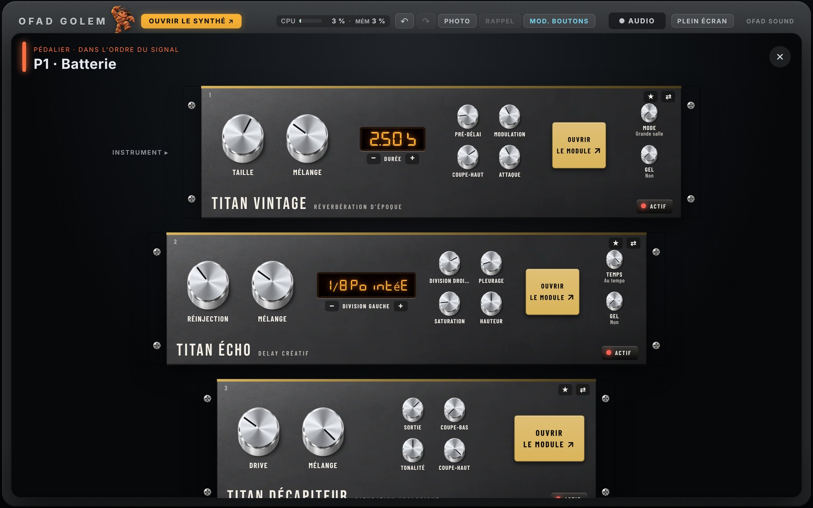 <b>Dans le pédalier</b></td>
<td align="center">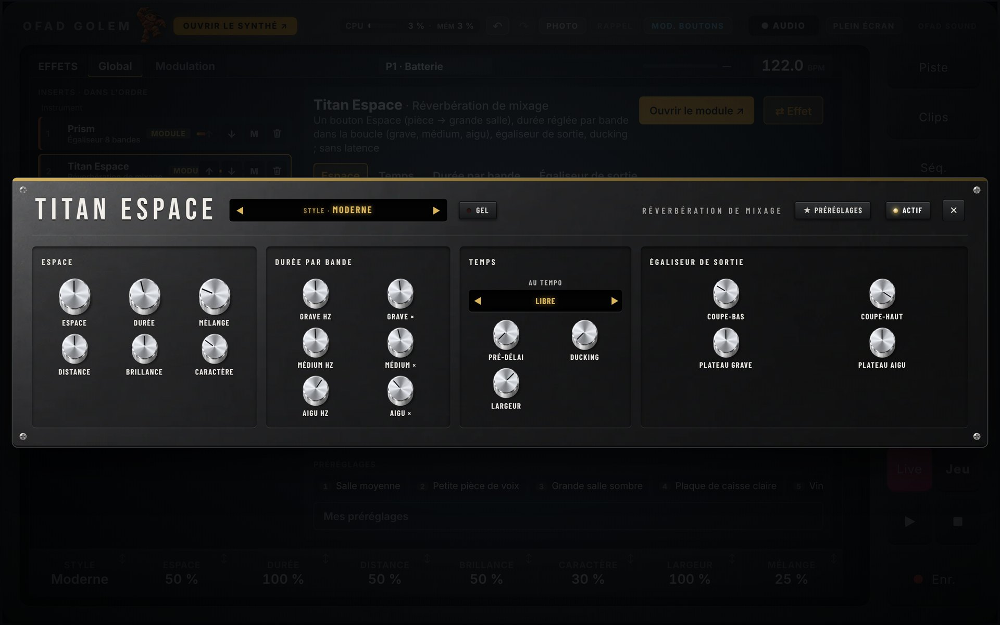 <b>Titan Espace · interface complète</b></td>
</tr>
<tr>
<td align="center">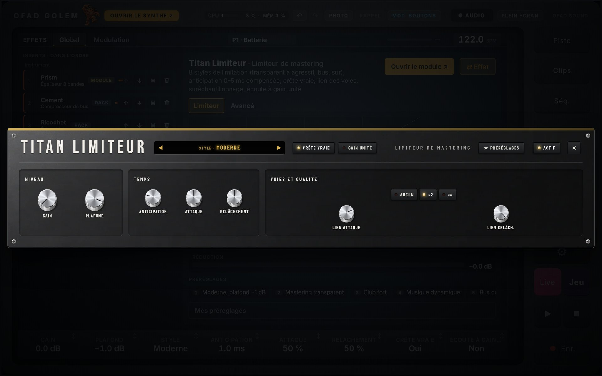 <b>Titan Limiteur</b></td>
<td align="center">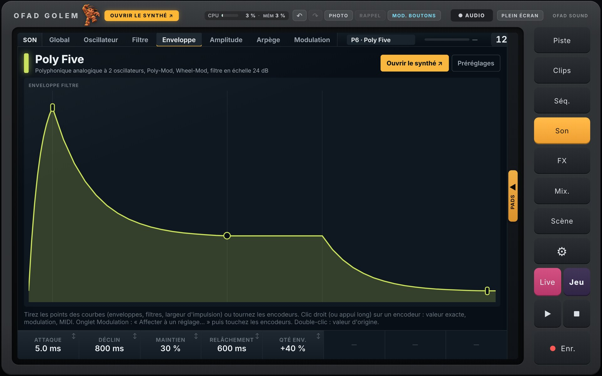 <b>Courbes de l'écran SON</b> les points se tirent au doigt</td>
</tr>
</table>

#### Aussi dans la 1.1
- **Nouvelle démo Tribe** (180 BPM) au démarrage, à côté de la démo Techno : 5 instruments, 4 scènes, le pavé vectoriel en cercle et un petit morceau prêt à jouer (intro, montée, break, retour).
- **Courbes de l'écran SON** : enveloppes, filtres et formes d'onde suivent les vraies valeurs, **leurs points se tirent** (attaque, déclin, coupure, résonance, largeur d'impulsion…), un point court sur l'enveloppe quand on joue ; animées ou fixes dans Réglages › Affichage.
- **Changer de son par MIDI** : banque (CC 0 / CC 32) + changement de programme sur une piste réglée sur un canal ; **CC 102 à 105** changent le son des effets des inserts 1 à 4. Tout est dans le document [Implémentation MIDI](https://github.com/cookhenri-art/ofad-golem-groovebox/blob/main/docs/IMPLEMENTATION-MIDI.md).
- **Pas numérotés de 1 à 16 dans chaque mesure** ; appui long sur une piste : éditeur d'échantillon.
- **Son plus fiable** : coups identiques d'une frappe à l'autre, oscillateurs qui repartent pareil, LFO avec 6 modes de déclenchement et polarité corrigée, boutons qui suivent les scènes, préréglages qui gardent les valeurs tenues par une scène.
- **FM Player** : un fond par piste, affichage du solo.
- L'égaliseur du **principal** agit avant ses inserts : un limiteur en dernier insert reste le dernier étage du son.

### ⬇️ Télécharger (en bas de cette page, « Assets »)
| Fichier | Pour quoi |
|---|---|
| **`OFAD-GOLEM-1.1.1-Windows-installateur.exe`** | **Windows** : application, plugin VST3 (au choix), notice, catalogue et sources |
| **`OFAD-GOLEM-1.1.1-Android.apk`** | **Android** : téléphones et tablettes |
| **`Notice-OFAD-GOLEM.pdf`** | Notice de prise en main et **raccourcis**, avec captures annotées (toutes les nouveautés de la 1.1) |
| **`Notice-OFAD-GOLEM-EN.pdf`** | **Manual in English** |
| **`Catalogue-OFAD-GOLEM.pdf`** | Les 38 instruments et les 54 effets, avec leurs façades |
| **`OFAD-GOLEM-1.1.1-sources.tar.gz`** | Les sources de cette version (AGPL-3.0) |
| **`OFAD-GOLEM-1.1.1-firmwares-sources.tar.gz`** | Les sources des 15 firmwares fournis avec le FM Player (GPL-3.0 / MPL-2.0) |
| **`SHA256SUMS.txt`** | Les empreintes de tous les fichiers, pour vérifier vos téléchargements |

> **Windows** : le programme n'est pas encore signé. Si Windows affiche « Windows a protégé votre ordinateur », cliquer sur « Informations complémentaires » puis « Exécuter quand même ».

> **Android** : mise à jour par-dessus la 1.1.0 ou la 1.0 (vos projets sont gardés). Pour la télécommande par câble, choisir « MIDI » dans la notification USB du téléphone.

### 🍎 Version Mac et iPhone / iPad (essai)

| Fichier | Pour quoi |
|---|---|
| **`OFAD-GOLEM-1.1.1-Mac-app.zip`** | **Mac** : l'application seule, sans logiciel de musique |
| **`OFAD-GOLEM-1.1.1-Mac-AU.zip`** | **Mac** : plugin AU (Logic Pro, GarageBand, Ableton Live…) |
| **`OFAD-GOLEM-1.1.1-Mac-VST3.zip`** | **Mac** : plugin VST3 (Ableton Live, Reaper, Bitwig, Studio One…) |
| **`OFAD-GOLEM-1.1.1-iOS-non-signe.ipa`** | **iPhone / iPad** (essai) : application non signée, à installer avec AltStore ou Sideloadly |

> **Version d'essai** : compilée pour les Mac à puce Apple et Intel (macOS 11 ou plus récent), pas encore testée sur un vrai Mac. Sur Mac, la piste MIDI joue aussi en **Bluetooth MIDI** (appairage dans « Configuration audio et MIDI »), et macOS demande l'accès au **réseau local** pour la télécommande Wi-Fi. Vos retours sont les bienvenus dans l'onglet [Issues](https://github.com/cookhenri-art/ofad-golem-groovebox/issues).
>
> **Installation** — **Application** : décompresser, glisser `Groovebox.app` dans **Applications**. **AU** : `Groovebox.component` dans `~/Bibliothèque/Audio/Plug-Ins/Components`. **VST3** : `Groovebox.vst3` dans `~/Bibliothèque/Audio/Plug-Ins/VST3`.
>
> **Premier lancement** : l'appli n'est pas encore signée par Apple. **Clic droit › Ouvrir**, ou **Réglages Système › Confidentialité et sécurité › Ouvrir quand même**. Si macOS dit que l'appli est « endommagée » : `xattr -cr /Applications/Groovebox.app` dans le Terminal.

### 🎹 Les 38 instruments et 🎚️ les 54 effets

  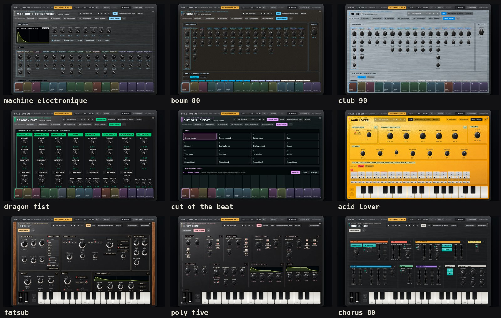
  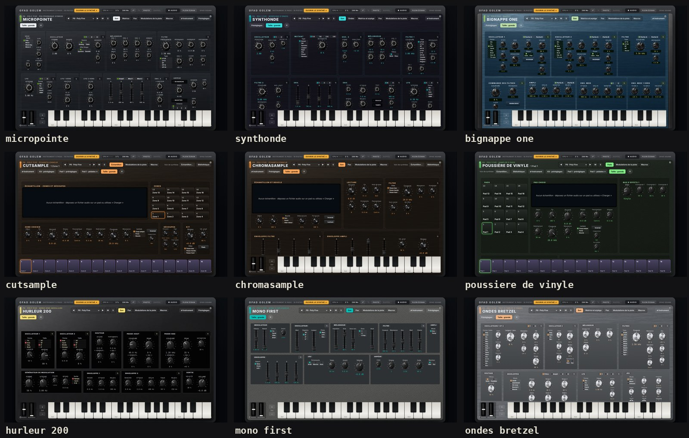
  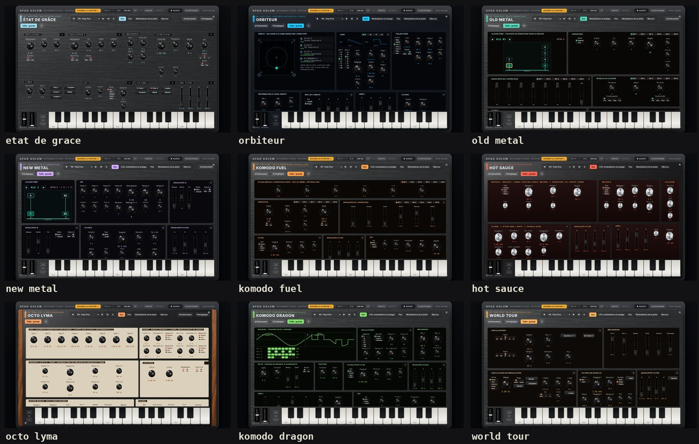
  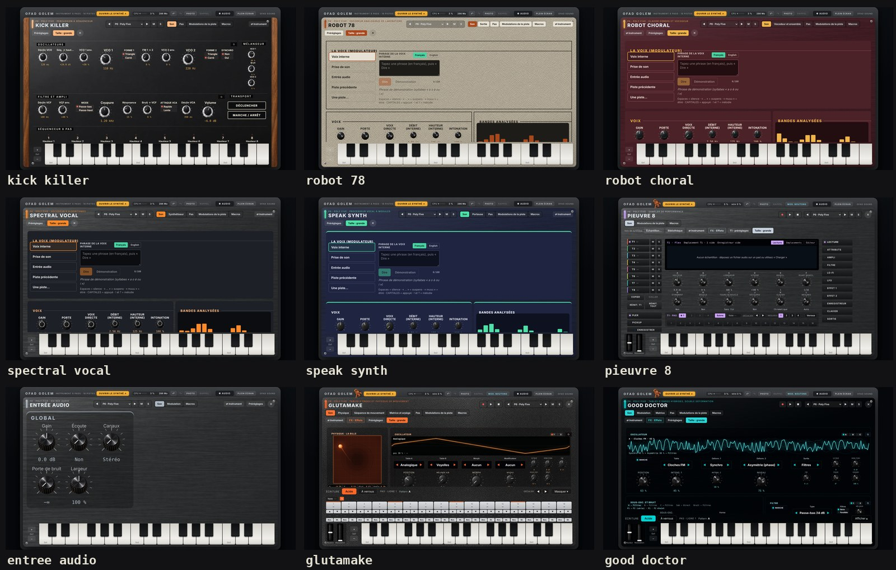
  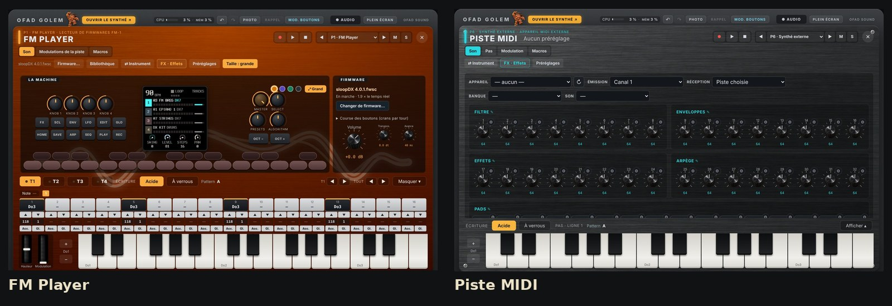

  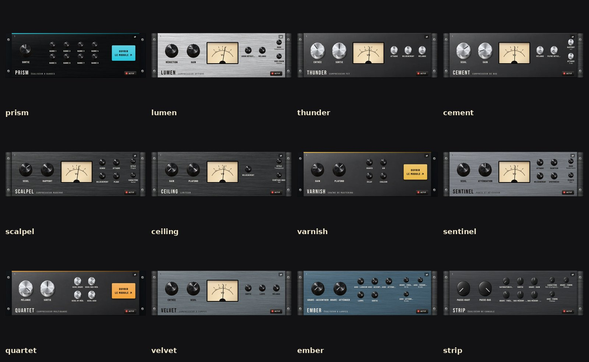
  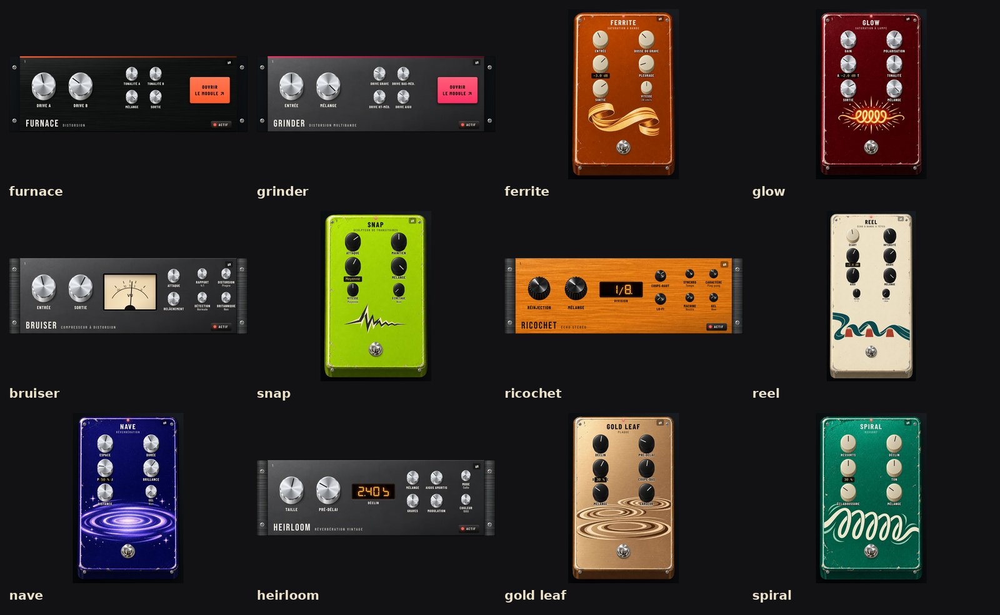
  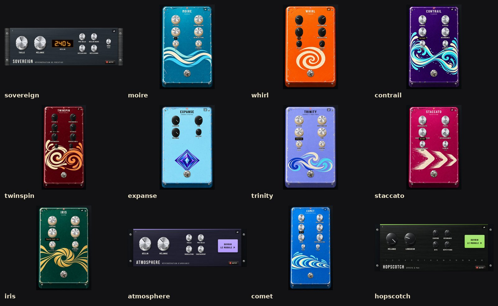
  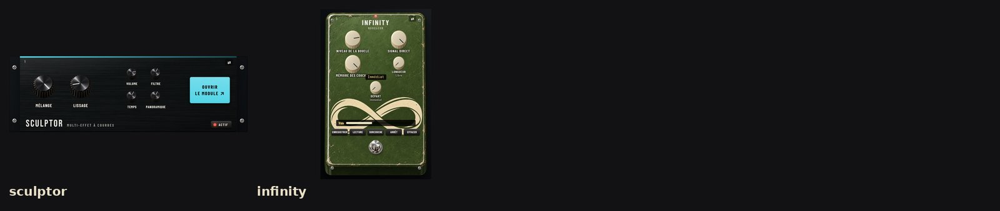
  

Toutes les nouveautés de la 1.0 (FM Player et ses 15 firmwares libres, nouveau workflow à une seule vue, écran Jeu, mode Grand…) : voir la [page de la 1.0.0](https://github.com/cookhenri-art/ofad-golem-groovebox/releases/tag/v1.0.0).

🔔 **Abonnez-vous / suivez le dépôt** (bouton **Watch › Releases** en haut de la page GitHub) pour les dernières mises à jour.

🧪 **Vos retours de test sont précieux** : quel synthé ou quelle boîte à rythmes vous pilotez avec la piste MIDI, ce qui coince, ce qui manque, dans l'onglet **[Issues](https://github.com/cookhenri-art/ofad-golem-groovebox/issues)**.

OFAD GOLEM est un projet indépendant. Ses instruments et ses effets reprennent des principes de synthèse et de traitement connus, sans utiliser les noms, logos, façades ni sons d'usine d'aucun fabricant. M-VAVE et FM-1 sont des marques de leurs propriétaires respectifs ; OFAD GOLEM n'est ni affilié, ni approuvé, ni sponsorisé par M-VAVE.

---

## English version

<b>🎹 OFAD GOLEM 1.1.1 — GOLEM steps out of the computer.</b> 1.1 plays <b>your external synths and drum machines</b> with GOLEM's sequencer (<b>MIDI track</b>), turns your phone into a <b>remote</b>, and adds an <b>AUDIO screen</b>, a <b>sample editor</b>, <b>7 restoration tools</b> and <b>9 high-end effects</b>.

🔔 <b>Follow the project, try it and share it as much as you can</b> so everyone can enjoy it.

A complete groovebox in your computer, tablet or phone, made for <b>all electronic music</b>: techno, house, acid, hardtek and tribe, hardcore, drum & bass, electro, ambient, beatmaking… 38 instruments, 54 effects, the sequencers we all know (step, parameter locks, acid, conditions), 16 tracks, 16 pads, scenes, song mode and audio editing. Free software (AGPL-3.0).

### 🔧 New in 1.1.1: screen fit fixed on some Android phones

On some phones (reported on a Galaxy S25+, Android 17, landscape), the device was drawn too low: a blank band at the top and the bottom of the screens cut off. GOLEM now places the device in the **actually visible** part of the screen. And at the bottom of **Settings**, the **"Screen info"** line (with a **Copy** button) shows the sizes your device reports: paste it into an [issue](https://github.com/cookhenri-art/ofad-golem-groovebox/issues) if a screen still doesn't fit on your device. Thanks to **sfrey** for the report ([issue #1](https://github.com/cookhenri-art/ofad-golem-groovebox/issues/1)).

Everything below is 1.1: 1.1.1 includes all of its new features.

### 🎛️ Spotlight: the MIDI track — GOLEM plays your machines

The new **MIDI track** instrument (**External MIDI** family) makes no sound itself: it **plays the connected device**, synth, drum machine or module. Everything a GOLEM track has works on it: **Acid** and **Locks** sequencers under the keyboard, **SEQUENCE** screen, scenes, modulations, launching, song, pads and controller.

- **The device bar**: **Device** (the MIDI output, with its link type: USB, Bluetooth, network), **Send** (channel 1 to 16), **Receive** (the channel that plays the track from a keyboard), **Bank** and **Sound**.
- **32 CC knobs in 4 sections of 8** that you **rename** ("Filter", "Envelopes"…). A knob's ⚙ wheel: **Learn** (turn the synth's knob, its CC and channel are set), CC number, channel. Numbers and channels are **fixed**: a scene or an LFO only moves the value.
- **16 assignable pads**: **CC held**, **CC on / off**, **CC steps** (2 to 8 values) or **note**.
- **MIDI locks**: long press on a step, turn a knob (CC lock), touch a pad (pad locked on the step).
- **MIDI effects**: arpeggiator (20 modes), chord and spread, scale, **note echo**, probability, velocity, transposition.
- **Links**: USB everywhere; **Bluetooth MIDI** on phones, tablets and Mac; network through an rtpMIDI-type driver; in music software, the **plug-in's MIDI output**. Nothing is sent on loading: your machine's sound is not overwritten.

### 🎚️ Step sound: a different preset on every step

In the **Locks** row, a step's details now have a **Sound** list: that step plays with **another preset** of the instrument (numbered as for program change), then the track goes back to its sound. The step shows "S12". On a MIDI track it is the device's sound, **bank included**: the program change goes out just before the note.

### 📱 The remote: your phone controls GOLEM

A phone running GOLEM becomes the **remote** of GOLEM on the PC (**USB cable** or **Wi-Fi**, no driver), of an FM-1 or of any MIDI device (USB, Bluetooth). **Remote** button on the home screen; **‹ GOLEM** goes back to GOLEM without restarting.

- **Mix** of the 16 tracks (names, colours and levels sent back by the PC), **16 assignable knobs**, crossfader, Fill / Break / Shift, transport.
- **Chaos**: the vector pad, each corner drives 4 GOLEM knobs or 4 CCs, **Spring** to return to the centre.
- **FM-1**: keyboard, wheels, pads, 8 CC knobs, sound − / +, bank, sending a .syx file.
- **Learn** from the connected device, and **profiles** to recall a setup with one touch.

### 🎙️ AUDIO screen, sample editor and restoration

- **AUDIO screen** ("● Audio" button): record the **master**, the processed master, **tracks**, **returns** or the mic / line **input**. Start and end **synced** to the sample, **perfect loop** (one run-up cycle, then exactly one cycle, no click), **N bars** or **free**. 24-bit WAV, 32-bit float WAV or 320 kbit/s MP3. A **4-effect chain** is applied **after the take** (maximum quality, the raw take is kept) or **during** it. The result goes to **Recordings**, **Processed sound**, **into a pad**, or **in place of the original** (can be undone). Long press on "● Audio": start right away with the last settings.
- **Sample editor**, the same everywhere (samplers, drum kit pads, long press on a track): selection, invert, normalize, fades, trim, silence, and **Process…** through a 4-effect chain **offline** (no latency while playing), previewed, with 8 undo versions.
- **Restoration**, 7 tools: **Denoiser**, **De-hum** (50 / 60 Hz), **De-click**, **Spectral de-esser**, **De-plosive**, **De-clip** and **De-reverb**, each with a listen to what it removes.
- Automatic **latency compensation**: when a tool delays the sound, the other tracks, groups and returns wait. The **Latency** indicator tells you which.

### ✨ Golem Titan FX: nine high-end effects

A compact black-metal face in the pedalboard, and a **full interface** through "Open the module" (full screen on a phone): **Titan Vintage** (70s–80s digital reverbs, 12 models), **Titan Espace** (mixing reverb with one "Space" knob), **Titan Limiteur** (mastering limiter, 8 styles, true peak), **Titan Écho** (creative two-tape echo), **Titan Décapiteur** (analogue saturation, 5 circuits), **Titan Saturne** (multiband saturation, 16 styles per band), **Titan Phaseur** (2 to 24 stages), **Titan Flanger-Doubleur** (through-zero flanger and voice doubler), **Titan Filtre** (2 filters, 8 types, 6 to 48 dB/oct).

#### Also in 1.1
- **New Tribe demo** (180 BPM) on the home screen, next to the Techno demo: 5 instruments, 4 scenes, the vector pad on a circle and a short song ready to play (intro, build-up, break, drop).
- **SOUND screen curves**: envelopes, filters and waveforms follow the real values and **their points can be dragged** (attack, decay, cutoff, resonance, pulse width…); a point runs along the envelope while playing; animated or still in Settings › Display.
- **Changing sounds over MIDI**: bank select (CC 0 / CC 32) + program change on a track set to a channel; **CC 102 to 105** change the sound of the effects in inserts 1 to 4. See the [MIDI implementation](https://github.com/cookhenri-art/ofad-golem-groovebox/blob/main/docs/MIDI-IMPLEMENTATION.en.md).
- **Steps numbered 1 to 16 in each bar**; long press on a track: sample editor.
- **More reliable sound**: identical hits from one strike to the next, oscillators that restart the same way, LFOs with 6 trigger modes and fixed polarity, knobs that follow scenes, presets that keep the values held by a scene.
- **FM Player**: one background per track, solo shown.
- The **master** EQ acts before its inserts: a limiter in the last insert stays the last stage of the sound.

### ⬇️ Download (at the bottom of this page, "Assets")
| File | What for |
|---|---|
| **`OFAD-GOLEM-1.1.1-Windows-installateur.exe`** | **Windows**: application, VST3 plugin (optional), manual, catalogue and sources |
| **`OFAD-GOLEM-1.1.1-Android.apk`** | **Android**: phones and tablets |
| **`Notice-OFAD-GOLEM-EN.pdf`** | **Manual in English**: getting started and **shortcuts**, with annotated screenshots (everything new in 1.1) |
| **`Notice-OFAD-GOLEM.pdf`** | The same manual in French |
| **`Catalogue-OFAD-GOLEM.pdf`** | The 38 instruments and 54 effects, with their panels |
| **`OFAD-GOLEM-1.1.1-sources.tar.gz`** | Source code of this release (AGPL-3.0) |
| **`OFAD-GOLEM-1.1.1-firmwares-sources.tar.gz`** | Sources of the 15 firmwares bundled with the FM Player (GPL-3.0 / MPL-2.0) |
| **`SHA256SUMS.txt`** | Checksums of every file, to verify your downloads |

> **Windows**: the program is not signed yet. If Windows shows "Windows protected your PC", click "More info" then "Run anyway".

> **Android**: installs over 1.1.0 or 1.0 (your projects are kept). For the cable remote, choose "MIDI" in the phone's USB notification.

### 🍎 Mac and iPhone / iPad (preview)

| File | What for |
|---|---|
| **`OFAD-GOLEM-1.1.1-Mac-app.zip`** | **Mac**: the standalone app, no music software needed |
| **`OFAD-GOLEM-1.1.1-Mac-AU.zip`** | **Mac**: AU plugin (Logic Pro, GarageBand, Ableton Live…) |
| **`OFAD-GOLEM-1.1.1-Mac-VST3.zip`** | **Mac**: VST3 plugin (Ableton Live, Reaper, Bitwig, Studio One…) |
| **`OFAD-GOLEM-1.1.1-iOS-non-signe.ipa`** | **iPhone / iPad** (preview): unsigned app, install with AltStore or Sideloadly |

> **Preview build**: compiled for Apple silicon and Intel Macs (macOS 11 or later), not yet tested on a real Mac. On Mac the MIDI track also plays over **Bluetooth MIDI** (pair in "Audio MIDI Setup"), and macOS asks for **local network** access for the Wi-Fi remote. Feedback is welcome in [Issues](https://github.com/cookhenri-art/ofad-golem-groovebox/issues).
>
> **Install** — **App**: unzip, drag `Groovebox.app` to **Applications**. **AU**: `Groovebox.component` into `~/Library/Audio/Plug-Ins/Components`. **VST3**: `Groovebox.vst3` into `~/Library/Audio/Plug-Ins/VST3`.
>
> **First launch**: the app is not signed by Apple yet. **Right-click › Open**, or **System Settings › Privacy & Security › Open Anyway**. If macOS says the app is "damaged": `xattr -cr /Applications/Groovebox.app` in Terminal.

Everything new in 1.0 (FM Player and its 15 free firmwares, single-view workflow, Play view, Big mode…): see the [1.0.0 page](https://github.com/cookhenri-art/ofad-golem-groovebox/releases/tag/v1.0.0).

🧪 **Your test feedback matters**: which synth or drum machine you drive with the MIDI track, what breaks, what's missing — in **[Issues](https://github.com/cookhenri-art/ofad-golem-groovebox/issues)**.

OFAD GOLEM is an independent project. Its instruments and effects follow well-known synthesis and processing principles, without using any manufacturer's names, logos, panels or factory sounds. M-VAVE and FM-1 are trademarks of their respective owners; OFAD GOLEM is not affiliated with, endorsed or sponsored by M-VAVE.
